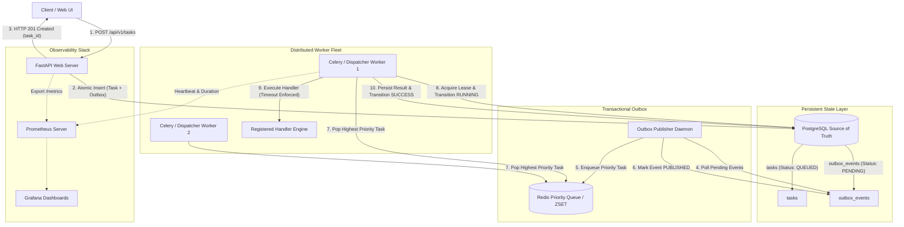
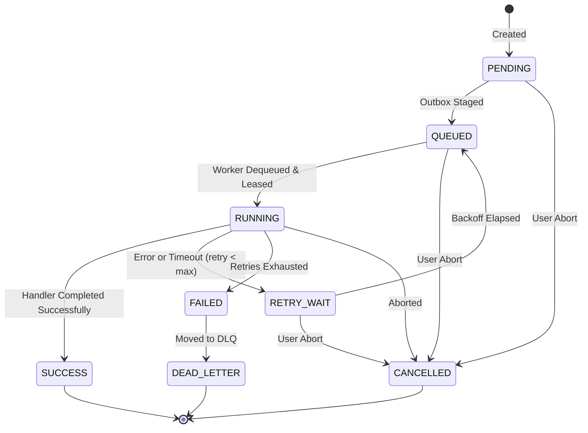

# TaskForge System Architecture

## 1. High-Level System Architecture

TaskForge decouples task submission from task execution to prevent slow computational workloads from exhausting HTTP web server threads.

---

## 2. Component Design

### 2.1 API Ingestion Layer (FastAPI)
- **Role:** Accepts HTTP requests, validates Pydantic models, injects `X-Correlation-ID`, checks idempotency keys, and records tasks.
- **Latency Target:** P95 < 10 ms for task submission.
- **Error Handling:** Standardized error schema (`APIErrorResponse`) with explicit HTTP status codes (`400 Bad Request`, `404 Not Found`, `409 Conflict`, `422 Unprocessable Entity`, `429 Too Many Requests`, `500 Server Error`).

### 2.2 Persistent State Layer (PostgreSQL)
TaskForge uses PostgreSQL as the definitive source of truth across 5 primary relational tables:
1. `tasks`: Core task definition, current status, priority (1-4), timeout, retry limit, and lease timestamps.
2. `task_attempts`: Audit trail of every execution attempt (worker ID, duration ms, timestamps, error message, and traceback).
3. `task_results`: Execution output and metadata payload.
4. `task_events`: Immutable state transition event log.
5. `outbox_events`: Transactional outbox staging table.

### 2.3 Transactional Outbox Pattern
To prevent the Dual-Write Problem, TaskForge does NOT publish directly to Redis in the HTTP handler. Instead:
1. The task record and an `outbox_events` record are inserted into the database in the same transaction.
2. The `OutboxPublisherWorker` reads batches of pending events with row-level locks (`SELECT FOR UPDATE SKIP LOCKED`).
3. For each event, it enqueues the task into the Redis priority broker and marks the outbox event `PUBLISHED`.
4. If Redis is down, outbox records remain safely staged in PostgreSQL and retry automatically upon broker reconnection.

### 2.4 Distributed Worker Fleet & Execution Leases
- Workers consume tasks according to priority order (`CRITICAL` > `HIGH` > `MEDIUM` > `LOW`).
- Upon pulling a task, a worker acquires an execution lease (`lease_token`, `lease_expires_at = now + 30s`).
- While executing, a background renewal thread extends the lease every 15 seconds.
- If a worker crashes mid-task, its renewal thread ceases, and the lease expires.
- The background `Reaper` detects expired leases on `RUNNING` tasks and safely re-enqueues them for retry without human intervention.

---

## 3. Task State Machine

---

## 4. Reliability & Fault Recovery

| Failure Mode | Detection | Automated Recovery Mechanism |
|---|---|---|
| **Worker process crash** | Lease expires (`lease_expires_at < now`) | Reaper recovers task to `RETRY_WAIT` and re-queues. |
| **Transient network error** | Handler throws exception | Exponential backoff with jitter $T = \min(60, 2^{\text{attempt}} + \text{jitter})$. |
| **Runaway task execution** | Execution time > `timeout_seconds` | Thread executor raises `TimeoutError`, attempt logged as `TIMED_OUT`. |
| **Duplicate message delivery** | Task status already `SUCCESS` or terminal | Execution engine detects terminal state, acknowledges message safely. |
| **Client duplicate submission** | Same `idempotency_key` | Database unique constraint prevents duplicate task; API returns existing task. |
| **Broker temporary outage** | Redis connection drops | Transactional outbox retains events in DB until broker recovers. |

