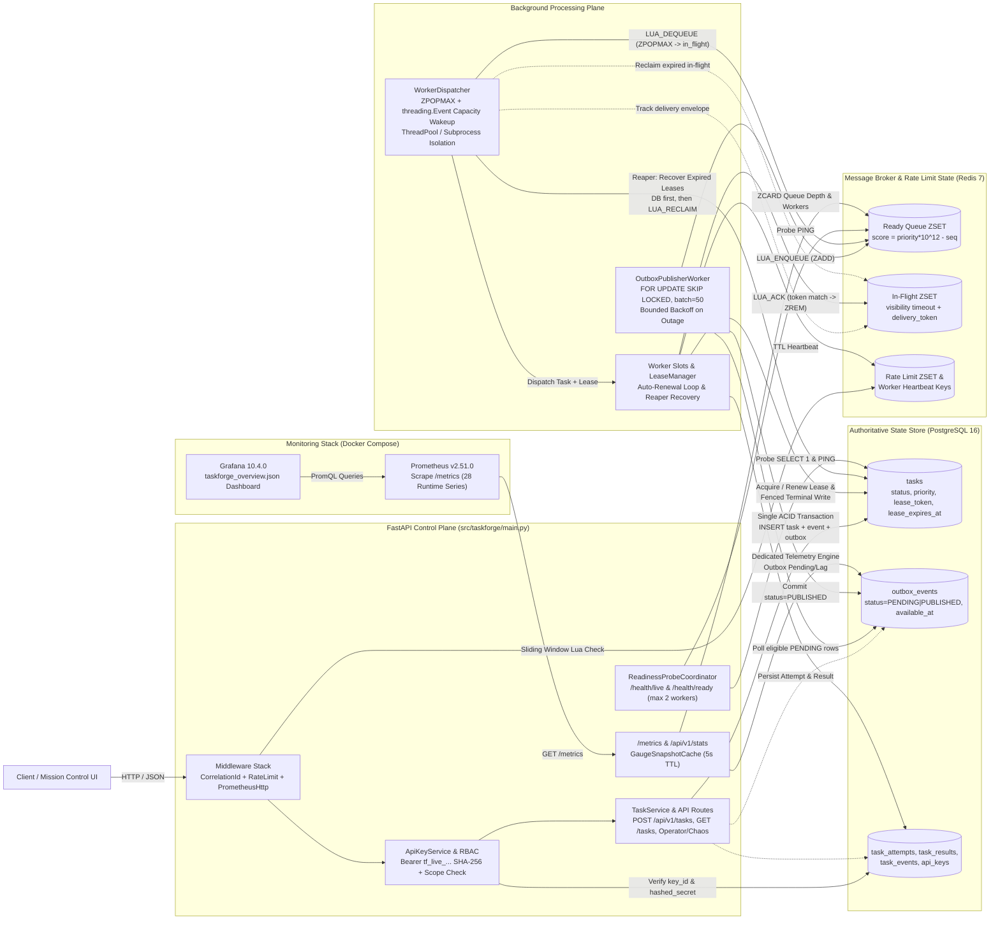

# TaskForge

**A Durable, Observable, and Empirically Verified Asynchronous Task Processing Platform**

[](https://www.python.org/)
[](https://fastapi.tiangolo.com/)
[](https://www.postgresql.org/)
[](https://redis.io/)
[](https://prometheus.io/)
[](docs/phases/phase_09/31_phase9_final_synthesis_and_closure.md)
[](LICENSE)

> *"Build systems that can prove they work."*

TaskForge is a locally deployable distributed task-processing platform engineered around PostgreSQL-backed durability, atomic Redis priority queueing, time-bounded worker leases with stale-write fencing, bounded-cardinality observability, and reproducible failure-recovery verification.

It is presented as a **measured, locally benchmarked platform** with explicit delivery semantics and documented scaling limits—not as an unverified claim of universal exactly-once execution or unlimited horizontal scale.

---

## Core Delivery Guarantee

> **TaskForge provides durable task submission through PostgreSQL transactions and a transactional outbox. Queue delivery is at-least-once. Worker ownership is protected by leases and fencing tokens. Task completion is persisted transactionally, and duplicate delivery is handled through idempotent execution and authoritative task state.**

---

## Architecture Overview

PostgreSQL acts as the **sole authoritative source of truth** (`tasks`, `outbox_events`, `task_attempts`, `task_results`, `task_events`, `api_keys`), while Redis serves exclusively as an ephemeral priority signaling broker, visibility-timeout queue, and rate-limiter store.



### Detailed Whitepaper & Visual Diagrams (`D1`–`D4`)
- **Full 13-Section Engineering Whitepaper:** [`docs/whitepaper/ARCHITECTURE.md`](docs/whitepaper/ARCHITECTURE.md)
- **Inspectable Mermaid Diagram Sources:**
  - `D1` — System Architecture: [`d1_system_architecture.mmd`](docs/whitepaper/diagrams/d1_system_architecture.mmd)
  - `D2` — Task Submission & Execution Sequence: [`d2_task_submission_execution.mmd`](docs/whitepaper/diagrams/d2_task_submission_execution.mmd)
  - `D3` — Lease Fencing Sequence: [`d3_lease_fencing_sequence.mmd`](docs/whitepaper/diagrams/d3_lease_fencing_sequence.mmd)
  - `D4` — Outbox & Broker Outage Recovery: [`d4_outbox_broker_recovery.mmd`](docs/whitepaper/diagrams/d4_outbox_broker_recovery.mmd)

---

## Key Engineering Capabilities

1. **Zero Dual-Write Loss via Transactional Outbox:**
   `create_task()` commits the `Task`, initial `TaskEvent`, and `OutboxEvent` inside one PostgreSQL ACID transaction. `OutboxPublisherWorker` sweeps eligible rows (`available_at <= now`, `FOR UPDATE SKIP LOCKED`, batch `50`), enqueues to Redis, and survives broker outages with bounded exponential backoff (`<= 5.0s`) without losing durable events (verified across a `5.71s` OS-level TCP socket proxy outage drill with `50/50` recovery and `0` lost events).
2. **Deterministic Priority + Intra-Tier FIFO Broker (`ZPOPMAX`):**
   Redis Sorted Set scores use disjoint priority bands `score = (priority * 10^12) - seq` (`LOW=1`..`CRITICAL=4`), giving strict tier preemption and FIFO ordering within each tier via atomic `LUA_ENQUEUE` / `LUA_DEQUEUE` (`ZPOPMAX`) / `LUA_ACK` (`delivery_token` match) / `LUA_RECLAIM`.
3. **Event-Driven Capacity Wake-up Dispatch:**
   `WorkerDispatcher` pairs single-element `ZPOPMAX` dequeuing with a lost-wakeup-proof `threading.Event` slot-release signal (adopted in `a89858b`), cutting slot replenishment latency by `74.5%–89.4%` (`29–34 ms -> 3.1–8.6 ms`) and raising worker utilization to `91.3%` at `c=4` while avoiding unnecessary batch-dequeue complexity (`c <= 10`).
4. **Lease Ownership & Authoritative Stale Fencing:**
   Workers acquire time-bounded leases (`30s` TTL, auto-renewed every `lease_duration / 2`), while a two-stage background Reaper recovers expired PostgreSQL leases first and reclaims Redis `in_flight` items second. All 5 state-mutating repository operations enforce `SELECT ... FOR UPDATE` token matching (`5/5` stale writes rejected, `0` corruptions in G9.4.3 drills).
5. **Security, Multi-Tenancy & Fail-Closed Rate Limiting:**
   Bearer API keys (`tf_live_<24-hex>_<32-secret>`) store only `SHA-256(key_id:secret)` digests verified with `hmac.compare_digest()`. Endpoints enforce RBAC scopes (`tasks:read`, `tasks:write`, `admin:operator`), row-level `tenant_id` filtering, `SQLSTATE 23505` idempotency collision handling, secret/lease masking (`mask_secret_string()`), and an atomic Redis Lua sliding-window rate limiter (`300 req/min` default) that fails closed (`HTTP 503`) on Redis unavailability to shield PostgreSQL.
6. **Bounded-Cardinality Observability & Isolated Health Probes:**
   Prometheus `/metrics` enforces finite label whitelists and an `Option A` runtime pool+lease budget of `28` combined series (`25` net-new G9.4 + `3` pre-existing G9.2). Backend gauges update through a `5.0s` single-flight `GaugeSnapshotCache` on a dedicated telemetry engine (`pool_size=2, max_overflow=1`), while `/health/ready` runs inside a bounded `ReadinessProbeCoordinator` (`max_workers=2`, `1.0s` timeout).

---

## Reproducible Public Benchmarks

Canonical benchmarks (`benchmarks/public/run_public_benchmarks.py`, Run `fc557f14` on clean commit `1d4a76c`, artifact [`benchmarks/public/benchmark_results.json`](benchmarks/public/benchmark_results.json)) were measured on a **single-host Windows 11 environment** (`12` logical cores, `15.65 GB` RAM, Python `3.12.10`, PostgreSQL `16.15`, Redis `7.4.12`, `concurrency=4`, `0.05s` outbox poll interval).

> **Measurement Qualification:** Results reflect steady-state throughput (excluding the first `10%` warmup tasks from percentiles/window) on the documented local single-host environment and must not be extrapolated to multi-node production clusters or different hardware without re-benchmarking. **Worker Execution / Lease Tenure** ($t_{\text{completed}} - t_{\text{started}}$) encompasses handler execution plus PostgreSQL lease ownership and terminal persistence overhead.

| Workload ID | Task Type | Seeded / Warmup / Measured | Steady-State Throughput | Outbox Dwell Mean | Queue Dwell Mean | Worker Execution / Lease Tenure Mean | End-to-End ($p50$ / $p95$ / Mean) | Run Outcomes (Success / Fail / Retry) |
| :--- | :--- | :---: | :---: | :---: | :---: | :---: | :---: | :---: |
| **`W-01`** | `noop` (framework overhead) | 300 / 30 / 270 | **`44.78 tasks/s`** | `955.318 ms` | `3,084.507 ms` | `52.310 ms` | `4,063.9` / `6,756.8` / `4,092.136 ms` | `300 / 0 / 0` (`100%`) |
| **`W-02`** | `cpu_bound` (prime sieve $n=500$) | 200 / 20 / 180 | **`44.59 tasks/s`** | `599.911 ms` | `2,173.850 ms` | `53.526 ms` | `2,842.9` / `4,607.8` / `2,827.287 ms` | `200 / 0 / 0` (`100%`) |
| **`W-03`** | `io_bound` ($50\,\text{ms}$ blocking sleep) | 100 / 10 / 90 | **`28.82 tasks/s`** | `316.172 ms` | `1,876.566 ms` | `103.291 ms` | `2,309.3` / `3,555.8` / `2,296.029 ms` | `100 / 0 / 0` (`100%`) |

Every individual measured task (`540/540`) satisfies the exact causal additive identity $L_{\text{outbox}} + L_{\text{queue}} + L_{\text{worker}} \equiv L_{\text{e2e}}$ with `max_per_task_discrepancy_ms = 0.000000 ms`.

---

## Quickstart & Reproducible Verification

### Prerequisites
- Python `3.12+` (`.venv`)
- Docker & Docker Compose, or local PostgreSQL `16` (`localhost:5432`) and Redis `7` (`localhost:6379`)

### 1. Run the One-Command Architecture Demo (`D1`–`D12`)
Demonstrates pre-flight checks, disposable DB/Redis isolation, Alembic migrations, `ZPOPMAX` priority ordering, real `3.11s` OS TCP Redis outage recovery, stale-worker PostgreSQL fencing (`D7`), `TERMINAL_DUPLICATE` suppression (`D8`), and identity reconciliation:

```powershell
# Check prerequisites without creating state
.venv\Scripts\python.exe scripts/demo.py --check

# Execute full interactive demonstration and safe teardown
.venv\Scripts\python.exe scripts/demo.py
```

### 2. Run the Canonical Public Benchmark Suite
Executes `W-01`, `W-02`, and `W-03` in disposable isolated resources, validates `benchmarks/public/schema/v1.json`, enforces arithmetic latency reconciliation, and emits `benchmarks/public/benchmark_results.json`:

```powershell
# Standard benchmark suite
.venv\Scripts\python.exe benchmarks/public/run_public_benchmarks.py

# Fast smoke run for a single workload
.venv\Scripts\python.exe benchmarks/public/run_public_benchmarks.py --quick --workload W-01
```

### 3. Run the Full Automated Verification Suite
Verified at frozen baseline `v0.9.0-phase9-freeze` (`fb31546`): **`267 passed`** (`0` failures, `0` skips across unit, integration, reliability, security, load, and documentation-contract tests):

```powershell
.venv\Scripts\pytest -q
```

### 4. Start the Full Stack (Docker Compose or Local Dev)

```bash
# Containerized stack: PostgreSQL, Redis, FastAPI, Celery worker, Prometheus, Grafana
docker compose up -d
```

- **Mission Control Web UI & API:** `http://127.0.0.1:8000/` (UI) · `http://127.0.0.1:8000/docs` (Swagger)
- **Health & Observability:** `/health/live`, `/health/ready`, `/metrics`, `/api/v1/stats`
- **Prometheus & Grafana (Docker Compose):** `http://localhost:9090` · `http://localhost:3000` (`admin` / `admin`)

For local development directly via `.venv`:

```powershell
alembic upgrade head
.venv\Scripts\python.exe -m uvicorn taskforge.main:app --host 127.0.0.1 --port 8000
```

---

## Known Limitations & Operational Boundaries

1. **Duplicate Execution vs. External Side-Effect Idempotency:** PostgreSQL state guards (`TERMINAL_DUPLICATE`) prevent duplicate corruption of completed tasks, and `idempotency_key` prevents duplicate API creation. However, if a worker crashes *after* calling an external third-party API but *before* committing `complete_task_success()`, lease recovery will re-invoke the handler under at-least-once delivery; handlers performing external side effects must pass downstream idempotency keys.
2. **Dispatcher Concurrency Ceiling:** `WorkerDispatcher` uses a single dequeue thread; G9.3 profiling observed serialization saturation at `c=20` (`74.0%` dispatcher duty cycle, `24.8%` worker saturation). Scale worker capacity horizontally across multiple worker processes (`c <= 10` per dispatcher) rather than increasing single-process thread concurrency.
3. **Fail-Closed Rate Limiter:** When Redis is unreachable, `RateLimitMiddleware` fails closed (`HTTP 503`) to protect PostgreSQL from unbounded ingress; API submissions require Redis availability (health and `/metrics` endpoints remain exempt).
4. **Tested Failure Envelope:** Drills verified single-node Redis socket severance (`5.71s`), $2\times$ DB pool contention, and stale-worker fencing. Multi-region partitions, PostgreSQL HA primary failover, and prolonged multi-hour disk/backlog saturation remain outside tested boundaries.

---

## Architecture Documentation & Phase 9 Provenance

- **Architecture Whitepaper:** [`docs/whitepaper/ARCHITECTURE.md`](docs/whitepaper/ARCHITECTURE.md)
- **Phase 9 Final Synthesis & Closure Report:** [`docs/phases/phase_09/31_phase9_final_synthesis_and_closure.md`](docs/phases/phase_09/31_phase9_final_synthesis_and_closure.md)
- **Phase 9 Document Index (`00`–`31`):** [`docs/phases/phase_09/README.md`](docs/phases/phase_09/README.md)
- **Architecture Decision Records (`ADR-001` – `ADR-010`):**
  - [ADR-001: Modular Monolith vs Microservices](docs/adr/ADR-001-modular-monolith-vs-microservices.md) · [ADR-002: PostgreSQL as Source of Truth](docs/adr/ADR-002-postgresql-as-source-of-truth.md) · [ADR-003: Redis as Message Broker](docs/adr/ADR-003-redis-as-message-broker.md) · [ADR-004: Celery and Custom Async Dispatcher](docs/adr/ADR-004-celery-and-async-dispatcher.md) · [ADR-005: Transactional Outbox Pattern](docs/adr/ADR-005-transactional-outbox-pattern.md) · [ADR-006: At-Least-Once Delivery Semantics](docs/adr/ADR-006-at-least-once-delivery.md) · [ADR-007: Idempotency Mechanism](docs/adr/ADR-007-idempotency-mechanism.md) · [ADR-008: Task State Machine](docs/adr/ADR-008-task-state-machine.md) · [ADR-009: Worker Recovery and Leases](docs/adr/ADR-009-worker-recovery-and-leases.md) · [ADR-010: Metrics and Tracing Architecture](docs/adr/ADR-010-metrics-and-tracing-architecture.md)

---

## License

This project is licensed under the MIT License - see the [LICENSE](LICENSE) file for details.
