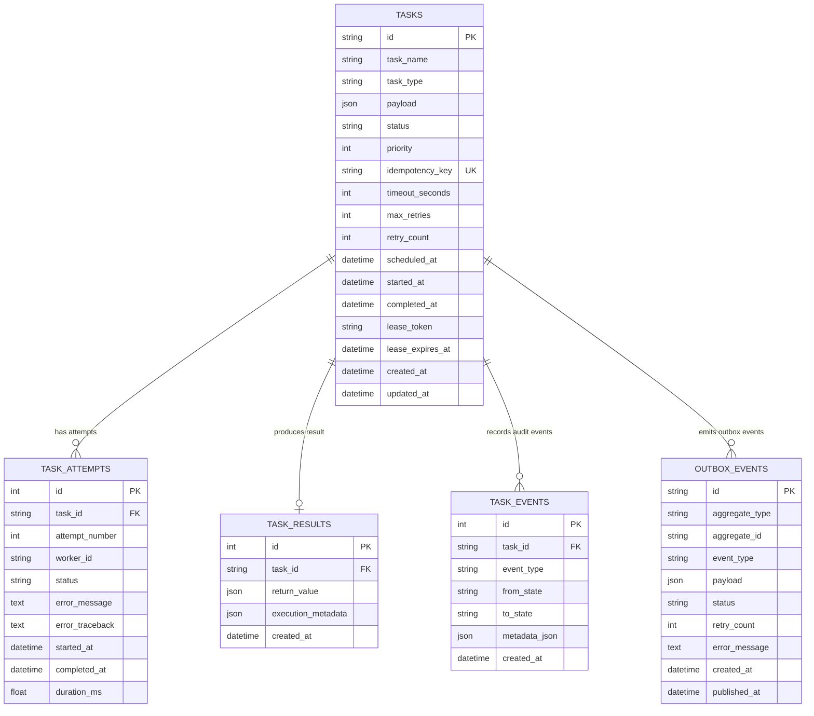

# TaskForge: Data Model & Schema Specification

## 1. Relational Entity Diagram

## 2. Indexing Strategy

1. **`tasks`**:
   - `ix_tasks_status`: Fast state filtering.
   - `ix_tasks_priority`: Priority queue ordering.
   - `ix_tasks_idempotency_key`: Unique lookup during deduplication.
   - `ix_tasks_status_priority`: Composite index for pending work queries.
   - `ix_tasks_lease_recovery`: Composite index on `(status, lease_expires_at)` for sub-millisecond reaper scans.

2. **`outbox_events`**:
   - `ix_outbox_status_created`: Composite index on `(status, created_at)` for the outbox publisher polling query.

3. **`task_attempts`**:
   - `ix_task_attempts_task_attempt`: Composite index on `(task_id, attempt_number)` for audit chronology.

