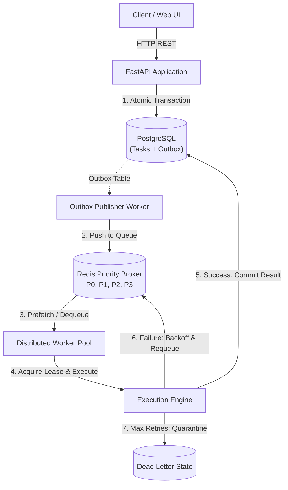

# TaskForge: System Architecture Overview

## 1. High-Level Blueprint

TaskForge implements an asynchronous decoupled task execution pipeline.

## 2. Component Breakdown

### 2.1 API Ingestion Layer (`src/taskforge/api`)
- **FastAPI Framework:** Handles synchronous HTTP task submissions, queries, cancellations, and retries.
- **Correlation ID Middleware:** Assigns a persistent UUID to every request, passing it across database records and structured logs.
- **Sliding-Window Rate Limiter:** Protects submission endpoints from denial-of-service spikes (configurable requests per minute per IP).
- **Pydantic Validation:** Strictly validates payloads, priorities, timeouts, and idempotency keys before database interaction.

### 2.2 Transactional Outbox & Queue (`src/taskforge/queue`)
- **Zero Message Loss Guarantee:** Prevents dual-write discrepancies by writing the task record and outbox event in the same atomic database transaction.
- **Priority Broker:** Redis sorted sets index tasks by priority (`P0_CRITICAL` through `P3_LOW`), ensuring urgent tasks execute first.

### 2.3 Worker Engine & Reliability (`src/taskforge/workers`)
- **Concurrency Dispatcher:** Thread-pool worker pool executing tasks with dynamic concurrency.
- **Distributed Leases:** Cryptographic lease tokens prevent split-brain processing.
- **Crash Recovery Reaper:** Periodically inspects and reclaims orphaned tasks left by crashing workers.
- **Exponential Backoff & Jitter:** Randomizes retry delays to prevent thundering herd problems on downstream services.
- **Dead-Letter Quarantine:** Non-recoverable failures are isolated for operator inspection.

