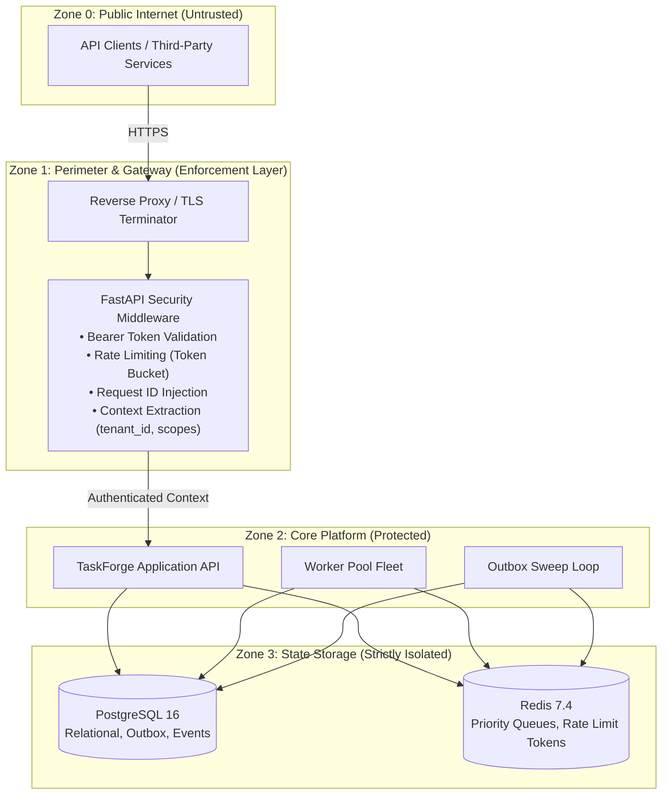

# G9.0.3 — Trust Boundaries & Access Policy

## 1. Trust Zone Architecture

TaskForge segregates its runtime operations into three boundaries:



---

## 2. Access Control & Identity Policies

### 2.1 Identity Principles
* **Client Identity:** Clients are identified by cryptographically generated API keys. Keys map deterministically to a `tenant_id` and an assigned list of OAuth2-style `scopes`.
* **Worker Identity:** Worker processes do not possess long-lived credentials to modify task states at will. A worker may only transition a task to `RUNNING` or `SUCCESS`/`FAILURE` if it presents the exact `lease_token` matching the task's active lease record in PostgreSQL.

### 2.2 Role-Based Access Control (RBAC) Contract

| Role / Scope | Permitted Actions | Forbidden Actions |
| :--- | :--- | :--- |
| `client:submitter` | `POST /api/v1/tasks` (scoped to own tenant) | Accessing other tenants' tasks; executing maintenance or recovery |
| `client:viewer` | `GET /api/v1/tasks/{id}`, `GET /api/v1/tasks` (own tenant only) | Submitting tasks; modifying tasks |
| `system:worker` | Claiming leased tasks, executing handlers, recording attempts | Bypassing lease token validation; modifying unrelated tasks |
| `operator:admin` | Lease recovery triggers, emergency queue drain, global metrics inspection | Injecting unsigned tasks directly into worker execution queues |

### 2.3 Tenant Fencing Enforcement
* **Rule 1 (Creation):** Every task created in `POST /api/v1/tasks` automatically inherits the authenticated caller's `tenant_id`. Clients cannot specify arbitrary tenant IDs in request payloads.
* **Rule 2 (Inspection):** When accessing `GET /api/v1/tasks/{task_id}`, the query compiles as:
  ```sql
  SELECT * FROM tasks WHERE id = :task_id AND tenant_id = :authenticated_tenant_id;
  ```
  If the task exists under a different tenant, the API returns `404 Not Found` (rather than `403 Forbidden`) to prevent tenant ID enumeration.

---

## 3. Secret Masking & Sanitization Standard

1. **Database Credentials:** `DATABASE_URL` credentials must never be printed to stdout, stderr, or logged in JSON log events. The platform must use `str(engine.url.render_as_string(hide_password=True))`.
2. **Lease Tokens & Tokens in Transit:** Full 64-character lease tokens and Redis delivery tokens must be truncated or hashed (`_fp(raw) = sha256(raw)[:12]`) when emitted in traces, benchmark logs, or diagnostic reports.
3. **HTTP Payloads:** Authorization headers (`Authorization: Bearer ***`) are masked in access logs.

