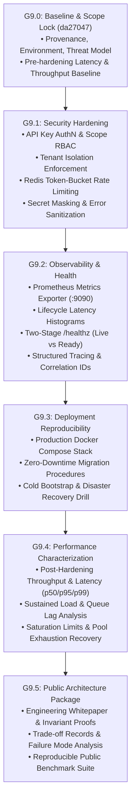

# G9.0.4 — Phase 9 Architecture Roadmap & Dependency Order

## 1. Roadmap Principles

Phase 9 transforms TaskForge from an experimentally verified reliability core (`v0.8.0-phase8-freeze`) into a fully diagnosable, secure, and operationally credible platform.

---

## 2. Dependency Order Justification

1. **Why G9.0 First?** Baseline measurements must be established *before* introducing auth, rate limiting, and telemetry middleware. This ensures performance regressions or latency overheads introduced by Phase 9.1–9.3 are quantitatively measurable against an immutable standard.
2. **Why Security (9.1) Before Observability (9.2)?** Establishing trust boundaries and tenant context early ensures that metrics, traces, and logs in 9.2 can be properly tagged with tenant, user, and security attributes without requiring retrofitting.
3. **Why Observability (9.2) Before Deployment & Performance (9.3 & 9.4)?** Performance profiling requires accurate instrumentation (queue depth gauges, latency histograms, worker saturation counters). Running benchmarks without telemetry leaves bottlenecks opaque.
4. **Why Deployment (9.3) Before Final Performance Characterization (9.4)?** Performance characterization must reflect the actual reproducible deployment topology (containerized networking, connection pools, CPU limits), not an ad-hoc local script.
5. **Why Architecture Presentation (9.5) Last?** Public documentation, whitepapers, and reproducible demo scripts must reflect measured and verified operational realities.

---

## 3. Scope Exclusions & Non-Goals

* **Non-Goal 1: Universal Exactly-Once Delivery:** TaskForge maintains at-least-once delivery with terminal duplicate fencing. Phase 9 does not attempt two-phase commit with external arbitrary side-effect systems.
* **Non-Goal 2: Complex Distributed Tracing Backends:** OpenTelemetry protocol will be supported, but TaskForge will not bundle distributed tracing clusters (e.g. Jaeger / Zipkin) into its default runtime footprint; standard Prometheus + structured JSON logs serve as core telemetry.
* **Non-Goal 3: Distributed Multi-Region Consensus:** TaskForge remains an active-passive / standalone cluster system backed by PostgreSQL and Redis. Multi-region cross-datacenter consensus is explicitly out of scope for Phase 9.

