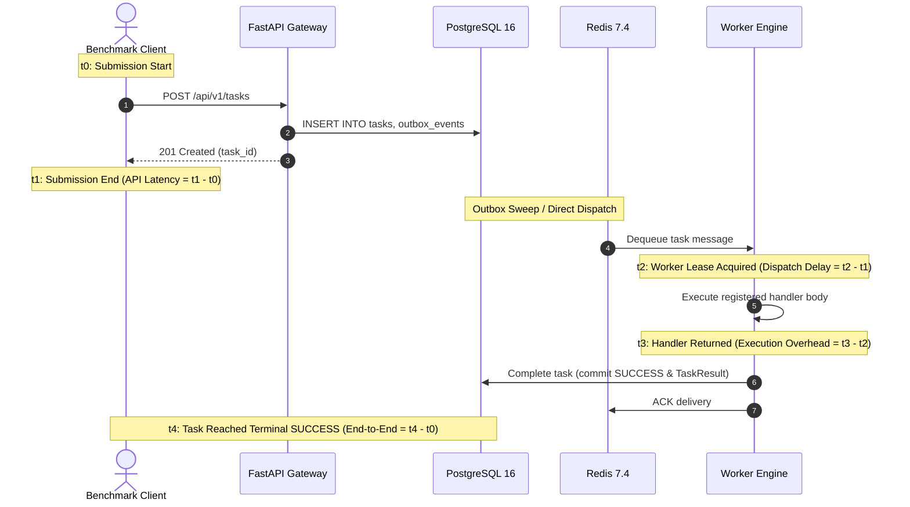

# G9.0.6 — Baseline Performance Profiling Methodology

## 1. Principles of Measurement

To establish an honest, unmanipulated performance baseline on `v0.8.0-phase8-freeze`:
1. **Statistically Significant Sample Size:** Tail latency (p99) cannot be reliably determined from 20 or 50 samples. The G9.0 baseline runs a minimum of 500 tasks per workload condition.
2. **Warm-Up Phase:** A dedicated warm-up run of 50 tasks precedes recorded measurement to eliminate JIT compilation, connection pool instantiation, and OS disk cache priming artifacts.
3. **No Discarding Failures:** If a task times out, fails to dispatch, or rejects lease ownership, it is recorded as a failure and included in total elapsed time and throughput calculations.
4. **Isolated Infrastructure:** Tests run against a dedicated disposable database (`taskforge_g90_benchmark`) and an isolated Redis key namespace (`taskforge:g90:benchmark:`) to prevent cross-test contamination.
5. **Zero Source Modifications:** The profiling harness is completely external to `src/`. Timestamps are captured via high-resolution monotonic clocks (`time.perf_counter()`) for client latency and PostgreSQL `clock_timestamp()` for database persistence lifecycles.

---

## 2. Metric Definitions & Formulas

### Detailed Formulas:
* **API Submission Latency ($L_{\text{submit}}$):** 
  $$L_{\text{submit}} = t_1 - t_0$$
  Elapsed time from HTTP request initiation until response headers and body are fully read.
* **Broker Dispatch Delay ($D_{\text{dispatch}}$):**
  $$D_{\text{dispatch}} = t_2 - t_1$$
  Elapsed time between successful task ingestion and the instant a worker acquires a valid lease and begins execution.
* **Execution Overhead ($O_{\text{exec}}$):**
  $$O_{\text{exec}} = t_3 - t_2$$
  Elapsed time spent executing the registered handler logic.
* **End-to-End Completion Latency ($L_{\text{e2e}}$):**
  $$L_{\text{e2e}} = t_4 - t_0$$
  Total wall-clock time from task creation to durable terminal state in PostgreSQL.
* **Throughput ($T$):**
  $$T = \frac{N_{\text{completed}}}{\Delta t_{\text{total}}}$$
  Where $N_{\text{completed}}$ is the number of successfully completed tasks within the measurement interval $\Delta t_{\text{total}}$.

---

## 3. Workload Definitions for G9.0

| Workload ID | Name | Task Handler | Concurrency | Task Count | Description |
| :--- | :--- | :--- | :--- | :--- | :--- |
| **W-01** | Baseline Noop Profiling | `noop` | 10 concurrent clients | 500 tasks | Zero-overhead handler to measure raw framework latency and database/Redis protocol overhead |
| **W-02** | CPU-Bound Prime Sieve | `compute_prime` ($n=1,000$) | 4 concurrent clients | 200 tasks | Measures worker CPU utilization and serialization overhead under computational load |
| **W-03** | I/O Simulation | `io_simulation` (delay=5ms) | 10 concurrent clients | 200 tasks | Measures worker throughput under external waiting conditions |

---

## 4. Preservation of Raw Artifacts & Schemas

* Raw per-task sample measurements are streamed directly to `benchmarks/raw/g90_baseline_raw_<timestamp>.jsonl`.
* Aggregated percentiles and environment metadata are machine-validated via Pydantic and persisted to `benchmarks/scenarios/g90/baseline_performance.json`.

