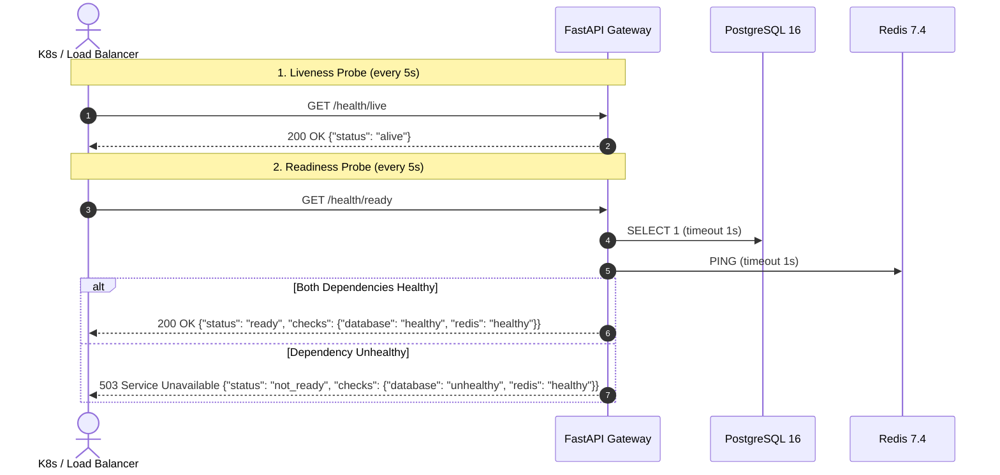

# G9.2.1 — Metrics & Observability Architecture Contract

## 1. Executive Summary & Purpose

Milestone G9.2 provides end-to-end operational visibility into TaskForge runtime behavior without degrading throughput, leaking sensitive credentials, or introducing memory leaks via unbounded Prometheus label cardinality.

This specification locks the metric names, types, label dimensions, histogram bucket layouts, and measurement semantics across the task processing lifecycle prior to adding instrumentation.

---

## 2. Cardinality Safety & Label Boundary Invariants

> [!CAUTION]
> **Strict Cardinality Invariant:**
> Under no circumstances may high-cardinality, dynamic, or security-sensitive values be attached as Prometheus metric labels.
> 
> **Explicitly Forbidden Labels:**
> * `task_id` (UUIDv4 — infinite cardinality)
> * `tenant_id` (customer identifier — unbounded cardinality, multi-tenant data leak)
> * `api_key_id` or `key_id` (credential metadata leak)
> * `worker_id` (ephemeral process/container identifiers — dynamic churn)
> * `exception_message` or `traceback` (arbitrary strings, potential secret/PII leak)
> * `trace_id` or `correlation_id` (per-request UUID — catastrophic TSDB cardinality explosion)

### Authorized Label Dimensions:
All Prometheus metric labels must be strictly constrained to finite, well-known enumerations:

| Label Name | Allowed Values | Cardinality Ceiling |
| :--- | :--- | :--- |
| `task_type` | Registered handler names (`noop`, `compute_prime`, `io_simulation`, `failing`, `memory_intensive`) | $\le 20$ |
| `priority` | `low`, `medium`, `high`, `critical` (or integers `0`, `1`, `2`, `3`) | $4$ |
| `status` | State machine enum: `PENDING`, `QUEUED`, `RUNNING`, `SUCCESS`, `FAILED`, `RETRY_WAIT`, `DEAD_LETTER`, `CANCELLED` | $8$ |
| `http_method` | `GET`, `POST`, `PUT`, `DELETE` | $4$ |
| `http_status` | Status code classes: `2xx`, `4xx`, `5xx` (or standard HTTP codes: `200`, `201`, `400`, `401`, `403`, `404`, `422`, `429`, `500`, `503`) | $\le 15$ |
| `route` | Parameterized endpoint route templates (e.g. `/api/v1/tasks`, `/api/v1/tasks/{id}`, `/api/v1/operator/recover`, `/health/ready`) | $\le 10$ |
| `component` | Subsystem name: `api`, `dispatcher`, `outbox_publisher`, `worker`, `lease_manager` | $5$ |
| `failure_reason`| Categorical taxonomy: `timeout`, `handler_exception`, `lease_expired`, `circuit_breaker`, `invalid_payload` | $\le 8$ |

Total maximum unique time-series across all metrics is mathematically capped at $< 500$, well within Prometheus scraping performance limits.

---

## 3. Canonical Metric Catalog

```mermaid
flowchart LR
    subgraph Submission["1. Ingestion (API)"]
        M1["taskforge_tasks_submitted_total"]
        M2["taskforge_api_request_duration_seconds"]
        M3["taskforge_rate_limit_exceeded_total"]
    end

    subgraph Outbox["2. Outbox & Broker"]
        M4["taskforge_outbox_lag_seconds"]
        M5["taskforge_queue_depth"]
        M6["taskforge_queue_wait_seconds"]
    end

    subgraph Execution["3. Worker Execution"]
        M7["taskforge_task_execution_duration_seconds"]
        M8["taskforge_tasks_completed_total"]
        M9["taskforge_retries_total"]
        M10["taskforge_dead_letter_total"]
    end

    subgraph Infrastructure["4. System Health"]
        M11["taskforge_active_workers"]
        M12["taskforge_db_pool_connections"]
        M13["taskforge_lease_recoveries_total"]
    end

    Submission --> Outbox --> Execution
    Infrastructure -.-> Submission
    Infrastructure -.-> Outbox
    Infrastructure -.-> Execution
```



### 3.1 Task Lifecycle Metrics

#### 1. `taskforge_tasks_submitted_total`
* **Type:** Counter
* **Description:** Total number of task creation requests accepted and durably persisted in PostgreSQL.
* **Labels:** `task_type`, `priority`
* **Measurement Semantics:** Incremented inside `TaskRepository.create_task` immediately upon successful transaction commit.

#### 2. `taskforge_task_queue_wait_seconds`
* **Type:** Histogram
* **Description:** Duration between task creation (`tasks.created_at`) and worker lease acquisition (`task_attempts.started_at`). Measures broker and dispatcher latency.
* **Labels:** `task_type`, `priority`
* **Buckets:** `[0.01, 0.05, 0.1, 0.25, 0.5, 1.0, 2.5, 5.0, 10.0, 30.0, 60.0]`

#### 3. `taskforge_task_execution_duration_seconds`
* **Type:** Histogram
* **Description:** Duration spent executing the task attempt inside the worker pipeline from handler invocation to result serialization.
* **Labels:** `task_type`, `status` (`SUCCESS` or `FAILED`)
* **Buckets:** `[0.005, 0.01, 0.025, 0.05, 0.1, 0.25, 0.5, 1.0, 2.5, 5.0, 10.0, 30.0]`

#### 4. `taskforge_tasks_completed_total`
* **Type:** Counter
* **Description:** Cumulative count of terminal task outcomes.
* **Labels:** `task_type`, `status` (`SUCCESS`, `FAILED`, `CANCELLED`, `DEAD_LETTER`)
* **Measurement Semantics:** Incremented once when a task enters a terminal status in PostgreSQL.

#### 5. `taskforge_retries_total`
* **Type:** Counter
* **Description:** Total number of automatic retry schedules triggered following an attempt failure.
* **Labels:** `task_type`, `failure_reason`
* **Measurement Semantics:** Incremented when a failed attempt transitions a task to `RETRY_WAIT`.

#### 6. `taskforge_dead_letter_total`
* **Type:** Counter
* **Description:** Total tasks exhausted beyond their retry budget and moved to `DEAD_LETTER`.
* **Labels:** `task_type`

---

### 3.2 Queue & Outbox Telemetry

#### 7. `taskforge_queue_depth`
* **Type:** Gauge
* **Description:** Current instantaneous backlog in the Redis priority queue.
* **Labels:** `priority`
* **Measurement Semantics:** Sampled via `ZCARD` / `LLEN` on Prometheus scrape.

#### 8. `taskforge_outbox_pending_events`
* **Type:** Gauge
* **Description:** Number of unpublished transactional outbox events remaining in PostgreSQL.
* **Labels:** None
* **Measurement Semantics:** Queried via `SELECT count(*) FROM outbox_events WHERE status = 'PENDING'`.

#### 9. `taskforge_outbox_lag_seconds`
* **Type:** Gauge
* **Description:** Age in seconds of the oldest pending outbox event. Alerts on outbox publisher stalling.
* **Labels:** None
* **Measurement Semantics:** `EXTRACT(EPOCH FROM (now() - MIN(created_at))) WHERE status = 'PENDING'`.

#### 10. `taskforge_lease_recoveries_total`
* **Type:** Counter
* **Description:** Total number of orphaned or expired worker leases recovered by the supervisor.
* **Labels:** `component` (`dispatcher`, `operator`)

---

### 3.3 HTTP Gateway & Rate Limiting Telemetry

#### 11. `taskforge_api_request_duration_seconds`
* **Type:** Histogram
* **Description:** End-to-end latency of HTTP requests processed by the FastAPI gateway.
* **Labels:** `http_method`, `route`, `http_status`
* **Buckets:** `[0.005, 0.01, 0.025, 0.05, 0.1, 0.25, 0.5, 1.0, 2.5, 5.0]`

#### 12. `taskforge_rate_limit_exceeded_total`
* **Type:** Counter
* **Description:** Number of requests rejected due to rate limiter quota exhaustion (HTTP 429).
* **Labels:** `route`

---

### 3.4 Worker Fleet & Connection Pool Health

#### 13. `taskforge_active_workers`
* **Type:** Gauge
* **Description:** Number of unique execution worker processes actively emitting heartbeats within their freshness window ($\le 10$ seconds).
* **Labels:** None

#### 14. `taskforge_db_pool_connections`
* **Type:** Gauge
* **Description:** State of the SQLAlchemy database connection pool.
* **Labels:** `state` (`checked_out`, `idle`, `overflow`)

---

## 4. Health Check Contract (`/health/live` vs `/health/ready`)



### 4.1 Liveness Probe Contract
* **Endpoint:** `GET /health/live` (and alias `/healthz/live`)
* **Purpose:** Proves process event loop responsiveness.
* **Dependencies Checked:** None. Never probes database or network broker.
* **Response:** Always HTTP 200 `{"status": "alive", "application": "TaskForge"}` if the process can serve HTTP.
* **Failure Meaning:** If this endpoint fails or hangs, the container must be restarted.

### 4.2 Readiness Probe Contract
* **Endpoint:** `GET /health/ready` (and alias `/healthz/ready`)
* **Purpose:** Proves whether this platform instance can accept production task submissions.
* **Dependencies Checked:**
  1. **PostgreSQL:** Execute `SELECT 1` with a strict 1.0-second statement timeout.
  2. **Redis:** Execute `PING` with a strict 1.0-second socket timeout.
* **Response Codes:**
  - HTTP `200 OK`: When all dependencies return healthy.
  - HTTP `503 Service Unavailable`: When any dependency is unreachable, timing out, or failing authentication.
* **Body Format:**
  ```json
  {
    "status": "ready",
    "application": "TaskForge",
    "checks": {
      "database": "healthy",
      "redis": "healthy"
    },
    "timestamp": "2026-11-10T08:30:00Z"
  }
  ```
