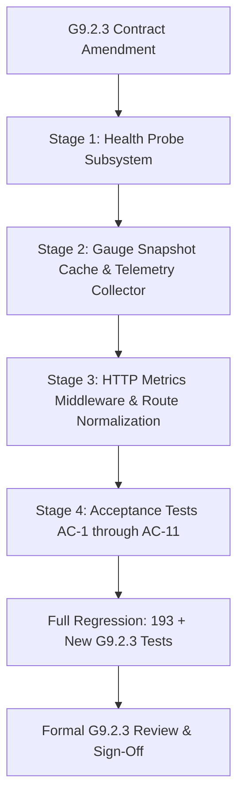

# G9.2.1 — Metrics & Observability Architecture Contract

## 1. Executive Summary & Purpose

Milestone G9.2 establishes end-to-end operational visibility into TaskForge runtime behavior without degrading throughput, leaking sensitive credentials, or introducing memory leaks via unbounded Prometheus label cardinality.

This contract provides an exact mathematical per-instance cardinality budget, locks metric names and types, defines lifecycle measurement semantics and timestamp boundaries, aligns queue depth with the Redis Sorted Set (`ZSET`) architecture, establishes enforceable timeout budgets for health checks, and guarantees telemetry failure isolation.

---

## 2. Cardinality Safety & Label Boundary Invariants

> [!CAUTION]
> **Strict Cardinality Invariant:**
> Under no circumstances may high-cardinality, dynamic, or security-sensitive values be attached as Prometheus metric labels.
> 
> **Explicitly Forbidden Labels:**
> * `task_id` (UUIDv4 — infinite cardinality)
> * `tenant_id` (customer identifier — unbounded cardinality, multi-tenant data leak)
> * `api_key_id` or `key_id` (credential metadata leak)
> * `worker_id` (ephemeral process/container identifiers — dynamic churn)
> * `exception_message` or `traceback` (arbitrary strings, potential secret/PII leak)
> * `trace_id` or `correlation_id` (per-request UUID — catastrophic TSDB cardinality explosion)

### 2.1 Authorized Finite Label Whitelists & Normalization Rules

Every metric label must adhere to a strict finite whitelist. Any runtime value not explicitly listed in the whitelist is mapped to the safe fallback value `"other"`:

1. **`task_type` (Max 6 values):**
   - Whitelist: `noop`, `compute_prime`, `io_simulation`, `failing`, `memory_intensive`
   - Fallback: `other` (any custom, legacy, or unregistered task type)
2. **`priority` (Max 4 values):**
   - Whitelist: `critical`, `high`, `medium`, `low`
   - Canonical Integer Mapping (matching `TaskPriority` enum in `src/taskforge/core/state_machine.py`):
     * `4` $\to$ `critical`
     * `3` $\to$ `high`
     * `2` $\to$ `medium`
     * `1` $\to$ `low`
   - Fallback: `medium` (default system priority when integer is invalid or out of range)
3. **`status` (Max 4 terminal values):**
   - Whitelist: `SUCCESS`, `FAILED`, `CANCELLED`, `DEAD_LETTER`
4. **`http_method` (Max 3 values):**
   - Whitelist: `GET`, `POST`
   - Fallback: `other`
5. **`route` (Max 5 route templates):**
   - Whitelist: `/api/v1/tasks`, `/api/v1/tasks/{id}`, `/api/v1/operator/recover`, `/api/v1/operator/outbox-sweep`
   - Fallback: `other`
6. **`status_code_class` (Max 4 values):**
   - Whitelist: `2xx`, `4xx`, `5xx`
   - Fallback: `other`
7. **`failure_reason` (Max 4 categories):**
   - Whitelist: `timeout`, `exception`, `circuit_breaker`
   - Fallback: `other`
8. **`initiator` (Max 2 values):**
   - Whitelist: `supervisor`, `operator`
9. **`recovery_result` (Max 2 values):**
   - Whitelist: `requeued`, `abandoned`
10. **`pool_state` (Max 3 values):**
    - Whitelist: `checked_out`, `idle`, `overflow`

---

## 3. Mathematical Cardinality Budget (Per Instrumented Instance)

A Prometheus histogram produces $B + 3$ time-series per label combination (where $B$ is the number of explicit bucket thresholds, plus the implicit `+Inf` bucket, `_sum`, and `_count`).

To prevent cardinality explosion, `http_status` is explicitly excluded from the high-frequency API duration histogram and tracked separately in an API request counter using `status_code_class`.

### Explicit Histogram Bucket Thresholds:
* **`taskforge_task_queue_wait_seconds`:**
  $B = 9$ explicit thresholds: `[0.01, 0.05, 0.1, 0.25, 0.5, 1.0, 2.5, 5.0, 15.0]`
  Multiplier: $9 + \text{Inf} + \text{sum} + \text{count} = 12$
* **`taskforge_task_execution_duration_seconds`:**
  $B = 8$ explicit thresholds: `[0.005, 0.01, 0.05, 0.1, 0.5, 1.0, 5.0, 15.0]`
  Multiplier: $8 + \text{Inf} + \text{sum} + \text{count} = 11$
* **`taskforge_api_request_duration_seconds`:**
  $B = 7$ explicit thresholds: `[0.005, 0.01, 0.025, 0.05, 0.1, 0.25, 1.0]`
  Multiplier: $7 + \text{Inf} + \text{sum} + \text{count} = 10$

### Exact Per-Instance Series Accounting:

| # | Metric Name | Type | Label Dimensions | Label Combinations | Bucket Multiplier | Max Series |
| :--- | :--- | :--- | :--- | :---: | :---: | :---: |
| 1 | `taskforge_tasks_submitted_total` | Counter | `task_type` (6) $\times$ `priority` (4) | 24 | 1 | **24** |
| 2 | `taskforge_task_queue_wait_seconds` | Histogram | `task_type` (6) $\times$ `priority` (4) | 24 | 12 ($9 + \text{Inf} + \text{sum} + \text{count}$) | **288** |
| 3 | `taskforge_task_execution_duration_seconds` | Histogram | `task_type` (6) | 6 | 11 ($8 + \text{Inf} + \text{sum} + \text{count}$) | **66** |
| 4 | `taskforge_tasks_completed_total` | Counter | `task_type` (6) $\times$ `status` (4) | 24 | 1 | **24** |
| 5 | `taskforge_retries_total` | Counter | `task_type` (6) $\times$ `failure_reason` (4) | 24 | 1 | **24** |
| 6 | `taskforge_dead_letter_total` | Counter | `task_type` (6) | 6 | 1 | **6** |
| 7 | `taskforge_queue_depth` | Gauge | `priority` (4) | 4 | 1 | **4** |
| 8 | `taskforge_outbox_pending_events` | Gauge | None | 1 | 1 | **1** |
| 9 | `taskforge_outbox_lag_seconds` | Gauge | None | 1 | 1 | **1** |
| 10 | `taskforge_lease_recoveries_total` | Counter | `initiator` (2) $\times$ `recovery_result` (2) | 4 | 1 | **4** |
| 11 | `taskforge_api_request_duration_seconds` | Histogram | `http_method` (3) $\times$ `route` (5) | 15 | 10 ($7 + \text{Inf} + \text{sum} + \text{count}$) | **150** |
| 12 | `taskforge_api_requests_total` | Counter | `http_method` (3) $\times$ `route` (5) $\times$ `status_code_class` (4) | 60 | 1 | **60** |
| 13 | `taskforge_rate_limit_exceeded_total` | Counter | `route` (5) | 5 | 1 | **5** |
| 14 | `taskforge_active_workers` | Gauge | None | 1 | 1 | **1** |
| 15 | `taskforge_db_pool_connections` | Gauge | `pool_state` (3) | 3 | 1 | **3** |
| 16 | `taskforge_telemetry_scrape_errors_total` | Counter | None | 1 | 1 | **1** |
| **SUBTOTAL** | **Base Metric Time-Series Ceiling** | — | — | — | — | **662** |

### Prometheus Client `_created` Series Accounting:
The official Python `prometheus_client` library by default emits a `_created` timestamp series for every counter and histogram time-series.
* **Base Metric Values:** **662 series** (guaranteed when `PROMETHEUS_DISABLE_CREATED_SERIES=true` is set).
* **With Default Python `_created` Timestamps:**
  - Counter `_created` series: $24 + 24 + 24 + 6 + 4 + 60 + 5 + 1 = 148$ series.
  - Histogram `_created` series: $24 + 6 + 15 = 45$ series.
  - Gauge series: 0 (gauges never emit `_created`).
  - Total series with `_created` enabled: $662 + 148 + 45 = \mathbf{855\text{ series}}$.
* **Per-Instance Budget Ceiling:** The per-instance series budget is formally locked at **662 base series** (or **855 series** under default Python client runtime behavior).

### Cluster Deployment Multiplication ($N$ Targets):
In a distributed deployment with $N$ scraped instances (e.g. 2 API pods + 2 worker pods = 4 targets):
* Total scraped series across cluster: $4 \times 662 = \mathbf{2,648\text{ series}}$ (or $4 \times 855 = 3,420$ with `_created`).

---

## 4. Lifecycle Event Semantics & Invariants

```mermaid
sequenceDiagram
    autonumber
    actor Client as API Caller
    participant API as FastAPI Gateway
    participant DB as PostgreSQL
    participant Broker as Redis Priority ZSet
    participant Worker as Worker Process

    Note over Client, API: 1. Submission Lifecycle
    Client->>API: POST /api/v1/tasks
    API->>DB: INSERT INTO tasks, outbox_events (commit)
    Note over API: Increment taskforge_tasks_submitted_total<br/>(ONLY after commit; skipped if idempotent duplicate)
    API-->>Client: 201 Created (task_id)

    Note over DB, Broker: 2. Outbox Sweep & Dispatch
    DB->>Broker: ZADD taskforge:queue:tasks score payload
    
    Note over Broker, Worker: 3. Worker Lease & Queue Wait
    Worker->>Broker: ZPOPMAX taskforge:queue:tasks
    Worker->>DB: acquire_lease -> sets started_at under row lock
    Note over Worker: Observe taskforge_task_queue_wait_seconds<br/>Δt = task_attempts.started_at - tasks.created_at

    Note over Worker: 4. Handler Execution
    Note over Worker: t_start = monotonic perf_counter()
    Worker->>Worker: execute registered handler body
    Note over Worker: t_end = monotonic perf_counter()
    Note over Worker: Observe taskforge_task_execution_duration_seconds<br/>Δt = t_end - t_start (handler-only)

    Note over Worker, DB: 5. Authoritative State Transition Commit
    alt Attempt Succeeded
        Worker->>DB: UPDATE tasks SET status='SUCCESS' (commit)
        Note over Worker: Increment taskforge_tasks_completed_total[status=SUCCESS]
    else Attempt Failed (retries remaining)
        Worker->>DB: UPDATE tasks SET status='RETRY_WAIT' (commit)
        Note over Worker: Increment taskforge_retries_total[failure_reason]
    else Attempt Failed (budget exhausted)
        Worker->>DB: UPDATE tasks SET status='DEAD_LETTER' (commit)
        Note over Worker: Increment taskforge_dead_letter_total
        Note over Worker: Increment taskforge_tasks_completed_total[status=DEAD_LETTER]
    end
```

### 4.1 Authoritative Transition Invariant
> [!IMPORTANT]
> **Authoritative State Transition Rule:**
> Lifecycle counters and duration histograms are observed **strictly after the corresponding database transaction has committed**.
> 
> * If a transaction rolls back or raises an exception, **zero metrics are observed**.
> * Duplicate deliveries fenced by lease validation or state machine checks do NOT increment completion or retry counters.
> * Repeated observations of already-terminal tasks do NOT increment counters.

### 4.2 Detailed Metric Semantics:

1. **`taskforge_tasks_submitted_total`:**
   - **Trigger Event:** Observed inside `TaskRepository.create_task` immediately after successful commit of `tasks` and `outbox_events`.
   - **Idempotency Guarantee:** When an idempotency key collision returns an existing task (`CreateTaskResult(task, created=False)`), this counter is NOT incremented.
2. **`taskforge_task_queue_wait_seconds`:**
   - **Timestamp Boundary:** $\Delta t = \text{task\_attempts.started\_at} - \text{tasks.created\_at}$.
   - **Definition:** `task_attempts.started_at` is durably committed in PostgreSQL under row lock when a worker successfully claims the lease. `tasks.created_at` is the original task insertion timestamp.
   - **Operational Purpose:** Answers whether queue backlog or outbox sweep latency is growing.
   - **Buckets:** `[0.01, 0.05, 0.1, 0.25, 0.5, 1.0, 2.5, 5.0, 15.0]` (9 explicit thresholds).
3. **`taskforge_task_execution_duration_seconds`:**
   - **Timestamp Boundary:** $\Delta t = t_{\text{handler\_exit}} - t_{\text{handler\_entry}}$.
   - **Definition:** Captured via `time.perf_counter()`. Strictly measures user-handler logic execution. Does NOT include lease renewal, argument deserialization, or result commit. Full pipeline attempt duration remains recorded in `task_attempts.duration_ms`.
   - **Operational Purpose:** Isolates user code compute bottlenecks from platform database/broker overhead.
   - **Buckets:** `[0.005, 0.01, 0.05, 0.1, 0.5, 1.0, 5.0, 15.0]` (8 explicit thresholds).
4. **`taskforge_tasks_completed_total`:**
   - **Trigger Event:** Incremented after successful commit of a transition to terminal states (`SUCCESS`, `FAILED`, `CANCELLED`, `DEAD_LETTER`). Intermediate states (`RETRY_WAIT`, `RUNNING`, `QUEUED`) are excluded.
5. **`taskforge_retries_total`:**
   - **Trigger Event:** Incremented after successful commit of a transition to `RETRY_WAIT`.
6. **`taskforge_dead_letter_total`:**
   - **Trigger Event:** Incremented exactly once when retry budget is exhausted and transition to `DEAD_LETTER` commits.
7. **`taskforge_queue_depth` (Redis Architecture Alignment):**
   - **Actual Redis Structure:** TaskForge ready queue is a single Redis Sorted Set (`ZSET`) at `self.queue_name` (e.g. `taskforge:queue:tasks`).
   - **Score Formula & Boundaries:**
     $$\text{score} = (\text{priority} \times 10^{12}) - \text{seq}$$
     * `priority` $\in [1, 4]$ (`1` = LOW, `2` = MEDIUM, `3` = HIGH, `4` = CRITICAL).
     * `seq` is generated per-priority tier via atomic Redis `INCR taskforge:seq:<priority>`, starting at 1.
     * `seq` is strictly positive: $1 \le \text{seq} \le 10^{12} - 1$.
     * **Atomic Overflow Guard:** If `seq > 999,999,999,999` ($\text{MAX\_SEQ}$), the Lua enqueue script atomically rejects the operation with an explicit error reply (`"Sequence boundary exceeded for priority tier"`). Enqueue strictly fails closed; sequence numbers can never overflow, wrap around, or corrupt adjacent score bands. (At $10^{12}$ capacity, a tier can ingest 1 trillion tasks before requiring an administrative rollover).
     * **Administrative Rollover Invariant:** Administrative sequence reset (resetting `taskforge:seq:<priority>` back to 0) is permitted **strictly and only under an enforceable exclusion protocol**:
       1. Ingestion of new tasks for that priority tier must be formally paused across the cluster (e.g. outbox sweeper dispatch halted and API task creation paused for that tier) and verified that all in-flight enqueue operations have ceased.
       2. The priority tier must be verified to be completely empty: `ZCOUNT queue min_score max_score == 0`.
       3. Both tier-emptiness verification and counter reset must take place while enqueue exclusion remains actively enforced.
       Resetting the counter while tasks remain in the queue or while uncoordinated enqueue operations are active would reintroduce sequence numbers already present, violating the strict FIFO ordering guarantee.
     * Disjoint non-overlapping score intervals:
       - `critical` (priority 4): $[3 \times 10^{12} + 1 \dots 4 \times 10^{12} - 1]$
       - `high` (priority 3): $[2 \times 10^{12} + 1 \dots 3 \times 10^{12} - 1]$
       - `medium` (priority 2): $[1 \times 10^{12} + 1 \dots 2 \times 10^{12} - 1]$
       - `low` (priority 1): $[1 \dots 10^{12} - 1]$
   - **Dispatch Ordering & FIFO Definition:**
     * Dequeue executes atomic `ZPOPMAX queue 1`. The element with the highest score is popped first.
     * Higher priority tiers always pop before lower tiers ($4 \times 10^{12} > 3 \times 10^{12} > 2 \times 10^{12} > 10^{12}$).
     * Within any tier, a smaller `seq` yields a higher score, popping earlier tasks first.
     * **FIFO Clarification:** In TaskForge, FIFO ordering within a tier strictly reflects **enqueue order** into the ready queue, not original task creation order. Tasks that are retried or re-enqueued receive a new monotonic sequence number at the time of re-enqueue.
   - **Collection Method:** Each priority tier depth is collected using $O(\log N)$ `ZCOUNT queue min_score max_score`:
     * `critical`: `ZCOUNT queue 3000000000001 3999999999999`
     * `high`: `ZCOUNT queue 2000000000001 2999999999999`
     * `medium`: `ZCOUNT queue 1000000000001 1999999999999`
     * `low`: `ZCOUNT queue 1 999999999999`
   - **Scope Restriction:** Does NOT count in-flight leased items in `taskforge:in_flight` or pending outbox rows in PostgreSQL.
8. **`taskforge_outbox_pending_events`:**
   - **Definition:** Instantaneous count of rows in PostgreSQL `outbox_events` with `status = 'PENDING'`.
9. **`taskforge_outbox_lag_seconds`:**
   - **Definition:** Age in seconds of the single oldest row in `outbox_events` with `status = 'PENDING'` relative to database `now()` (`EXTRACT(EPOCH FROM (now() - MIN(created_at)))`).
   - **Zero State:** If zero rows are pending, the gauge is explicitly set to `0.0`.
10. **`taskforge_lease_recoveries_total`:**
    - **Trigger Event:** Incremented upon successful execution of lease recovery.
    - **Labels:** `initiator` (`supervisor` vs `operator`) $\times$ `recovery_result` (`requeued` if restored to `QUEUED`, `abandoned` if max retries exceeded).
11. **`taskforge_active_workers` (Bounded Discovery):**
    - **Discovery Implementation:** Workers maintain heartbeats in a dedicated Redis sorted set `taskforge:workers:active` (member = `worker_id`, score = Unix epoch timestamp).
    - **Collection Method & Complexity:**
      * Stale worker pruning executes `ZREMRANGEBYSCORE taskforge:workers:active -inf (now - 15.0)` with time complexity $O(\log N + M)$, where $M$ is the number of removed members.
      * Pruning threshold uses an authoritative 15-second cutoff ($\text{now} - 15.0$). Because active workers emit heartbeats every 5.0 seconds, this guarantees active workers are never prematurely removed.
      * Active worker count is read via `ZCARD taskforge:workers:active` with time complexity $O(1)$.
      * Queue depth queries execute `ZCOUNT queue min_score max_score` with time complexity $O(\log N)$.
    - **Prohibition:** $O(N)$ `KEYS` commands are strictly forbidden in production collectors.
12. **`taskforge_db_pool_connections` (Application Engine Ownership):**
    - **Definition:** Read strictly from the *application* SQLAlchemy connection pool (`engine.pool.checkedout()`, `engine.pool.checkedin()`, `engine.pool.overflow()`), NOT the dedicated telemetry engine (`pool_size=1, max_overflow=0`).
    - **Isolation Invariant:** The telemetry collector reads these connection state attributes in-memory without borrowing or checking out any connections from the application pool.
    - **Labels:** `pool_state` (`checked_out`, `idle`, `overflow`).
    - **Aggregation:** Emitted per process; aggregated across instances using `sum(...) by (pool_state)`.
13. **`taskforge_telemetry_scrape_errors_total`:**
    - **Trigger Event:** Incremented whenever a background gauge snapshot refresh query fails, times out, or encounters database/Redis unavailability. Incremented exactly once per failed refresh attempt (never multiplied by the number of waiting concurrent scrapes).

---

### 4.3 HTTP Request Telemetry & Middleware Ordering

1. **`taskforge_api_request_duration_seconds`:**
   - **Definition:** Measures request-response lifecycle duration in seconds for HTTP endpoints.
   - **Labels:** `http_method` (`GET`, `POST`, `other`) $\times$ `route` (normalized route template).
   - **Buckets:** `[0.005, 0.01, 0.025, 0.05, 0.1, 0.25, 1.0]` (7 explicit thresholds; 10 series per label combination including `+Inf`, `_sum`, `_count`).
2. **`taskforge_api_requests_total`:**
   - **Definition:** Total count of completed HTTP requests.
   - **Labels:** `http_method` $\times$ `route` $\times$ `status_code_class` (`2xx`, `4xx`, `5xx`, `other`).
3. **`taskforge_rate_limit_exceeded_total`:**
   - **Definition:** Total count of requests rejected due to rate limit exhaustion (HTTP 429).
   - **Labels:** `route`.
4. **Middleware Ordering & Rate-Limit Integration Invariant:**
   - `PrometheusHttpMiddleware` wraps `RateLimitMiddleware` as the outer middleware layer.
   - When `RateLimitMiddleware` rejects a request with HTTP 429, the response bubbles through `PrometheusHttpMiddleware`, ensuring:
     * `taskforge_rate_limit_exceeded_total[route]` increments exactly once.
     * `taskforge_api_requests_total[http_method, route, status_code_class="4xx"]` increments exactly once.
     * `taskforge_api_request_duration_seconds[http_method, route]` records the rejection latency.
5. **Framework Route Normalization (Zero Cardinality Leakage):**
   - Route labels strictly use framework route templates (e.g. `request.scope.get("route").path` yielding `/api/v1/tasks/{id}`) rather than raw request URLs (`/api/v1/tasks/4a8f90...`).
   - If a request does not match an approved framework route template, it is normalized to fallback `"other"`. Raw IDs, query parameters, and dynamic paths are strictly excluded from label values.

---

## 5. Gauge Snapshot Caching, Single-Flight Refresh & Metric Ownership

### 5.1 Gauge Snapshot Cache & Single-Flight Concurrency
To prevent database pool starvation and Redis connection exhaustion from aggressive Prometheus scrape intervals:
1. **Cached Gauge Snapshot:** Telemetry gauges (`queue_depth`, `outbox_pending_events`, `outbox_lag_seconds`, `active_workers`) are cached in memory with a **5.0-second TTL cache window**.
2. **Single-Flight Refresh Guard & Operation Semantics:**
   - **Single-Flight Guarantee:**
     $$\boxed{\text{Concurrent refresh operations per process} \le 1}$$
   - A non-blocking thread lock (`threading.Lock().acquire(blocking=False)`) guards the refresh cycle. When the 5-second TTL expires, exactly one thread initiates and executes the refresh operation across all backend collectors (PostgreSQL outbox pending count, outbox lag, Redis queue depth ZCOUNTs, worker discovery ZREMRANGEBYSCORE/ZCARD).
   - A **refresh operation** is defined as the single cohesive execution cycle that runs these queries against PostgreSQL and Redis.
   - Concurrent scrape requests arriving during an in-flight refresh operation immediately receive the last valid cached snapshot without triggering duplicate backend load.
   - Backend query count during warm-cache expiry equals the queries required by that *single refresh operation* (not arbitrarily hardcoded to one single SQL query, as multiple queries across DB and Redis constitute the refresh operation).
3. **Failed Refresh Preservation & Error Accounting:**
   - If a background refresh query fails, times out, or encounters database/Redis errors:
     1. The **previous valid snapshot is preserved intact** and continues to be served until a subsequent refresh succeeds.
     2. A failed refresh will NEVER clear, zero out, or overwrite a valid existing snapshot.
     3. Valid gauge values will NEVER be replaced with fabricated zeros.
     4. `taskforge_telemetry_scrape_errors_total` is incremented **exactly once per failed refresh attempt** (never multiplied by the number of waiting concurrent scrapes).
4. **Cold-Start Fallback:** If the very first scrape occurs before any successful snapshot exists and the backend queries fail, affected backend gauges are completely omitted from the scrape exposition (never reporting fabricated `0` values), and `taskforge_telemetry_scrape_errors_total` is incremented once.
5. **Dedicated Telemetry Engine:** Scrapes use a separate, dedicated database engine with `pool_size=1, max_overflow=0` to guarantee application connection pools are never starved by metrics scraping.
6. **Application Connection Pool Gauges (`taskforge_db_pool_connections`):**
   - The gauge `taskforge_db_pool_connections{pool_state="..."}` describes the **application database pool** (`engine.pool`), NOT the dedicated telemetry engine (`pool_size=1, max_overflow=0`).
   - The telemetry collector reads the application engine's pool statistics directly in-memory (`pool.size()`, `pool.checkedout()`, `pool.overflow()`, `pool.checkedin()`) without checking out or borrowing connections from the application pool.
   - This process-local gauge is collected in-memory during `/metrics` generation (or cached alongside process metrics), preserving G9.2.1 aggregation semantics (`sum(...) by (pool_state)`).
7. **Redis Command Complexities & Priority Intervals:**
   - Bounded discovery and queue depth queries strictly enforce the following command complexities:
     | Command | Complexity | Purpose |
     | :--- | :--- | :--- |
     | `ZCOUNT` | $O(\log N)$ | Tiered queue depth count over score intervals |
     | `ZCARD` | $O(1)$ | Active worker set cardinality count |
     | `ZREMRANGEBYSCORE` | $O(\log N + M)$ | Pruning expired worker heartbeats ($M = \text{removed members}$) |
   - **Queue Depth Score Intervals:** Queue-depth queries execute `ZCOUNT` using the exact disjoint score intervals established in G9.2.1:
     * **Critical:** $3 \times 10^{12}+1$ through $4 \times 10^{12}-1$ (`[3000000000001, 3999999999999]`)
     * **High:** $2 \times 10^{12}+1$ through $3 \times 10^{12}-1$ (`[2000000000001, 2999999999999]`)
     * **Medium:** $10^{12}+1$ through $2 \times 10^{12}-1$ (`[1000000000001, 1999999999999]`)
     * **Low:** $1$ through $10^{12}-1$ (`[1, 999999999999]`)
   - **Worker Expiry Threshold:** `ZREMRANGEBYSCORE taskforge:workers:active -inf (now - 15.0)` uses an authoritative 15-second cutoff ($\text{now} - 15.0$). Workers emit heartbeats every 5.0 seconds; this 15-second cutoff reflects the platform stale-worker expiration policy under normal operating conditions.

### 5.2 Metric Ownership & Aggregation Rules

* **Authoritative Exporter Pattern:** Shared infrastructure gauges (`queue_depth`, `outbox_pending_events`, `outbox_lag_seconds`, `active_workers`) represent centralized cluster state rather than process-local state. Where possible, scrape jobs should designate a single authoritative exporter for cluster-wide gauges.
* **Multi-Target Scrape Deduplication:** If multiple application targets expose shared-state gauges, Prometheus alerting and visualization queries must use `max(...) by (priority)` for deduplication. Operators must **never use `sum()`** (which linearly double-counts broker backlog with replica count) and **never use `avg()`** (which computes misleading fractional task counts across targets).

| Metric Category | Owned By | Aggregation Operator across Instances |
| :--- | :--- | :--- |
| **Shared-State Gauges** (`queue_depth`, `outbox_pending_events`, `outbox_lag_seconds`, `active_workers`) | Centralized Infrastructure (Redis / PostgreSQL) | Use `max(...) by (priority)` or select a designated single exporter target. Never use `sum()` or `avg()`. |
| **Process-Local Metrics** (`api_requests_total`, `api_request_duration_seconds`, `rate_limit_exceeded_total`) | Specific API Process | Use `sum(rate(...[5m]))` across instances. |
| **Worker Execution Metrics** (`task_execution_duration_seconds`, `tasks_completed_total`, `retries_total`) | Specific Worker Process | Use `sum(rate(...[5m]))` across instances. |
| **Connection Pool Gauges** (`db_pool_connections`) | Specific Process Engine | Use `sum(...) by (pool_state)` to monitor aggregate connection consumption across all running services. |

---

## 6. Health Check Contracts & Enforceable Timeout Deadlines

TaskForge exposes independent liveness and readiness endpoints with dual route paths:

### 6.1 Liveness Probe (`GET /health/live` & `GET /healthz/live`)
* **Purpose:** Proves process event loop responsiveness to container orchestrators.
* **Dual Route Aliases:** Both `/health/live` and `/healthz/live` are registered and expose identical semantics.
* **Dependencies:** None. Zero database queries and zero Redis commands.
* **Response:** Always HTTP 200 `{"status": "alive", "application": "TaskForge"}`.
* **Liveness Semantics:** Even during complete downstream outages of PostgreSQL and Redis, liveness probes continue to return HTTP 200 immediately. If the Python asyncio event loop is deadlocked or running a runaway CPU loop, HTTP requests will not be processed and will time out at the orchestrator/load balancer level, triggering a container restart.

### 6.2 Readiness Probe (`GET /health/ready` & `GET /healthz/ready`)
* **Purpose:** Proves that the API instance has healthy connectivity to all downstream backing stores required to accept task ingestion.
* **Dual Route Aliases:** Both `/health/ready` and `/healthz/ready` are registered and expose identical semantics.
* **Shutdown and Ingress Race Safety (Atomic Lifecycle Boundary):**
  - An atomic lifecycle synchronization boundary (guarded by state lock) coordinates the shutdown state and probe executor submission.
  - Once application shutdown begins (FastAPI lifespan exit), the shutdown state transitions atomically to quiescence.
  - No new readiness probes may be accepted or submitted to the executor after shutdown begins; incoming requests immediately fast-fail with HTTP `503 Service Unavailable`, preventing `RuntimeError: cannot schedule new futures after shutdown`.
* **Bounded Execution & Underlying Inflight Probe Capacity:**
  1. **Capacity Reservation Invariant:**
     $$\boxed{0 \le \text{inflight probe futures} \le 2}$$
     - Probing operations execute within a dedicated `ThreadPoolExecutor` constrained to **exactly two worker threads** (`max_workers=2, thread_name_prefix="readiness-probe"`).
     - The two slots strictly represent **actual submitted, unfinished underlying futures in the executor**, not merely active HTTP requests.
     - Slot reservation is acquired atomically before future submission.
     - The execution slot is released **strictly via the underlying `concurrent.futures.Future`'s completion callback (`future.add_done_callback(...)`)**, and **NEVER by coroutine exit or cancellation**.
     - An execution slot remains occupied until the underlying synchronous thread actually finishes or aborts its I/O.
  2. **Fast-Fail on Probe Saturation:**
     - If both execution slots are occupied by unfinished futures (${\text{inflight}} = 2$), incoming readiness requests **immediately fast-fail with HTTP `503 Service Unavailable`** without submitting new tasks to the executor queue or spawning additional threads.
     - Maximum concurrent underlying probe operations is strictly bounded to **two** at all times.
  3. **Sequential Dependency Execution & Driver-Level Deadlines:**
     - Health checks for downstream dependencies execute **sequentially** within the probe worker thread:
       1. **PostgreSQL Check:** Psycopg connection timeout `connect_timeout=1` (integer seconds required by libpq) and statement execution timeout `statement_timeout=500`ms.
       2. **Redis Check:** Redis socket connect timeout `socket_connect_timeout=0.5`s and command execution timeout `socket_timeout=0.5`s.
     - **Cumulative Execution vs 1.0s Coroutine Deadline:** Under simultaneous failure or network blackholing of both backends, sequential execution can take up to $1.0\text{s} + 0.5\text{s} + 0.5\text{s} = 2.0\text{s}$, exceeding the 1.0-second coroutine deadline (`asyncio.wait_for(..., timeout=1.0)`).
     - This behavior is architecturally sound and safe: the caller coroutine times out independently at 1.0s and returns HTTP 503 to the client, while the underlying future continues executing in its worker thread and retaining its reserved slot until completion, preventing thread accumulation under sustained dependency degradation.
  4. **Thread Termination Expectations:**
     - Timed-out probe threads eventually abort at the OS socket/driver level according to their individual driver timeout configurations. The contract guarantees that unfinished probe operations cannot accumulate beyond the 2-slot capacity, preventing thread exhaustion or connection pool depletion under sustained dependency outages.
* **Failure Responses (HTTP 503 Service Unavailable):**
  - If any dependency fails, times out, or exceeds the 1.0-second operational deadline, the probe immediately returns HTTP `503 Service Unavailable`.
* **Sanitized Problem Details (Zero Credential Leakage):**
  - Under no circumstances will database URLs, credentials, hostnames, ports, or raw exception tracebacks be emitted in the 503 response body:
  ```json
  {
    "status": "not_ready",
    "application": "TaskForge",
    "checks": {
      "database": "unavailable",
      "redis": "healthy"
    },
    "timestamp": "2026-11-10T14:00:00Z"
  }
  ```
* **Executor Lifecycle & Shutdown Semantics:**
  - **Instantiation:** The dedicated readiness executor (`ThreadPoolExecutor(max_workers=2, thread_name_prefix="readiness-probe")`) is created during application startup.
  - **Ingress Quiescence:** Once application shutdown begins (FastAPI lifespan exit), no new readiness requests are accepted; incoming requests immediately fast-fail with HTTP `503 Service Unavailable`.
  - **Cancellation of Pending Work:** With the strict two-slot reservation system, unbounded executor queues are eliminated. Any pending, not-yet-running futures in the bounded queue may be cancelled via `executor.shutdown(wait=False, cancel_futures=True)`.
  - **Running Thread Drain & Lifespan Non-Blocking Contract:** Running probe operations are NOT killed by `shutdown(wait=False)`. The FastAPI lifespan teardown handler grants a bounded grace period ($\le 1.0$s) awaiting natural thread completion under driver-level socket/statement timeouts. The application lifespan handler does not block indefinitely waiting on worker threads.
  - **Python Interpreter Shutdown Limitations & Supervisor Backstop:**
    * In standard CPython, worker threads spawned by `ThreadPoolExecutor` are joined during interpreter shutdown (`atexit` / runtime teardown). `shutdown(wait=False)` returns immediately from the function call, but it cannot abort running threads, and the Python runtime itself will attempt to join non-daemon worker threads before process termination.
    * Consequently, if an underlying database or Redis thread remains blocked indefinitely at the OS socket/driver level beyond the configured driver timeouts, graceful Python interpreter termination can be stalled.
    * Clean recovery therefore relies on the strict driver-level socket deadlines (`connect_timeout=1`, `socket_connect_timeout=0.5s`), while the operational container/process supervisor termination policy (e.g. Docker `stop_grace_period` / `docker stop -t 5` or Kubernetes `terminationGracePeriodSeconds` issuing `SIGKILL`) serves as the authoritative operational backstop against stalled processes.

---

## 7. Telemetry Failure Isolation Standard

> [!IMPORTANT]
> **Fault Isolation Invariant:**
> Telemetry collection, metric observation, and tracing MUST NEVER interfere with core task processing correctness.

1. **Explicit Exception Boundary:**
   - Every metric observation wrapper catches standard `Exception` (never `BaseException` to preserve `KeyboardInterrupt` / `SystemExit`).
   - If an exception occurs during metric recording, it is caught, logged at `DEBUG` level, and suppressed.
2. **Never Mask Task Exceptions:**
   - Metrics wrappers use `try...except Exception:` blocks that do NOT wrap business logic. If a business logic exception occurs, it propagates unchanged.
3. **No Recursive Telemetry Reporting:**
   - If a metric recording operation fails, the system must NOT attempt to increment an error metric through the same failing metrics path.
4. **No Transaction Coupling:**
   - Metrics updates are in-memory operations and must never participate in database transactions or hold row locks.

---

## 8. Gate G9.2.3 Acceptance Criteria & Verification Matrix

### 8.1 Acceptance Criteria Definition (AC-1 through AC-11)

| Criterion | Subsystem | Description & Pass Condition |
| :--- | :--- | :--- |
| **AC-1** | Health Probes | **Liveness Independence & Route Aliasing:** Verify that both `/health/live` and `/healthz/live` return HTTP 200 `{"status": "alive", "application": "TaskForge"}` without executing any database or Redis queries, even during total downstream backing store outages. |
| **AC-2** | Health Probes | **Readiness Concurrency Ceiling & Fast-Fail Saturation:** Verify that the dedicated readiness executor strictly enforces $0 \le \text{inflight probe futures} \le 2$. When two probe operations are actively executing in threads, a concurrent 3rd probe request immediately fast-fails with HTTP 503 without submitting to the executor queue or spawning additional threads. |
| **AC-3** | Health Probes | **Slot Persistence on Coroutine Cancellation:** Verify that cancelling an awaiting readiness probe coroutine (via client disconnect or timeout) does NOT release the concurrency permit; the slot remains occupied until the underlying worker thread's future completes. |
| **AC-4** | Health Probes | **Sanitized Problem Details Schema:** Verify that readiness failures emit HTTP 503 with standardized schema (`status="not_ready"`, application name, dependency checks breakdown) and assert complete absence of database URLs, credentials, hostnames, ports, and exception tracebacks. |
| **AC-5** | Gauge Cache | **Warm Cache Single-Flight Refresh:** Establish an initial valid snapshot, expire the 5.0s TTL, and issue 50 concurrent scrape requests. Verify that exactly 1 refresh operation executes backend queries, while all other 49 scrapes receive the prior valid snapshot without initiating duplicate backend operations. |
| **AC-6** | Gauge Cache | **Stale Snapshot Preservation on Failure:** Simulate a backend failure during gauge refresh. Verify that the previous valid snapshot remains intact and served, valid values are never replaced with zero, and `taskforge_telemetry_scrape_errors_total` increments exactly once per failed refresh attempt (not once per waiting scrape). |
| **AC-7** | Gauge Cache | **Cold-Start Gauge Omission:** In a cold-start state where no prior snapshot exists and backend queries fail, verify that affected infrastructure gauges are completely omitted from the Prometheus exposition (never reported as fabricated zeros), and `taskforge_telemetry_scrape_errors_total` increments once. |
| **AC-8** | HTTP Telemetry | **Route Template Normalization:** Issue 100 requests with distinct UUID path parameters to `/api/v1/tasks/{id}`. Verify that Prometheus metrics collapse to exactly 1 route-label combination (`route="/api/v1/tasks/{id}"`), preventing cardinality explosion. |
| **AC-9** | HTTP Telemetry | **Rate-Limit Rejection Telemetry:** Issue requests that trigger HTTP 429 rejections from `RateLimitMiddleware`. Verify that `PrometheusHttpMiddleware` observes the response as `status_code_class="4xx"` and increments `taskforge_rate_limit_exceeded_total` exactly once per rejection. |
| **AC-10** | Regression | **Full Repository Regression Invariant:** Execute the complete repository-wide test suite. Verify that all 193 existing tests (165 Phase 8 baseline + 14 G9.1 + 14 G9.2.2) plus all new G9.2.3 integration tests pass with 0 failures and 0 skips. |
| **AC-11** | Health Probes | **Shutdown and Readiness Submission Race:** Initiate application shutdown while readiness requests are arriving. Verify that no new probe is submitted after shutdown begins (fast-failing with HTTP 503), preventing `RuntimeError: cannot schedule new futures after shutdown`, and verify that already-running probe futures retain their slots until natural completion. |

### 8.2 Mandatory Implementation Boundaries
The following boundaries are strictly mandatory during G9.2.3 implementation:
1. **Core Semantics Preservation:** Do not modify queue scoring, enqueue/dequeue Lua scripts, lease semantics, recovery behavior, or worker execution semantics.
2. **Metric Definition Integrity:** Do not alter the G9.2.2 metric definitions, label taxonomies, or lifecycle accounting invariants.
3. **Resource Bound Invariant:** Do not introduce unbounded threads, unbounded executor queues, or Redis $O(N)$ `KEYS` commands.
4. **Fault Isolation:** Do not allow telemetry failures to break business requests or readiness response sanitization.
5. **No Fabricated Zeroes:** Do not fabricate zero-valued infrastructure gauges when no successful snapshot exists.
6. **Release Tag Immutability:** Keep the Phase 8 frozen tag `v0.8.0-phase8-freeze` (commit `da27047`) unchanged.
7. **Provenance & Verification Trail:** Preserve a reproducible benchmark and regression-test trail anchored at the frozen G9.2.2 baseline commit (`6ad01df`).

### 8.3 Implementation Sequence & Staging Plan


