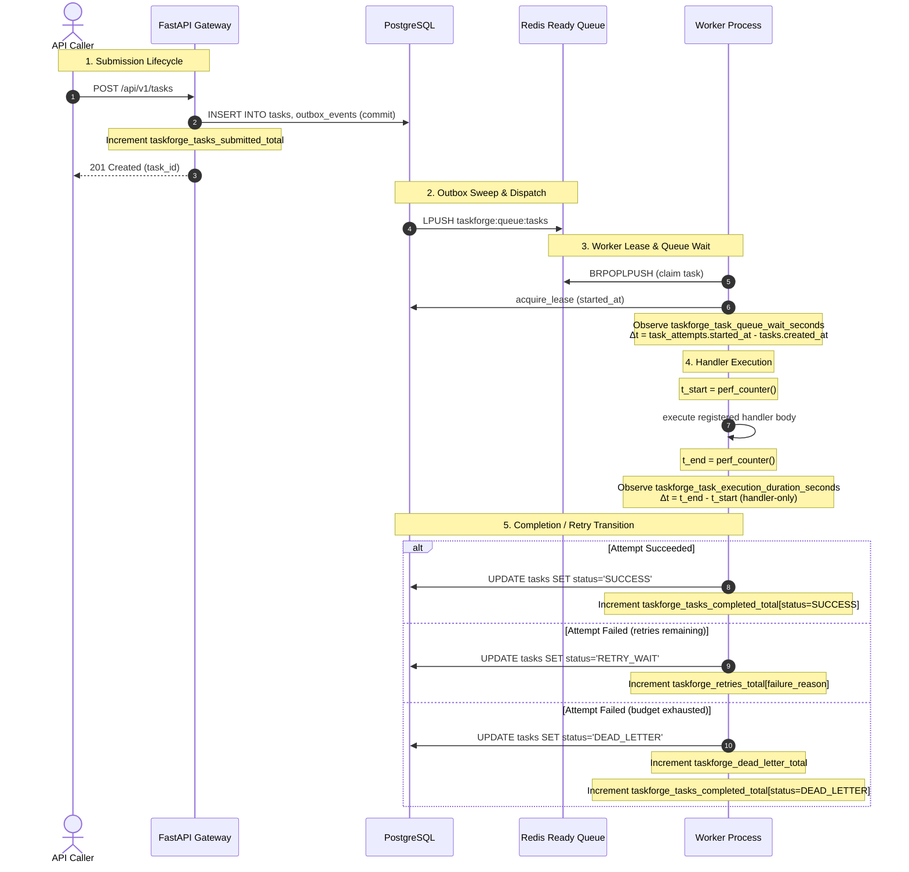

# G9.2.1 — Metrics & Observability Architecture Contract

## 1. Executive Summary & Purpose

Milestone G9.2 establishes end-to-end operational visibility into TaskForge runtime behavior without degrading throughput, leaking sensitive credentials, or introducing memory leaks via unbounded Prometheus label cardinality.

This contract provides an exact mathematical cardinality budget, locks metric names and types, defines lifecycle measurement semantics and timestamp boundaries, establishes timeout budgets for health checks, and guarantees telemetry failure isolation.

---

## 2. Cardinality Safety & Label Boundary Invariants

> [!CAUTION]
> **Strict Cardinality Invariant:**
> Under no circumstances may high-cardinality, dynamic, or security-sensitive values be attached as Prometheus metric labels.
> 
> **Explicitly Forbidden Labels:**
> * `task_id` (UUIDv4 — infinite cardinality)
> * `tenant_id` (customer identifier — unbounded cardinality, multi-tenant data leak)
> * `api_key_id` or `key_id` (credential metadata leak)
> * `worker_id` (ephemeral process/container identifiers — dynamic churn)
> * `exception_message` or `traceback` (arbitrary strings, potential secret/PII leak)
> * `trace_id` or `correlation_id` (per-request UUID — catastrophic TSDB cardinality explosion)

### 2.1 Authorized Finite Label Whitelists & Normalization Rules

Every metric label must adhere to a strict finite whitelist. Any runtime value not explicitly listed in the whitelist is mapped to the safe fallback value `"other"`:

1. **`task_type` (Max 6 values):**
   - Whitelist: `noop`, `compute_prime`, `io_simulation`, `failing`, `memory_intensive`
   - Fallback: `other` (any custom or unregistered task type)
2. **`priority` (Max 4 values):**
   - Whitelist: `critical`, `high`, `medium`, `low`
   - Normalization: Integer priorities are mapped deterministically (`3` $\to$ `critical`, `2` $\to$ `high`, `1` $\to$ `medium`, `0` $\to$ `low`)
3. **`status` (Max 4 terminal values):**
   - Whitelist: `SUCCESS`, `FAILED`, `CANCELLED`, `DEAD_LETTER`
4. **`http_method` (Max 2 values for API endpoints):**
   - Whitelist: `GET`, `POST`
   - Fallback: `other`
5. **`route` (Max 5 route templates):**
   - Whitelist: `/api/v1/tasks`, `/api/v1/tasks/{id}`, `/api/v1/operator/recover`, `/api/v1/operator/outbox-sweep`
   - Fallback: `other`
6. **`status_code_class` (Max 3 values):**
   - Whitelist: `2xx`, `4xx`, `5xx`
7. **`failure_reason` (Max 4 categories):**
   - Whitelist: `timeout`, `exception`, `circuit_breaker`
   - Fallback: `other`
8. **`initiator` (Max 2 values):**
   - Whitelist: `supervisor`, `operator`
9. **`pool_state` (Max 3 values):**
   - Whitelist: `checked_out`, `idle`, `overflow`

---

## 3. Mathematical Cardinality Budget

A Prometheus histogram produces $B + 3$ time-series per label combination (where $B$ is the number of explicit bucket thresholds, plus the implicit `+Inf` bucket, `_sum`, and `_count`).

To prevent cardinality explosion, `http_status` is explicitly excluded from the high-frequency API duration histogram and tracked separately in an API request counter with 3 status classes.

| # | Metric Name | Type | Label Dimensions | Label Combinations | Bucket Series / Multiplier | Max Series |
| :--- | :--- | :--- | :--- | :---: | :---: | :---: |
| 1 | `taskforge_tasks_submitted_total` | Counter | `task_type` (6) $\times$ `priority` (4) | 24 | 1 | **24** |
| 2 | `taskforge_task_queue_wait_seconds` | Histogram | `task_type` (6) $\times$ `priority` (4) | 24 | 11 ($8 + \text{Inf} + \text{sum} + \text{count}$) | **264** |
| 3 | `taskforge_task_execution_duration_seconds` | Histogram | `task_type` (6) | 6 | 11 ($8 + \text{Inf} + \text{sum} + \text{count}$) | **66** |
| 4 | `taskforge_tasks_completed_total` | Counter | `task_type` (6) $\times$ `status` (4) | 24 | 1 | **24** |
| 5 | `taskforge_retries_total` | Counter | `task_type` (6) $\times$ `failure_reason` (4) | 24 | 1 | **24** |
| 6 | `taskforge_dead_letter_total` | Counter | `task_type` (6) | 6 | 1 | **6** |
| 7 | `taskforge_queue_depth` | Gauge | `priority` (4) | 4 | 1 | **4** |
| 8 | `taskforge_outbox_pending_events` | Gauge | None | 1 | 1 | **1** |
| 9 | `taskforge_outbox_lag_seconds` | Gauge | None | 1 | 1 | **1** |
| 10 | `taskforge_lease_recoveries_total` | Counter | `initiator` (2) | 2 | 1 | **2** |
| 11 | `taskforge_api_request_duration_seconds` | Histogram | `http_method` (2) $\times$ `route` (5) | 10 | 10 ($7 + \text{Inf} + \text{sum} + \text{count}$) | **100** |
| 12 | `taskforge_api_requests_total` | Counter | `http_method` (2) $\times$ `route` (5) $\times$ `status_code_class` (3) | 30 | 1 | **30** |
| 13 | `taskforge_rate_limit_exceeded_total` | Counter | `route` (5) | 5 | 1 | **5** |
| 14 | `taskforge_active_workers` | Gauge | None | 1 | 1 | **1** |
| 15 | `taskforge_db_pool_connections` | Gauge | `pool_state` (3) | 3 | 1 | **3** |
| **TOTAL** | **Entire Application Metric Space** | — | — | — | — | **555** |

### Process Model & Multiprocess Accounting:
* Under standard single-process or containerized deployments where Prometheus scrapes each instance (or uses `prometheus_client` multiprocess directory mode), the global series budget across all 15 metrics is strictly bounded to a **maximum ceiling of 555 time-series**.

---

## 4. Lifecycle Event Semantics & Timestamp Definitions



### Detailed Metric Semantics:

1. **`taskforge_tasks_submitted_total`:**
   - **Trigger Event:** Executed inside `TaskRepository.create_task` immediately following the successful PostgreSQL transaction commit of `tasks` and `outbox_events`.
   - **Idempotency Guarantee:** If an idempotency key collision occurs and an existing task is returned (`CreateTaskResult(task, created=False)`), this counter is NOT incremented.
2. **`taskforge_task_queue_wait_seconds`:**
   - **Timestamp Formula:** $\Delta t = t_{\text{lease\_acquired}} - t_{\text{task\_created}}$
   - **Definition:** High-resolution difference between the timestamp when a worker successfully claims the task lease in PostgreSQL (`task_attempts.started_at`) and the original task persistence timestamp (`tasks.created_at`).
   - **Operational Purpose:** Answers whether queue backlog or outbox sweep latency is growing.
   - **Buckets:** `[0.01, 0.05, 0.1, 0.25, 0.5, 1.0, 2.5, 5.0, 15.0]` (8 explicit buckets). Normal behavior is $< 0.1$s; degraded behavior spans $1.0$s to $15.0$s.
3. **`taskforge_task_execution_duration_seconds`:**
   - **Timestamp Formula:** $\Delta t = t_{\text{handler\_exit}} - t_{\text{handler\_entry}}$
   - **Definition:** Pure user-handler execution time captured via monotonic clock (`time.perf_counter()`). Does NOT include database lease renewal, argument unpacking, or completion commit overhead. Full pipeline attempt duration remains recorded in `task_attempts.duration_ms`.
   - **Operational Purpose:** Isolates user code bottlenecks from framework overhead.
   - **Buckets:** `[0.005, 0.01, 0.05, 0.1, 0.5, 1.0, 5.0, 15.0]` (8 explicit buckets).
4. **`taskforge_tasks_completed_total`:**
   - **Trigger Event:** Recorded when a task transitions to any terminal state (`SUCCESS`, `FAILED`, `CANCELLED`, `DEAD_LETTER`).
   - **Constraint:** Does not count intermediate states (`RETRY_WAIT`, `RUNNING`, `QUEUED`).
5. **`taskforge_retries_total`:**
   - **Trigger Event:** Increment occurs when a failed execution attempt results in a transition to `RETRY_WAIT`. Does not increment on the initial task submission or upon eventual final abandonment.
6. **`taskforge_dead_letter_total`:**
   - **Trigger Event:** Increment occurs exactly once at the instant `retry_count >= max_retries` and the task transitions to `DEAD_LETTER`.
7. **`taskforge_queue_depth`:**
   - **Definition:** Strict count of ready task envelopes currently waiting in Redis priority lists (`taskforge:queue:tasks:critical`, `high`, `medium`, `low`). Does NOT include tasks in-flight/leased, delayed/scheduled tasks in the delay zset, or pending outbox rows in PostgreSQL.
8. **`taskforge_outbox_pending_events`:**
   - **Definition:** Instantaneous count of rows in PostgreSQL `outbox_events` with `status = 'PENDING'`.
9. **`taskforge_outbox_lag_seconds`:**
   - **Definition:** Age in seconds of the single oldest row in `outbox_events` with `status = 'PENDING'` relative to current database time (`now() - MIN(created_at)`). If zero rows are pending, the gauge is explicitly set to `0.0`.
10. **`taskforge_lease_recoveries_total`:**
    - **Trigger Event:** Increments whenever an expired worker lease is reclaimed and the task is restored to `QUEUED` or failed. Label `initiator` distinguishes automated dispatcher recovery (`supervisor`) from operator manual triggers (`operator`).
11. **`taskforge_active_workers`:**
    - **Definition:** Number of distinct worker processes with an active heartbeat key (`taskforge:heartbeats:*`) in Redis whose timestamp is within the last 10 seconds.
12. **`taskforge_db_pool_connections`:**
    - **Definition:** Sampled from SQLAlchemy engine connection pool status (`pool.checkedin()`, `pool.checkedout()`, `pool.overflow()`).

---

## 5. Gauge Refresh Mechanisms & Scrape Performance

To prevent database and Redis connection starvation from high-frequency Prometheus polling:
1. **On-Scrape Collector Pattern:** Telemetry gauges (`queue_depth`, `outbox_pending_events`, `outbox_lag_seconds`, `active_workers`, `db_pool_connections`) are collected on-demand inside a custom Prometheus collector registered with `prometheus_client.REGISTRY` during the `GET /metrics` scrape.
2. **Query Budget:** All gauge collection queries are limited to indexed lookups:
   - `SELECT count(id), EXTRACT(EPOCH FROM (now() - MIN(created_at))) FROM outbox_events WHERE status = 'PENDING';` (indexed on `ix_outbox_status_created`).
   - Redis `LLEN` / `ZCARD` / `KEYS` (O(1) operations).
3. **Execution Guard:** Scrape queries enforce a strict 500ms timeout. If a query times out, the previous gauge values are preserved and an internal error counter is incremented.

---

## 6. Health Check Contracts & Timeout Budgets

TaskForge exposes independent liveness and readiness endpoints:

### 6.1 Liveness Probe (`GET /health/live`)
* **Purpose:** Proves process event loop responsiveness to container orchestrators.
* **Dependencies:** None. Absolutely zero database queries or Redis commands.
* **Response:** Always HTTP 200:
  ```json
  {
    "status": "alive",
    "application": "TaskForge"
  }
  ```
* **Liveness Semantics:** If the Python asyncio event loop is deadlocked or running a runaway CPU loop, HTTP requests will not be processed and will time out at the orchestrator/load balancer level, triggering a container restart.

### 6.2 Readiness Probe (`GET /health/ready`)
* **Purpose:** Proves that the API instance has healthy connectivity to all downstream backing stores required to accept task ingestion.
* **Total Request Timeout Budget:** **1.0 second overall**.
  - Sub-budget for PostgreSQL: 500ms statement timeout.
  - Sub-budget for Redis: 500ms socket/command timeout.
* **Probing Implementation:**
  - PostgreSQL: `SELECT 1` executed with `options="-c statement_timeout=500"`.
  - Redis: `client.ping()` executed with `socket_timeout=0.5`.
* **Failure Responses (HTTP 503 Service Unavailable):**
  - If PostgreSQL is unreachable, times out, or rejects authentication: `database: "unavailable"`.
  - If Redis is unreachable or times out: `redis: "unavailable"`.
  - If either dependency fails, the endpoint returns HTTP `503 Service Unavailable`.
* **Security & Secret Masking:**
  - Under no circumstances will database URLs, credentials, hostnames, or raw exception tracebacks be emitted in the 503 response body. The response format is strictly sanitized:
  ```json
  {
    "status": "not_ready",
    "application": "TaskForge",
    "checks": {
      "database": "unavailable",
      "redis": "healthy"
    },
    "timestamp": "2026-11-10T14:00:00Z"
  }
  ```

---

## 7. Telemetry Failure Isolation Standard

> [!IMPORTANT]
> **Fault Isolation Invariant:**
> Telemetry collection, metric observation, and tracing MUST NEVER interfere with core task processing correctness.

1. **Non-Blocking Exception Handling:** Every Prometheus counter increment and histogram observation in application code must be enclosed in non-raising execution blocks or safe utility wrappers (`safe_increment`, `safe_observe`).
2. **Zero Secondary Failures:** If Prometheus metrics recording raises an exception (e.g. memory exhaustion, invalid label type), the exception is logged at `DEBUG` level and swallowed. The underlying task creation, lease claim, execution, or completion commit proceeds without interruption.
3. **No Distributed Transaction Binding:** Metrics updates are purely in-memory operations within the process. They must never participate in database transactions or hold row locks.
