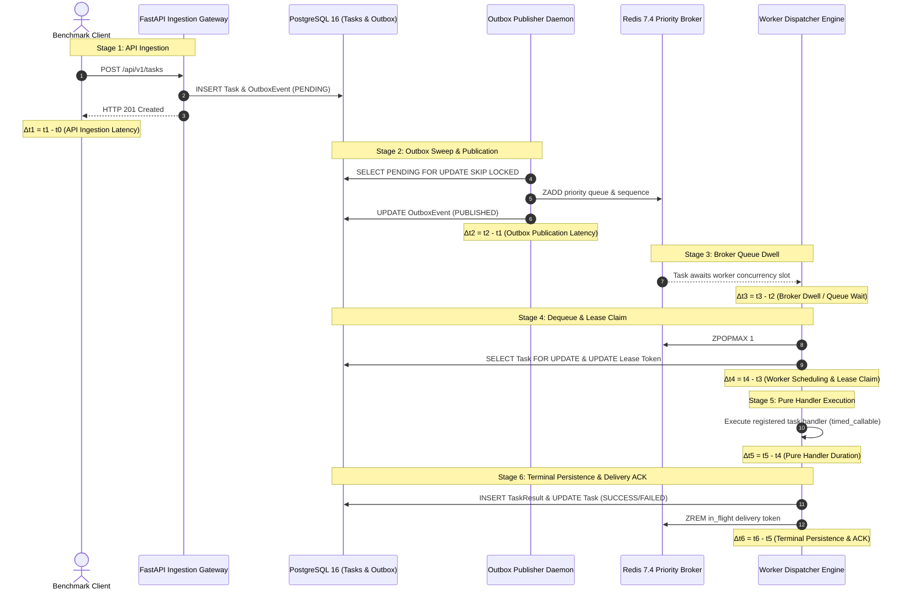
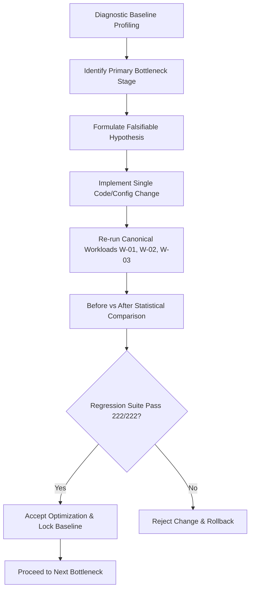
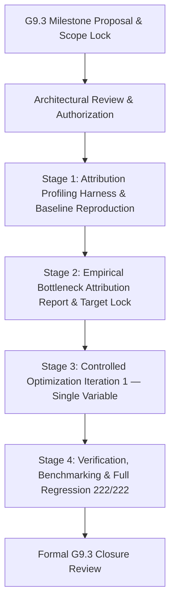

# Milestone G9.3 — Performance Profiling, Bottleneck Attribution & Controlled Optimization Proposal

**Milestone Identifier:** Gate G9.3  
**Status:** PROPOSED — PENDING ARCHITECTURAL REVIEW & AUTHORIZATION  
**Baseline Anchor:** `v0.8.0-phase8-freeze` (`da27047f56fe2eec75acdb8502f505542cf61202`)  
**Observability & Security Provenance:** Commit `ada0b9b`  
**Working Tree:** Clean  

---

## 1. Executive Summary & Purpose

Milestone G9.3 leverages the observability foundation established in Gate G9.2 (lifecycle metrics, single-flight gauge caching, bounded readiness probes, and outermost HTTP instrumentation) and the security controls locked in Gate G9.1 (API key auth, scope RBAC, sliding-window rate limiting) to **profile, attribute, and systematically optimize TaskForge processing performance**.

### Core Invariant:
> [!IMPORTANT]
> **No Speculative Optimization:**
> G9.3 strictly prohibits premature or speculative architectural refactoring. Every optimization must be preceded by empirical bottleneck attribution, governed by a hypothesis-driven experiment, executed in isolation (one variable at a time), and validated against frozen G9.0 baseline workloads with complete reliability and security regression proof.

---

## 2. G9.0 Baseline Reference & Workload Preservation

All performance evaluations in G9.3 are strictly calibrated against the frozen G9.0 baseline dataset and canonical workloads:

### 2.1 Frozen Workload Definitions (`benchmarks/scenarios/g90/workload_definitions.json`)

| Workload ID | Name | Task Handler | Concurrency | Task Count | Target Metric & Purpose |
| :--- | :--- | :--- | :--- | :--- | :--- |
| **W-01** | Baseline Noop Profiling | `noop` | 10 concurrent clients | 500 tasks (50 warmup) | Raw pipeline latency, outbox sweep rate, and broker dispatch overhead |
| **W-02** | CPU-Bound Prime Sieve | `compute_prime` ($n=1,000$) | 4 concurrent clients | 200 tasks (20 warmup) | Worker CPU contention, scheduling, and multi-thread threadpool dynamics |
| **W-03** | I/O Delay Simulation | `io_simulation` (5ms delay) | 10 concurrent clients | 200 tasks (20 warmup) | External latency resilience and worker throughput under waiting states |

### 2.2 Frozen G9.0 Baseline Performance Figures (`benchmarks/scenarios/g90/baseline_performance.json`)

| Metric | W-01 (Noop, 500 tasks, c=10) | W-02 (Compute, 200 tasks, c=4) | W-03 (I/O, 200 tasks, c=10) |
| :--- | :--- | :--- | :--- |
| **Throughput ($T$)** | **10.66 tasks/sec** | **7.53 tasks/sec** | **10.96 tasks/sec** |
| **Wall-Clock Duration** | 46.897 seconds | 26.558 seconds | 18.244 seconds |
| **API Latency ($L_{\text{submit}}$) [p50 / p95 / p99]** | 178.9ms / 368.1ms / 447.0ms | 49.4ms / 109.5ms / 132.8ms | 150.4ms / 293.5ms / 334.4ms |
| **Dispatch Delay ($D_{\text{dispatch}}$) [p50 / p95 / p99]** | **22,543.2ms** / 35,724.5ms / 36,399.0ms | **14,442.1ms** / 21,338.2ms / 23,528.4ms | **4,993.1ms** / 12,321.2ms / 14,403.1ms |
| **Execution Overhead ($O_{\text{exec}}$) [p50 / p95 / p99]** | 123.3ms / 344.9ms / 441.4ms | 45.1ms / 97.6ms / 128.8ms | 126.8ms / 296.9ms / 329.9ms |
| **End-to-End Latency ($L_{\text{e2e}}$) [p50 / p95 / p99]** | 22,823.5ms / 36,216.7ms / 36,939.5ms | 14,540.2ms / 21,425.4ms / 23,623.4ms | 5,271.1ms / 12,591.4ms / 14,711.5ms |

### Key Baseline Observation:
In burst workload W-01, **Broker Dispatch Delay accounts for >95% of total end-to-end latency** (median 22.5s out of 22.8s). G9.3 will attribute and dissect this composite delay into its discrete component stages.

---

## 3. Bottleneck Attribution Architecture (Six-Stage Dissection)

To isolate performance bottlenecks definitively, the pipeline is instrumented across six non-overlapping, contiguous stages:

### Stage Definitions & Attribution Formulas:

1. **Stage 1 — API Ingestion Latency ($\Delta t_1 = t_1 - t_0$):**
   - HTTP transport wire time + Starlette middleware chain (`PrometheusHttpMiddleware` $\rightarrow$ `RateLimitMiddleware` $\rightarrow$ `CorrelationIdMiddleware`) + Pydantic schema validation + DB transaction inserting `Task` and `OutboxEvent` (`status = 'PENDING'`).
2. **Stage 2 — Outbox Sweep & Publication Latency ($\Delta t_2 = t_2 - t_1$):**
   - Delay between outbox row commit and `OutboxPublisherWorker` polling cycle + `SELECT FOR UPDATE SKIP LOCKED` + Redis `ZADD` enqueue + outbox status update to `PUBLISHED`.
3. **Stage 3 — Broker Queue Dwell / Queue Wait ($\Delta t_3 = t_3 - t_2$):**
   - Time the enqueued task spends waiting in Redis priority sorted set until a worker thread becomes available. (Measured via `taskforge_task_queue_wait_seconds`).
4. **Stage 4 — Worker Scheduling & Lease Acquisition ($\Delta t_4 = t_4 - t_3$):**
   - Worker thread assignment + PostgreSQL `SELECT ... FOR UPDATE` row lock + 64-bit cryptographic random lease token generation + commit of `RUNNING` status and `TaskAttempt` row.
5. **Stage 5 — Pure Handler Execution Duration ($\Delta t_5 = t_5 - t_4$):**
   - Exclusive execution time of the target Python task function, measured via `timed_callable` wrapper without executor submission or lease acquisition overhead. (Measured via `taskforge_task_execution_duration_seconds`).
6. **Stage 6 — Terminal Persistence & Delivery ACK ($\Delta t_6 = t_6 - t_5$):**
   - Serialization and commit of `TaskResult` + state transition to `SUCCESS` / `FAILED` in PostgreSQL + Redis `ZREM` ACK on `taskforge:in_flight`.

---

## 4. Continuous Measurement & Profiling Harness Improvements

To monitor infrastructure health during benchmarks, G9.3 introduces continuous time-series telemetry sampling (sampled every 250ms into a dedicated run telemetry stream):

1. **Broker Queue Depth over Time:** High-resolution sampling of `taskforge_queue_depth{priority="..."}` via $O(\log N)$ `ZCOUNT` across all 4 tiers.
2. **Outbox Event Backlog & Lag:** Continuous sampling of `outbox_pending_events` and `outbox_lag_seconds`.
3. **Publisher Batching Throughput:** Empirical measurement of outbox events published per second and publisher cycle duration.
4. **Worker Dispatcher Utilization:** Ratio of active worker futures to concurrency ceiling ($\text{active\_tasks} / \text{concurrency}$).
5. **Application Database Pool Contention:** Direct in-memory sampling of `engine.pool.checkedout()`, `idle()`, and `overflow()`.
6. **Microsecond Timestamp Tracking:** Per-task recording of timestamps $t_0, t_1, t_2, t_3, t_4, t_5, t_6$ in streaming JSONL run logs.

---

## 5. Controlled Optimization Methodology (One Change Per Experiment)

Optimizations will be evaluated sequentially under strict single-variable experimental control:

### Suspected Bottleneck Candidates for Investigation:
1. **Candidate A (Outbox Polling Batching & Pacing):**
   - *Investigation:* `OutboxPublisherWorker` polls every 200ms with a fixed batch limit of 50. In a 500-task burst, this artificially forces $\ge 10$ sequential poll cycles and individual non-pipelined Redis `ZADD` round-trips.
   - *Hypothesis:* Adaptive polling (immediate drain when batch is full) and pipelined Redis publishing will reduce Stage 2 latency without overloading the broker.
2. **Candidate B (Worker Dispatcher Queue Polling & Batch Dequeue):**
   - *Investigation:* `WorkerDispatcher._dispatch_loop` pulls one task at a time via `ZPOPMAX queue 1` with a 100ms sleep on empty.
   - *Hypothesis:* Multiplexed or batch dequeue when multiple worker slots are idle will reduce Stage 3 queue dwell under burst arrivals.
3. **Candidate C (Database Transaction & Connection Holding Times):**
   - *Investigation:* Analyze whether task attempts hold database connections during handler execution.
   - *Hypothesis:* In-memory connection release during I/O delays or handler execution (where safe) prevents pool starvation during high concurrency.

---

## 6. Reliability & Security Guardrails (Non-Negotiable Invariants)

Every proposed optimization candidate must maintain absolute conformance to the established TaskForge contracts:
1. **Lease Fencing Invariant:** Mutual exclusion remains governed strictly by 64-bit cryptographic random lease tokens committed in PostgreSQL under row-level locks. No optimization may weaken lease verification.
2. **Terminal Transition Idempotency:** Terminal transitions (`SUCCESS`, `FAILED`, `CANCELLED`, `DEAD_LETTER`) must remain idempotent.
3. **At-Least-Once Delivery & Outbox Reliability:** No task may be lost, skipped, or orphaned.
4. **Security & Tenant Isolation:** API key authentication, scope RBAC, sliding-window rate limiting, and tenant authorization checks must remain fully enforced.
5. **Telemetry Cardinality Budget:** The Prometheus registry must strictly adhere to the accepted **662 base series / 855 total series** budget.
6. **Telemetry Failure Isolation:** Metric errors must never interrupt core task execution.
7. **Regression Suite Integrity:** All 222 repository-wide tests must pass with 0 failures and 0 skips after every candidate evaluation.

---

## 7. Acceptance Criteria Framework

Following the principle of establishing measurement validity before declaring optimization targets:

### Step 1: Measurement & Attribution Validity Acceptance
- **AC-9.3.1 (Telemetry Attribution Fidelity):** The profiling harness accurately captures all six stage timestamps ($t_0$ through $t_6$) for 100% of tasks in W-01, W-02, and W-03 with zero missing timestamps.
- **AC-9.3.2 (Baseline Reproduction):** Re-running W-01, W-02, and W-03 on the current post-G9.2 baseline (`ada0b9b`) reproduces the G9.0 baseline within expected variance ($\pm 10\%$) while fully observing all G9.2 Prometheus metrics.
- **AC-9.3.3 (Stage Breakdown Accountability):** Total end-to-end latency equals the sum of the attributed stages ($\sum \Delta t_i \approx L_{\text{e2e}}$) with $< 2\%$ unaccounted residual.

### Step 2: Bottleneck Identification & Attribution Acceptance
- **AC-9.3.4 (Quantified Bottleneck Identification):** Provide an empirical attribution report establishing the exact percentage contribution of each of the six stages to total latency under W-01, W-02, and W-03.
- **AC-9.3.5 (Formal Optimization Target Lock):** Based on the empirical breakdown, formulate defensible, measurable optimization hypotheses and targets for review before code changes are executed.

### Step 3: Controlled Optimization Acceptance
- **AC-9.3.6 (Statistically Significant Improvement):** The accepted optimization demonstrates a statistically significant improvement in throughput ($T$) or tail latency ($p95/p99$) over baseline across a minimum of 3 consecutive runs.
- **AC-9.3.7 (Zero Regression Invariant):** 100% pass rate across the full 222-test repository regression suite, with zero regressions in lease fencing, idempotency, security, or Prometheus cardinality.

---

## 8. Reproducibility & Provenance Standard

- **Host Environment:** Windows 11 Professional (AMD64), 12 logical cores, 16 GB RAM.
- **Runtimes:** Python 3.12.10 AMD64 (`.venv`), PostgreSQL 16.15 (port 5432), Redis 7.4.12 (port 6379).
- **Git Provenance Anchor:** Commit `ada0b9b` on branch `phase-9-hardening`.
- **Workload Definition Integrity:** SHA-256 hash of `workload_definitions.json` validated prior to each run.
- **Raw Data Provenance:** Every benchmark trial streams raw per-task records to timestamped JSONL files with corresponding SHA-256 checksums recorded in the benchmark scenario output.
- **Warmup Rigor:** Minimum 50 warmup tasks executed before recorded measurement in every trial.

---

## 9. Implementation Sequence & Staging Plan

