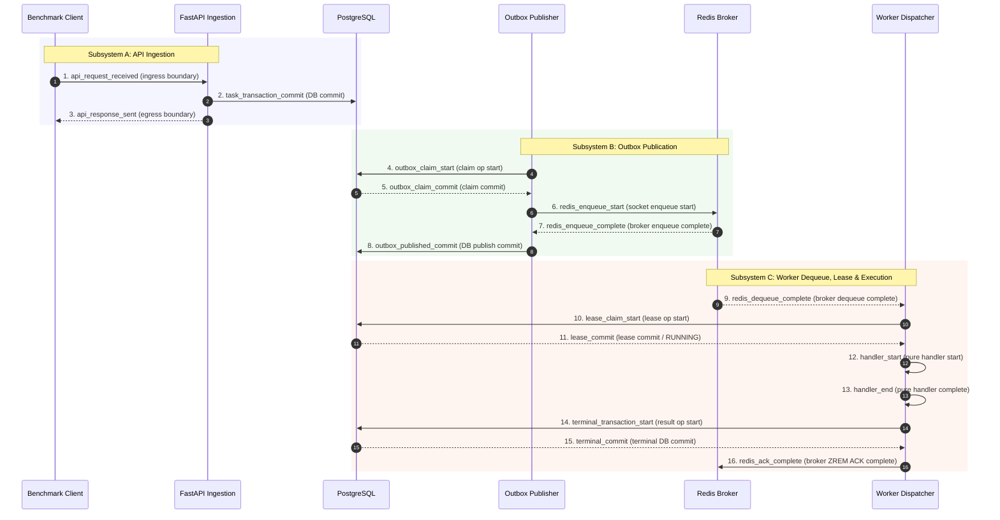

# Milestone G9.3 — 16-Event Lifecycle Attribution Contract & Performance Profiling Architecture

**Milestone Identifier:** Gate G9.3  
**Status:** AMENDED CONTRACT — FORMALLY AUTHORIZED FOR STAGE 1B IMPLEMENTATION  
**Baseline Anchor:** `v0.8.0-phase8-freeze` (`da27047f56fe2eec75acdb8502f505542cf61202`)  
**Observability & Security Provenance:** Commit `ada0b9b`  
**Controlled Baseline Reference:** Stage 1A-R Reconciliation (`benchmarks/scenarios/g93/stage1a_r_report.json`)  
**Working Tree:** Clean  

---

## 1. Executive Summary & Purpose

Milestone G9.3 leverages the observability foundation established in Gate G9.2 (lifecycle metrics, single-flight gauge caching, bounded readiness probes, and outermost HTTP instrumentation) and the security controls locked in Gate G9.1 (API key auth, scope RBAC, sliding-window rate limiting) to **profile, attribute, and systematically optimize TaskForge processing performance**.

### Core Invariant:
> [!IMPORTANT]
> **No Speculative Optimization:**
> G9.3 strictly prohibits premature or speculative architectural refactoring. Every optimization must be preceded by empirical bottleneck attribution, governed by a hypothesis-driven experiment, executed in isolation (one variable at a time), and validated against frozen G9.0 baseline workloads with complete reliability and security regression proof.

---

## 2. Workload Definitions & Reference Baselines

All performance evaluations in G9.3 are strictly calibrated against the frozen G9.0 baseline dataset and canonical workloads:

### 2.1 Frozen Workload Definitions (`benchmarks/scenarios/g90/workload_definitions.json`)
- **File SHA-256:** `04f2306538868a41514c19f0958e04bf0b0586b3a83989e115231a32e50f0110` (created in commit `1e32386`, unmodified).

| Workload ID | Name | Task Handler | Concurrency | Task Count | Target Metric & Purpose |
| :--- | :--- | :--- | :--- | :--- | :--- |
| **W-01** | Baseline Noop Profiling | `noop` | 10 concurrent clients | 500 tasks (50 warmup) | Pipeline latency, outbox sweep rate, and broker dispatch overhead |
| **W-02** | CPU-Bound Prime Sieve | `compute_prime` ($n=1,000$) | 4 concurrent clients | 200 tasks (20 warmup) | Worker CPU contention, scheduling, and multi-thread threadpool dynamics |
| **W-03** | I/O Delay Simulation | `io_simulation` (5ms delay) | 10 concurrent clients | 200 tasks (20 warmup) | External latency resilience and worker throughput under waiting states |

### 2.2 Historical G9.0 Baseline Figures (`benchmarks/scenarios/g90/baseline_performance.json`)

| Metric | W-01 (Noop, 500 tasks, c=10) | W-02 (Compute, 200 tasks, c=4) | W-03 (I/O, 200 tasks, c=10) |
| :--- | :--- | :--- | :--- |
| **Throughput ($T$)** | **10.66 tasks/sec** | **7.53 tasks/sec** | **10.96 tasks/sec** |
| **Wall-Clock Duration** | 46.897 seconds | 26.558 seconds | 18.244 seconds |
| **API Latency ($L_{\text{submit}}$) [p50 / p95 / p99]** | 178.9ms / 368.1ms / 447.0ms | 49.4ms / 109.5ms / 132.8ms | 150.4ms / 293.5ms / 334.4ms |
| **Dispatch Delay ($D_{\text{dispatch}}$) [p50 / p95 / p99]** | **22,543.2ms** / 35,724.5ms / 36,399.0ms | **14,442.1ms** / 21,338.2ms / 23,528.4ms | **4,993.1ms** / 12,321.2ms / 14,403.1ms |
| **Execution Overhead ($O_{\text{exec}}$) [p50 / p95 / p99]** | 123.3ms / 344.9ms / 441.4ms | 45.1ms / 97.6ms / 128.8ms | 126.8ms / 296.9ms / 329.9ms |
| **End-to-End Latency ($L_{\text{e2e}}$) [p50 / p95 / p99]** | 22,823.5ms / 36,216.7ms / 36,939.5ms | 14,540.2ms / 21,425.4ms / 23,623.4ms | 5,271.1ms / 12,591.4ms / 14,711.5ms |

### 2.3 Stage 1A-R Reconciled Reference Baseline (`stage1a_r_report.json`)
Executed across 6 paired alternating trials with clean database isolation between runs:
- **W-01 (noop):** Duration mean = $33.01\,\text{s}$, Throughput mean = $15.24\,\text{TPS}$, Exec $p50$ mean = $129.57\,\text{ms}$.
- **W-02 (prime $n=1000$):** Duration mean = $29.75\,\text{s}$, Throughput mean = $7.07\,\text{TPS}$, Exec $p50$ mean = $45.66\,\text{ms}$ ($\Delta = +0.57\,\text{ms}$ vs G9.0).
- **W-03 (I/O 5ms):** Duration mean = $14.13\,\text{s}$, Throughput mean = $14.39\,\text{TPS}$, Exec $p50$ mean = $125.52\,\text{ms}$ ($\Delta = -1.26\,\text{ms}$ vs G9.0).

*Reconciliation Note:* G9.0 remains the immutable historical benchmark. Stage 1A-R establishes the controlled experimental reference under isolated table resets. Throughput differences reflect database table isolation and polling phase alignment, not application optimizations.

---

## 3. The 16-Event Lifecycle Attribution Contract

To overcome the structural deficiencies of contiguous stage summation ($\sum \Delta t_i = L_{\text{e2e}}$) and avoid conflating database transactions with broker operations, Stage 1B formally establishes the **16-Event Lifecycle Attribution Contract**.

### 3.1 Formal 16-Event Specification

| # | Event Name | Subsystem | Semantic Boundary Type | Exact Definition & Location |
| :-: | :--- | :--- | :--- | :--- |
| **1** | `api_request_received` | API | **Application-observed response boundary** | Starlette ASGI middleware entry timestamp immediately upon receiving request headers. |
| **2** | `task_transaction_commit` | API | **Transaction commit completion** | Timestamp captured immediately after `db.commit()` returns for the ingestion transaction inserting `Task` and `OutboxEvent`. |
| **3** | `api_response_sent` | API | **Application-observed response boundary** | Starlette ASGI middleware exit timestamp immediately after response stream consumption. |
| **4** | `outbox_claim_start` | Outbox | **Operation start** | Timestamp immediately before executing `SELECT ... FOR UPDATE SKIP LOCKED` on `outbox_events`. |
| **5** | `outbox_claim_commit` | Outbox | **Transaction commit completion** | Timestamp immediately after batch claim lock is committed in PostgreSQL. |
| **6** | `redis_enqueue_start` | Outbox | **Operation start** | Client socket boundary timestamp immediately before dispatching Redis `ZADD` command. |
| **7** | `redis_enqueue_complete` | Outbox | **Operation completion** | Client socket boundary timestamp immediately after Redis `ZADD` command successfully returns. |
| **8** | `outbox_published_commit` | Outbox | **Transaction commit completion** | Timestamp immediately after `UPDATE outbox_events SET status = 'PUBLISHED'` transaction commit returns. |
| **9** | `redis_dequeue_complete` | Worker | **Operation completion** | Client socket boundary timestamp immediately after Redis `ZPOPMAX` / `evalsha` dequeue command returns an item. |
| **10** | `lease_claim_start` | Worker | **Operation start** | Timestamp immediately before executing worker lease acquisition query (`SELECT Task FOR UPDATE`). |
| **11** | `lease_commit` | Worker | **Transaction commit completion** | Timestamp immediately after lease is acquired, lease token persisted, and `RUNNING` status commit returns. |
| **12** | `handler_start` | Worker | **Operation start** | In-process monotonic timestamp immediately before target task handler function invocation. |
| **13** | `handler_end` | Worker | **Operation completion** | In-process monotonic timestamp immediately after target task handler function invocation returns. |
| **14** | `terminal_transaction_start` | Worker | **Operation start** | Timestamp immediately before opening transaction to persist `TaskResult` and terminal `Task` state. |
| **15** | `terminal_commit` | Worker | **Transaction commit completion** | Timestamp immediately after terminal transaction commit returns in PostgreSQL. |
| **16** | `redis_ack_complete` | Worker | **Operation completion** | Client socket boundary timestamp immediately after Redis `ZREM` delivery acknowledgement returns. |

---

## 4. Process Topology & Clock Domain Strategy

### 4.1 Process Topology & Clock Source Declaration

| Component | Execution Topology & Identity | Host Environment | Clock Source | Clock Resolution & Characteristics |
| :--- | :--- | :--- | :--- | :--- |
| **FastAPI Ingestion** | Primary process / TestClient runner (PID $P_{\text{bench}}$) | Windows 11 Host | `time.perf_counter_ns()` + `time.time()` | Nanosecond monotonic + Host UTC epoch |
| **Outbox Publisher** | Background daemon thread within $P_{\text{bench}}$ | Windows 11 Host | `time.perf_counter_ns()` + `time.time()` | Shares host clock with API; zero cross-host skew |
| **Worker Dispatcher** | Worker dispatcher & thread pool within $P_{\text{bench}}$ | Windows 11 Host | `time.perf_counter_ns()` + `time.time()` | Shares host clock with API; zero cross-host skew |
| **Redis 7.4 Broker** | Docker container (`localhost:6379`) | Local Docker Linux VM | **Client-side host socket boundaries** | Measured strictly via Python host clock at call boundaries |
| **PostgreSQL 16 DB** | Docker container (`localhost:5432`) | Local Docker Linux VM | **Host-observed commit returns** | Monotonic timestamps captured immediately after DB commit returns |

### 4.2 Clock Domain Synchronization & Uncertainty Guardrails
- **PostgreSQL Offset Characterization:** The Stage 1A-R empirical probe demonstrated an observed offset of $-0.422 \pm 0.211\,\text{ms}$ with mean RTT of $0.281\,\text{ms}$. While tight, this observed range is not treated as a guaranteed global bound.
- **Client-Side Commit Observation:** All database event timestamps are captured on the host immediately after the SQLAlchemy/Psycopg commit call returns. This provides application-observed completion timestamps and eliminates dependency on container clock synchronization.
- **Micro-Interval Guard ($< 5\,\text{ms}$):** In-process intervals (such as handler execution $T_{\text{handler-exec}}$) are measured exclusively with monotonic nanosecond precision (`time.perf_counter_ns()`). No cross-process or cross-system clock correlation will be asserted for intervals smaller than $5\,\text{ms}$.

---

## 5. Non-Contiguous Interval Attribution & Anomaly Preservation

The attribution engine computes discrete intervals without assuming stage contiguity or clamping values to zero:

### 5.1 Primary Attribution Intervals
1. **$T_{\text{api-server}} = t_{\text{task-transaction-commit}} - t_{\text{api-request-received}}$:** Server-side ingestion duration.
2. **$T_{\text{outbox-lag}} = t_{\text{outbox-claim-start}} - t_{\text{task-transaction-commit}}$:** Outbox backlog residence.
   - *Visibility Invariant:* If an outbox claim cycle begins before a newly committed task row becomes visible in the snapshot, this is recorded as a *not-yet-eligible batch cycle*, not clamped to zero.
3. **$T_{\text{outbox-claim}} = t_{\text{outbox-claim-commit}} - t_{\text{outbox-claim-start}}$:** Outbox batch lock & claim transaction time.
4. **$T_{\text{redis-enq}} = t_{\text{redis-enqueue-complete}} - t_{\text{redis-enqueue-start}}$:** Network round-trip duration for Redis `ZADD`.
5. **$T_{\text{outbox-commit}} = t_{\text{outbox-published-commit}} - t_{\text{redis-enqueue-complete}}$:** Duration to commit `PUBLISHED` status in PostgreSQL.
6. **$T_{\text{broker-dwell}} = t_{\text{redis-dequeue-complete}} - t_{\text{redis-enqueue-complete}}$:** Client-observed broker dwell estimate.
7. **$T_{\text{worker-lease}} = t_{\text{lease-commit}} - t_{\text{lease-claim-start}}$:** Lease acquisition transaction duration in PostgreSQL.
8. **$T_{\text{handler-exec}} = t_{\text{handler-end}} - t_{\text{handler-start}}$:** Pure in-process task handler execution.
9. **$T_{\text{terminal-persist}} = t_{\text{terminal-commit}} - t_{\text{terminal-transaction-start}}$:** Terminal result and state commit duration.
10. **$T_{\text{redis-ack}} = t_{\text{redis-ack-complete}} - t_{\text{terminal-commit}}$:** Broker delivery acknowledgement (`ZREM`) round-trip.

### 5.2 Negative-Interval & Overlap Handling Invariants
- **Preservation of Raw Timestamps:** Raw timestamps are permanently preserved in the raw JSONL records without synthetic modification.
- **Client-Observed Broker Dwell Anomaly Accounting:** Due to client-side scheduling between Redis command completion and Python timestamp capture, apparent negative intervals ($t_{\text{redis-dequeue-complete}} < t_{\text{redis-enqueue-complete}}$) can theoretically occur. The attribution report will:
  1. Never clamp negative intervals to zero.
  2. Report negative observations in a dedicated anomaly vector.
  3. Quantify their exact frequency and magnitude.
  4. Designate this interval strictly as the *client-observed broker dwell estimate*.
- **Publication / Dequeue Race Overlap:** In high-throughput bursts, a worker may dequeue an item from Redis before the outbox publisher commits `status = 'PUBLISHED'` in PostgreSQL:
  $$\Delta t_{\text{overlap}} = \max\left(0.0, t_{\text{outbox-published-commit}} - t_{\text{redis-dequeue-complete}}\right)$$
  The attribution report will explicitly quantify the frequency and duration of this concurrency overlap.
- **Non-Additive Percentiles:** Individual stage percentiles ($p50, p95, p99$) will never be summed to estimate total latency. Total end-to-end latency percentiles will be computed directly from the true per-task end-to-end sample distribution.

---

## 6. Sampling Overhead Findings & Stage 1B Overhead Commitment

### 6.1 Stage 1A-R Accepted Overhead Conclusion
- **Finding:** No material handler-execution overhead was observed in the sampling-enabled trials ($\le 3.12\%$ variance across all workloads).
- **Qualification:** Because total-system wall-clock duration in W-02 and W-03 exhibited natural run-to-run dispersion (RSD 16%–30%) driven by outbox batch polling phase alignment, the Stage 1A-R data does not prove a sub-0.5% total-system overhead guarantee.
- **Commitment:** Stage 1B diagnostic profiling overhead will be independently measured and reported across baseline (profiling disabled) and instrumented (profiling enabled) runs.

---

## 7. Stage 1B Implementation Boundaries & Scope Lock

### 7.1 Permitted Scope
- Capture all 16 lifecycle events around existing operations.
- Use host monotonic timestamps (`time.perf_counter_ns()`) for durations.
- Capture UTC timestamps (`time.time()`) for external correlation.
- Stream diagnostic events to separate JSONL benchmark artifacts in `benchmarks/raw/g93/`.
- Generate per-task interval distributions, timestamp completeness audits, and negative/overlap reports.
- Run W-01, W-02 ($n=1,000$), and W-03 against reconciled workload definitions.
- Measure and report profiling harness overhead.

### 7.2 Prohibited Scope
- **No changes to production `src/` core algorithms:** Zero alterations to lease acquisition, token generation, renewal, or fencing logic.
- **No changes to state machines or retry behavior:** Terminal transitions, retry backoffs, and idempotency guards remain completely unaltered.
- **No changes to outbox semantics:** Outbox transaction boundaries, batching rules, and publishing logic remain unchanged.
- **No changes to queue mechanics:** Redis priority scoring, queue ordering, and dequeue semantics remain untouched.
- **No synchronous diagnostic database writes:** Profiling timestamps must never be written to application database tables on the critical path.
- **No Prometheus metric cardinality expansion:** Existing Prometheus metrics retain their G9.2 definitions; no dynamic task IDs or unbounded labels permitted.
- **No speculative optimizations:** Optimization code is strictly forbidden until the Stage 1B attribution report is reviewed and target-lock authorization is granted.

---

## 8. Required Stage 1B Deliverables

Upon completion of the Stage 1B profiling run, the following evidence will be submitted:
1. Final event schema and clock-domain verification.
2. Raw JSONL artifacts with per-run SHA-256 hashes.
3. Timestamp completeness report ($100\%$ capture rate across all 16 events).
4. Negative-interval and concurrency overlap analysis.
5. Stage-specific $p50 / p95 / p99$ distributions for all 10 discrete intervals.
6. Per-workload end-to-end distributions calculated directly from per-task samples.
7. Profiling overhead measurement (profiling enabled vs disabled).
8. Full regression verification (222 / 222 repository tests passing).
9. Empirical bottleneck attribution report ranking the primary delay stages.
10. Falsifiable optimization hypothesis for Stage 2 target lock review.
