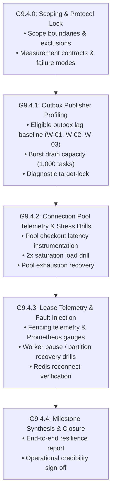

# Gate G9.4 — Operational Resilience & Reliability Hardening: Scoping & Measurement Contract

**Milestone:** Gate G9.4 — Operational Resilience & Reliability Hardening (Scoping & Protocol Design)  
**Author:** TaskForge Platform Hardening Team  
**Date:** 2026-11-11  
**Status:** Scoping Proposal Submitted for Architectural Review  
**Authorized Production Base Commit:** `a89858b73f8488e05cbcc2393a61f3080ffc7a38`  
**G9.3 Closure Commit:** `9422505`  
**Frozen Baseline Tag:** `v0.8.0-phase8-freeze` (`da27047f56fe2eec75acdb8502f505542cf61202`)  
**Workload Definitions Hash (SHA-256):** `04f2306538868a41514c19f0958e04bf0b0586b3a83989e115231a32e50f0110`  
**Scope Boundary:** Strictly Scoping & Measurement Contract Design. Zero production source-code modifications. Zero connection-pool modifications. Zero outbox publisher semantic changes. Zero modification to retry, lease, fencing, or delivery semantics.

---

## 1. Executive Summary & Objective

With the formal closure of Gate G9.3, TaskForge's dispatcher scheduling efficiency is hardened, with polling sleep lag reduced by $95\% - 99\%$, queue starvation reduced by $86\% - 94\%$, and batch dequeue formally rejected for the production envelope ($c \le 10$).

Gate G9.4 shifts focus to **Operational Resilience & Reliability Hardening** under dependency stress, burst backlog, and resource constraints. G9.3 diagnostic profiling isolated two critical upstream and infrastructural bottlenecks:
1. **Outbox Publisher Throughput & Cadence:** Eligible outbox lag ($T_{\text{outbox-lag}} = 71.78 - 145.13\,\text{ms}$) introduces measurable dwell before tasks reach Redis, driven by fixed publisher polling cadence ($100\,\text{ms}$) and batch-claim database operations.
2. **Database Connection-Pool Resilience:** Under concurrent ingestion and worker execution, database connection acquisition contention bounds throughput and poses pool-exhaustion risks during dependency degradation.
3. **Advanced Lease Telemetry:** Worker ownership transitions, renewal latency, and fencing token validation currently lack fine-grained Prometheus instrumentation.

This document establishes the formal G9.4 scope, failure-mode taxonomy, measurement contract, and acceptance criteria prior to any implementation.

---

## 2. Scope Boundaries & Explicit Non-Goals

### 2.1 Permitted Workstreams (Staged Evaluation):
1. **Target 1 — Outbox Publisher Cadence & Throughput Profiling:**
   - Measure publisher claim cycle latency, batch claim throughput, and polling sleep delay under sustained burst ingestion.
   - Evaluate event-driven outbox notification or adaptive cadence mechanisms in an isolated experimental harness.
2. **Target 2 — Database Connection-Pool Resilience:**
   - Instrument SQLAlchemy / Psycopg connection-pool checkout latency, active connection occupancy, and queue saturation.
   - Establish failure-injection drills simulating connection starvation, transient DB stall, and pool exhaustion.
3. **Target 3 — Advanced Lease & Fencing Telemetry:**
   - Implement Prometheus metrics exposing active leases, lease renewal latency, stale worker fencing rejections, and recovery cycle durations.

### 2.2 Explicit Exclusions & Non-Goals:
- **No Production Code Changes During Scoping:** Production remains locked at `a89858b`.
- **No Modification of Authoritative State:** PostgreSQL remains the sole source of truth for task state and lease ownership.
- **No Relaxation of Lease Fencing:** Fencing tokens and heartbeat expirations remain strictly enforced.
- **No Unmeasured Changes to Polling Cadence:** Outbox publisher polling interval remains $0.1\,\text{s}$ in production until empirically justified by a dedicated campaign.
- **No Multi-Region Distributed Consensus:** Cross-datacenter consensus remains out of scope.

---

## 3. Failure-Mode & Operational Resilience Analysis

| Failure Mode | Component | Trigger Condition | Architectural Vulnerability | Target Mitigation & Verification |
| :--- | :--- | :--- | :--- | :--- |
| **F-01: Outbox Ingestion Backlog** | Outbox Publisher | Ingestion burst (e.g. 500 tasks in 1s) exceeds publisher drain rate ($50\,\text{tasks/batch}$, $100\,\text{ms}$ sleep) | Outbox backlog accumulates; tasks experience multi-second outbox dwell before broker insertion | Measure batch claim throughput; evaluate adaptive polling / notification signal |
| **F-02: Connection Pool Exhaustion** | Database Engine | Concurrent API requests ($> 10$) + worker lease transactions exceed pool limit (`pool_size=5, max_overflow=10`) | `TimeoutError: QueuePool limit exceeded`; API returns 500 or worker thread blocks | Measure pool checkout wait times; test backpressure / circuit breaking under saturation |
| **F-03: Stale Worker Fencing Race** | Worker Lease Manager | Network stall causes worker heartbeat to expire; replacement worker claims task; original worker resumes | Stale worker commits results or ACKs delivery after lease lost | Enforce fencing token check in PostgreSQL commit; verify zero duplicate commits under partition |
| **F-04: Redis Transient Disconnect** | Broker Driver | Redis network hiccup or restart during active dequeue/ack | Dispatcher loop crashes or enters unhandled exception loop | Verify exponential backoff reconnect loop; zero lost deliveries; unacked tasks recovered by PostgreSQL |
| **F-05: Database Transient Degradation** | Persistence Layer | Slow query or locking contention delays task commit return | Thread pool blocked on DB commit; in-flight tasks exceed timeout | Verify lease timeout fencing and graceful degradation with circuit breaking |

---

## 4. Measurement Methodology & Metrics Contract

### 4.1 Outbox Publisher Metrics
1. **Outbox Claim Latency ($T_{\text{outbox-claim}}$):**
   Duration of `SELECT id, payload FROM outbox_events WHERE status = 'PENDING' ORDER BY created_at FOR UPDATE SKIP LOCKED LIMIT :batch_size`.
2. **Outbox Eligible Lag ($T_{\text{outbox-lag}}$):**
   Interval from `task_transaction_commit` to `outbox_claim_start`.
3. **Outbox Publication Throughput ($R_{\text{outbox}}$):**
   Tasks claimed and enqueued per second during backlog drain.
4. **Publisher Idle vs Active Duty ($U_{\text{pub}}$):**
   Ratio of time spent claiming/publishing versus sleeping in poll interval.

### 4.2 Connection Pool Telemetry
1. **Pool Checkout Wait Time ($T_{\text{pool-checkout}}$):**
   Histogram measuring time spent waiting to acquire a connection from `SessionLocal()`.
2. **Pool Occupancy ($N_{\text{pool-active}}$):**
   Gauge tracking checked-out connections versus configured `pool_size` and `max_overflow`.
3. **Pool Saturation Rejections ($C_{\text{pool-overflow}}$):**
   Counter tracking `QueuePool` timeout exceptions.

### 4.3 Lease & Fencing Telemetry
1. **Lease Renewal Duration ($T_{\text{lease-renew}}$):**
   Latency of background heartbeat extension query (`UPDATE tasks SET lease_expires_at = ... WHERE id = :id AND lease_token = :token`).
2. **Fencing Rejections ($C_{\text{fencing-reject}}$):**
   Counter tracking stale workers attempting to commit after lease reassignment.

---

## 5. Measurable Acceptance Criteria (Gate G9.4)

| Criterion ID | Dimension | Target Metric / Constraint | Verification Method |
| :--- | :--- | :--- | :--- |
| **AC-9.4.1** | Outbox Baseline | Characterize eligible outbox lag $p50/p95/p99$ across W-01, W-02, W-03 under G9.3 baseline | Dedicated 3-trial outbox profiling campaign |
| **AC-9.4.2** | Outbox Throughput | Measure maximum sustained outbox publisher drain rate under a 1,000-task burst backlog | Backlog drain test with $1,000$ pending outbox events |
| **AC-9.4.3** | Pool Exhaustion Safety | Under $2\times$ connection pool saturation (e.g. 30 concurrent callers with pool size 15), zero hung threads; clear fast-fail or bounded wait | Synthetic load test saturating DB connection pool |
| **AC-9.4.4** | Fencing Correctness | Stale workers resuming after simulated lease expiration must be 100% fenced ($0$ duplicate executions) | Fault-injection test simulating worker pause and replacement |
| **AC-9.4.5** | Broker Reconnection | Dispatcher and outbox publisher recover cleanly after 5s Redis outage without restart | Simulated Redis restart / connection drop drill |
| **AC-9.4.6** | Telemetry Export | All new resilience metrics exported via `/metrics` and scraped without regression | Automated integration test suite |
| **AC-9.4.7** | Zero Regression | Full test suite passes (235+ tests) with zero failures or skips | `pytest tests/` |

---

## 6. Execution Roadmap & Staged Progression

---

## 7. Operational Commitments & Baseline Lock

- **Production Commit:** `a89858b73f8488e05cbcc2393a61f3080ffc7a38` remains unchanged.
- **Phase 8 Frozen Tag:** `v0.8.0-phase8-freeze` (`da27047f56fe2eec75acdb8502f505542cf61202`) remains untouched.
- **Regression State:** 235 / 235 tests passed.
- **Next Authorized Step:** Execute G9.4.1 (Outbox Publisher Profiling & Cadence Baseline) following user approval of this scoping contract.
