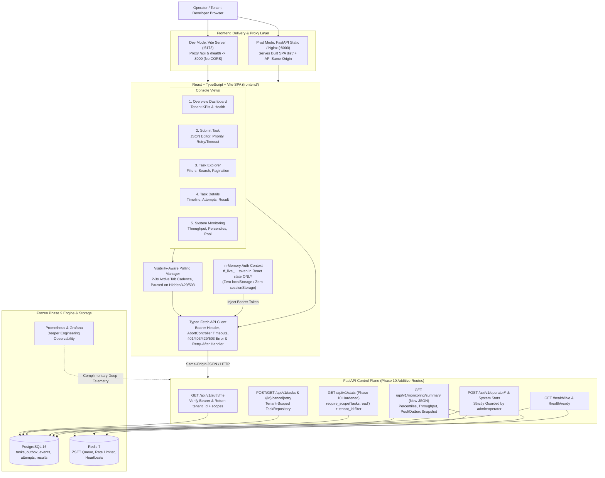

# Phase 10 — TaskForge Web Console: Frontend Architecture & Gate F0 Specification

**Milestone:** Phase 10 — Gate `F0` (Architecture & Contract Lock)  
**Branch:** `phase-10-frontend` (additive branch; Phase 9 baseline `v0.9.0-phase9-freeze` at `fb31546` preserved immutable)  
**Stack:** React 18 + TypeScript + Vite  
**Status:** GATE `F0` SPECIFICATION COMPLETE — SUBMITTED FOR ENGINEERING REVIEW BEFORE `F1` IMPLEMENTATION  
**Date:** 2026-11-11  

---

## 1. Executive Objective

Phase 10 delivers the **TaskForge Web Console**, turning TaskForge's verified backend platform into a directly operable developer and operations product without requiring Swagger, `curl`, or custom Python scripts.

The console is an **operations and task-management interface** consumed directly by users and operators, while **Prometheus + Grafana** remain the complementary deep infrastructure observability stack (`docker-compose.yml`).

### Non-Negotiable Phase 10 Constraints
1. **Immutable Phase 9 Preservation:** `v0.9.0-phase9-freeze` (`fb31546`) and all Phase 9 backend/benchmark evidence remain untouched on `phase-9-hardening`. All Phase 10 work proceeds strictly additively on `phase-10-frontend`.
2. **Zero Hardcoded Data in Production Views:** Every KPI, task row, attempt, timeline transition, health status, and performance metric rendered in the UI must originate from an authenticated/live backend API response.
3. **Zero Browser Secret Persistence:** API keys (`tf_live_...`) are never stored in `localStorage`, `sessionStorage`, non-HttpOnly cookies, URLs, or bundled JS artifacts.
4. **Gate `F0` Lock Before `F1` Implementation:** No React scaffolding or frontend source files (`frontend/`) are authored until Gate `F0` contracts are reviewed and closed.

---

## 2. Explicit Decisions on the Five Pre-`F0` API Contract Gaps

An audit of the frozen Phase 9 FastAPI backend (`src/taskforge/main.py`, `api/routes/`, `api/schemas.py`, `api/dependencies.py`) surfaced five gaps between existing endpoints and UI requirements. All five decisions are formally locked below:

| Gap # | Identified Audit Finding | Locked Phase 10 Decision | Rationale & Scope |
| :---: | :--- | :--- | :--- |
| **G1** | **Browser Authentication:** `get_current_principal()` expects `Authorization: Bearer tf_live_...`, with no browser login endpoint or principal introspection route. | **In-Memory API Key + `/api/v1/auth/me`:** User enters `tf_live_...` at session start; stored strictly in React memory (`AuthContext`). Add `GET /api/v1/auth/me` returning `{key_id, tenant_id, name, scopes}` without echoing secrets. | Satisfies local-first demo requirements without persisting secrets in browser storage. Future multi-user production deployments should upgrade to an `HttpOnly`, `SameSite=Strict` BFF session cookie. |
| **G2** | **Monitoring Percentiles:** `/api/v1/stats` lacks `p50`/`p95`/`p99` latency and throughput; `/metrics` emits Prometheus plain text. | **Dedicated JSON Monitoring Endpoint:** Add `GET /api/v1/monitoring/summary` emitting JSON throughput, queue/execution percentiles, and health/pool metrics computed server-side. **Do not** parse Prometheus exposition text in React. | Keeps UI contracts strongly typed in TypeScript and prevents coupling React to Prometheus exposition format details, while adding `0` new Prometheus series. |
| **G3** | **Tenant Scope Asymmetry:** `/api/v1/tasks` filters by `principal.tenant_id`, whereas `/api/v1/stats` currently queries global counts across all tenants without auth. | **Server-Side Tenant Scoping + Explicit Operator View:** Harden `GET /api/v1/stats` with `require_scope("tasks:read")` + `WHERE tenant_id = :tenant_id`. Expose global cluster stats / worker fleets / recovery sweeps exclusively on `admin:operator`-guarded endpoints. | Tenant isolation is enforced at the database query layer—never hidden solely in React UI state. |
| **G4** | **Lease Information Exposure:** `TaskResponse` omits raw `lease_token` and `lease_expires_at` while embedding `attempts` (`worker_id`, `duration_ms`) and `events` (`LEASE_EXPIRED_RECOVERED`). | **Preserve Token Omission:** Keep `lease_token` strictly absent from all API responses and UI views. Render attempt histories, worker IDs, retry counts, and recovery events from `TaskResponse`. | Upholds G9.1 secret/lease-token sanitization boundaries while giving operators full diagnostic visibility into lease recovery. |
| **G5** | **Frontend Hosting & CORS:** FastAPI serves legacy `src/taskforge/static/index.html` at `/` and `/ui`, and mounts no `CORSMiddleware`. | **Same-Origin Proxy Hosting:** Use Vite dev server proxy (`/api`, `/health` $\to$ `127.0.0.1:8000`) during development, and serve built `dist/` static assets behind FastAPI/Nginx same-origin in production/Docker. Avoid broad `CORSMiddleware`. | Eliminates cross-origin cookie/header complexity and keeps production deployment minimal inside `docker-compose.yml`. |

---

## 3. Frontend Architecture Diagram (`F0`)

Source: [`docs/phases/phase_10/diagrams/f0_frontend_architecture.mmd`](diagrams/f0_frontend_architecture.mmd)

---

## 4. Console Pages & Functional Modules

### 4.1 Overview Dashboard (`F2`)
- **Tenant KPI Cards:** Total, Queued (`PENDING` + `QUEUED`), Running (`RUNNING`), Retry Wait (`RETRY_WAIT`), Successful (`SUCCESS`), Failed/Dead-Letter (`FAILED` + `DEAD_LETTER`), and Cancelled (`CANCELLED`) task counts strictly filtered to the signed-in `tenant_id`.
- **Service Health Pill:** Live `/health/ready` indicator showing PostgreSQL & Redis status (`ready` vs `degraded`/`not_ready`).
- **Recent Activity Table:** Latest 10 tenant tasks with deep links to Task Details.
- **Operator Cluster Panel (Gated by `admin:operator`):** System-wide queue depth by priority, active workers, and link to Monitoring/Operator actions—hidden in UI *and* rejected (`403`) on backend unless the key holds `admin:operator`.

### 4.2 Submit Task (`F3`)
- **Task Type Selector:** Lists all 17 registered handlers (`json_transform`, `compute_prime`, `io_simulation`, `db_process`, `long_running`, `image_resize`, `payment_reconcile`, `report_generate`, `webhook_send`, `csv_export`, `noop`, `cpu_bound`, `io_bound`, `failing`, `sleep`, `failure_simulation`, `timeout_simulation`) with schema-valid preset JSON snippets (editable by the user).
- **Execution Controls:** Human-readable `task_name`, JSON `payload` editor with live syntax check before submit, `priority` (`1=LOW`..`4=CRITICAL`), `timeout_seconds` (`1..3600`), `max_retries` (`0..10`), optional `idempotency_key` (with quick UUID generator), and optional future `scheduled_at` (ISO 8601 UTC).
- **Idempotency Feedback:** Explicitly differentiates HTTP `201 Created` (new task queued) vs. HTTP `200 OK` (idempotent key matched existing task) and redirects/links to Task Details.

### 4.3 Task Explorer (`F4`)
- **Server-Driven Filtering & Pagination:** Filter by `status`, `task_type`, `priority`, with `limit` (`20`/`50`/`100`) and `offset` pagination controls (`has_more`, `total` display).
- **Action Controls:** Direct link to details; inline **Cancel** (`CANCELLABLE_STATES` only) and **Retry** (`FAILED` / `DEAD_LETTER` only) gated by `tasks:write` scope. Terminal `SUCCESS` / `CANCELLED` tasks never render edit/cancel mutations.

### 4.4 Task Details (`F5`)
- **Lifecycle Timeline:** Ordered chronological timeline rendered from `TaskResponse.events` (`TASK_CREATED`, `STATUS_CHANGED`, `LEASE_EXPIRED_RECOVERED`), highlighting state transitions (`from_state -> to_state`) and `metadata_json`.
- **Attempt History Table:** All `TaskAttemptResponse` rows showing `attempt_number`, `worker_id`, `status`, `started_at`, `completed_at`, `duration_ms`, and sanitized `error_message` (no `lease_token` exposed).
- **Result & Payload Inspector:** Pretty-printed syntax-highlighted JSON viewers for input `payload` and `TaskResultResponse` (`return_value`, `execution_metadata`).
- **Live Status Polling:** Automatically polls `GET /api/v1/tasks/{task_id}` every `2s` while the task is in non-terminal state, stopping immediately upon entering `SUCCESS`, `DEAD_LETTER`, or `CANCELLED`.

### 4.5 System Monitoring (`F6`)
- **Consumer Source:** Dedicated `GET /api/v1/monitoring/summary` JSON endpoint + `/health/ready`.
- **Visualizations & Metrics:** Queue depth by priority (`critical`, `high`, `medium`, `low`), active workers & slot utilization (`active_tasks / concurrency`), recent throughput, `p50`/`p95`/`p99` queue-wait & execution latency percentiles, outbox pending count/lag, and DB connection pool utilization (`checked_out`, `idle`, `overflow`).
- **Role Scope Handling:** Tenant-scoped users see database/Redis readiness and tenant task rate summary; `admin:operator` principals additionally see cluster-wide queue depth, outbox lag, worker list, DB pool stats, and operator recovery actions (`/recover`, `/outbox-sweep`).

---

## 5. Polling Strategy & Network Resilience

- **Cadence:** Default active polling every **`2.5s`** (`2–3s` budget) on Overview, Task Explorer, active Task Details, and System Monitoring, using native `fetch` + `AbortController` (`5.0s` request timeout).
- **Visibility-Aware Pause:** Suspends background intervals whenever `document.visibilityState === "hidden"` and triggers an immediate catch-up fetch upon tab focus.
- **Backpressure & Error Handling:**
  - On HTTP `429 Too Many Requests`: reads `Retry-After` header, halts background polling for the cooldown window, and shows a countdown banner.
  - On HTTP `503 Service Unavailable` or network failure: displays non-blocking degraded-service banner with correlation ID (if returned) and backs off polling exponentially (`5s -> 10s -> 30s`).
  - On HTTP `401 Unauthorized`: clears in-memory token and returns cleanly to the API key sign-in modal with clear explanation.

---

## 6. Phased Delivery Roadmap (`F0` – `F8`)

| Gate | Title | Core Deliverables & Exit Condition |
| :---: | :--- | :--- |
| **`F0`** | Architecture & Contract Lock | Spec, API contract, security model, design system, architecture diagram, explicit decisions on gaps `G1`–`G5`, `F0` verification plan (**Current Gate**). |
| **`F1`** | Frontend Foundation & Backend Contracts | Phase 10 additive backend endpoints (`/auth/me`, tenant-scoped `/stats`, `/monitoring/summary`), Vite + React + TS scaffold, typed API client, in-memory auth flow. |
| **`F2`** | Overview Dashboard | Tenant-scoped KPI cards, `/health/ready` status indicator, recent tasks table, gated operator summary panel. |
| **`F3`** | Task Submission & Validation | Registered handler selector (17 types), JSON payload validator, priority/timeout/retry/idempotency controls, `201` vs. `200` handling. |
| **`F4`** | Task Explorer | Server-paginated table, status/type/priority filtering, role/state-guarded cancel & retry controls. |
| **`F5`** | Task Details & Timeline | Ordered event timeline (`events`), attempt table (`attempts`), result JSON inspector (`result`), non-terminal auto-polling. |
| **`F6`** | Live Updates & System Monitoring | Visibility-aware polling manager, `429`/`503` backoff, `/monitoring/summary` charts/gauges, operator panel. |
| **`F7`** | Security, Accessibility & Responsive UI | WCAG AA contrast/keyboard nav checks, error boundary & timeout hardening, zero secret persistence audit, responsive tablet/mobile layout. |
| **`F8`** | E2E Acceptance & Docker Demo | Full Playwright/Vitest/pytest E2E workflow (`submit -> queue -> execute -> inspect result`), failure scenario UI tests, Docker Compose integration & Phase 10 closure report. |

---

## 7. Related Gate `F0` Artifacts

- [`FRONTEND_API_CONTRACT.md`](FRONTEND_API_CONTRACT.md) — Exact request/response schemas, Phase 10 endpoint additions, error taxonomy, and TypeScript interface contracts.
- [`FRONTEND_SECURITY_MODEL.md`](FRONTEND_SECURITY_MODEL.md) — In-memory key policy, server-side tenant isolation enforcement, RBAC matrix, and rate-limit/XSS protections.
- [`FRONTEND_DESIGN_SYSTEM.md`](FRONTEND_DESIGN_SYSTEM.md) — Visual tokens, 8-state status semantics, typography, responsive layout, and UX state matrix.
- [`F0_ACCEPTANCE_CRITERIA.md`](F0_ACCEPTANCE_CRITERIA.md) — Formal `F0` verification checklist and Phase 10 gating rules.

