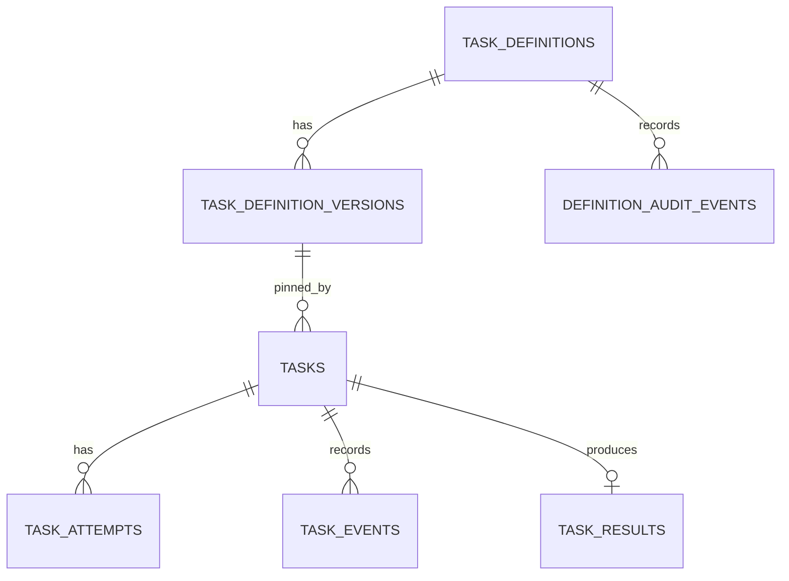

# Phase 11 (`G11.0`) — Data Model & Schema Contract

**Revision Target:** Next Alembic migration after `5a361f84b61f` (`003_api_keys_and_tenant_support`)

---

## 1. Entity-Relationship Overview

---

## 2. Tables & Columns

### `task_definitions`
| Column | Type | Nullable | Constraints / Indexes |
| --- | --- | --- | --- |
| `id` | `String(36)` | `False` | `PK` |
| `tenant_id` | `String(64)` | `False` | Indexed; composite `UniqueConstraint("tenant_id", "name", name="uq_task_definitions_tenant_name")`, `Index("ix_task_definitions_tenant_status", "tenant_id", "status")` |
| `name` | `String(160)` | `False` | Max 160 chars |
| `description` | `Text` | `True` | Max 4000 chars at API layer |
| `execution_type` | `String(32)` | `False` | Initially `"builtin"` |
| `status` | `String(24)` | `False` | `DRAFT`, `ACTIVE`, `DISABLED` |
| `active_version_id` | `String(36)` | `True` | `FK("task_definition_versions.id", use_alter=True, ondelete="SET NULL")` |
| `created_by` | `String(128)` | `False` | Authenticated `principal.key_id` |
| `created_at` | `DateTime(timezone=True)` | `False` | Indexed (`tenant_id, created_at`) |
| `updated_at` | `DateTime(timezone=True)` | `False` | Indexed (`tenant_id, updated_at`) |

### `task_definition_versions`
| Column | Type | Nullable | Constraints / Indexes |
| --- | --- | --- | --- |
| `id` | `String(36)` | `False` | `PK` |
| `definition_id` | `String(36)` | `False` | `FK("task_definitions.id", ondelete="CASCADE")`, indexed |
| `version` | `Integer` | `False` | Monotonic (`1, 2, ...`); `UniqueConstraint("definition_id", "version", name="uq_task_def_versions_def_ver")`; `UniqueConstraint("id", "definition_id", name="uq_task_def_versions_id_def")` |
| `execution_type` | `String(32)` | `False` | `"builtin"` |
| `task_type` | `String(100)` | `False` | Registered handler key |
| `configuration_json` | `JSON` | `False` | Default handler payload config |
| `input_schema_json` | `JSON` | `False` | JSON Schema Draft 2020-12 |
| `output_schema_json` | `JSON` | `True` | Optional future output contract |
| `execution_policy_json` | `JSON` | `False` | Overridable keys / execution bounds |
| `content_hash` | `String(64)` | `False` | Canonical SHA-256 hex digest |
| `validation_status` | `String(24)` | `False` | `UNVALIDATED`, `VALID`, `INVALID` |
| `validation_report_json` | `JSON` | `False` | Structured validation outcome |
| `created_by` | `String(128)` | `False` | Authenticated `principal.key_id` |
| `created_at` | `DateTime(timezone=True)` | `False` | Immutable creation timestamp |

### `definition_audit_events`
| Column | Type | Nullable | Constraints / Indexes |
| --- | --- | --- | --- |
| `id` | `String(36)` | `False` | `PK` |
| `tenant_id` | `String(64)` | `False` | Indexed (`tenant_id, created_at`) |
| `definition_id` | `String(36)` | `False` | `FK("task_definitions.id", ondelete="CASCADE")`, indexed |
| `version_id` | `String(36)` | `True` | `FK("task_definition_versions.id", ondelete="SET NULL")` |
| `actor_id` | `String(128)` | `False` | Authenticated `principal.key_id` |
| `action` | `String(48)` | `False` | `DEFINITION_CREATED`, `VERSION_CREATED`, `VERSION_VALIDATED`, `VERSION_ACTIVATED`, `DEFINITION_DISABLED`, `DEFINITION_ENABLED`, `DEFINITION_EXECUTED` |
| `metadata_json` | `JSON` | `False` | Secret-free structured metadata |
| `created_at` | `DateTime(timezone=True)` | `False` | UTC timestamp |

### `tasks` (Additive Nullable Extensions)
| Column | Type | Nullable | Constraints / Indexes |
| --- | --- | --- | --- |
| `definition_id` | `String(36)` | `True` | Indexed |
| `definition_version_id` | `String(36)` | `True` | Indexed; composite `FK(["definition_version_id", "definition_id"] -> ["task_definition_versions.id", "task_definition_versions.definition_id"], ondelete="RESTRICT")` + `CheckConstraint` enforcing both-null or both-non-null |
