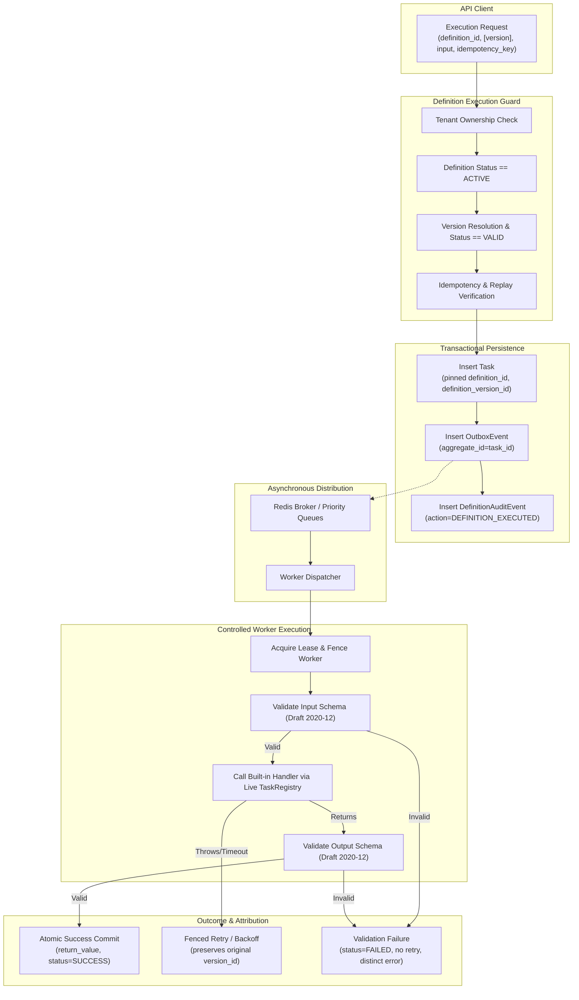

# Gate G11.4 — Controlled Execution Adapter Architecture Specification

**Milestone:** Gate G11.4  
**Branch:** `phase-11-custom-task-foundation`  
**Predecessor Commits:** `e5bb468` (G11.3 baseline), `b4dbb46` (G11.3 reconciliation)  
**Status:** Approved for Implementation  

---

## 1. Architectural Overview & Context

Gate G11.4 connects custom task definitions and versions created in G11.1–G11.3 to TaskForge's battle-tested execution infrastructure.

The core design principle is **zero architectural duplication**: custom task definitions do not introduce a secondary worker pool, a distinct database queue, or dynamic runtime code interpreters. Instead, G11.4 introduces a **Controlled Execution Adapter** that wraps the existing `TaskRepository`, `TaskService`, `WorkerDispatcher`, and `execute_task` pipeline with strict definition guards, input/output JSON Schema enforcement, immutable version pinning, and auditable execution attribution.



---

## 2. Mandatory Engineering Constraints Compliance Matrix

| Constraint ID | Specification Requirement | Architectural Implementation Mechanism |
| :--- | :--- | :--- |
| **G11.4-01** | Only active, valid definition versions can receive new execution requests. | `POST /definitions/{id}/execute` checks `definition.status == 'ACTIVE'`, `version.validation_status == 'VALID'`. Submissions against disabled definitions or unvalidated/invalid versions are rejected with `HTTP 409 Conflict` or `HTTP 422 Unprocessable Entity`. |
| **G11.4-02** | No arbitrary Python execution or dynamic imports. | `execution_type` is restricted to `'builtin'`. Handler execution is dispatched strictly through registered function objects from the live `TaskRegistry`. No `eval()`, `exec()`, or dynamic runtime module imports. |
| **G11.4-03** | Handler resolution must use the live `TaskRegistry`. | Worker resolves `handler = get_handler(version.task_type)` at runtime from `_HANDLERS`. Missing or uncallable registrations fail safely into a designated execution failure disposition. |
| **G11.4-04** | Execution must bind to an immutable version snapshot. | The task record permanently stores composite foreign key `(definition_version_id, definition_id)`. Pinned at request acceptance time; cannot be mutated post-submission. |
| **G11.4-05** | Input must be validated before handler execution. | Runtime inputs are checked against `version.input_schema_json` using G11.3's `validate_schema_instance()`. If validation fails, the task aborts without invoking the task handler. |
| **G11.4-06** | Output must be validated against output schema. | If `version.output_schema_json` is declared, handler return value is validated prior to committing success. Output schema violations mark the attempt as a non-retryable validation failure. |
| **G11.4-07** | Existing idempotency guarantees must be preserved. | Matching `(tenant_id, idempotency_key)` returns the existing task (`HTTP 200 OK`) with its originally pinned `definition_version_id`. Mismatched parameters raise `HTTP 409 Conflict`. |
| **G11.4-08** | Retries must preserve version attribution. | On transient failures or worker crashes, the retry scheduler increments `retry_count` but reads configuration and schema strictly from the pinned `definition_version_id`. Retries never re-query the latest active version. |
| **G11.4-09** | Lease fencing must prevent stale workers from committing. | All updates to `tasks`, `task_attempts`, and `task_results` require matching `lease_token`. Stale workers whose leases expired or were superseded are rejected with `PermissionError` (Fenced). |
| **G11.4-10** | Disable/activation races have defined semantics. | Version resolution uses row-level locking (`SELECT ... FOR UPDATE` on `task_definitions`). If definition is disabled before worker picks it up, the pinned version still executes safely to completion (guaranteed by immutable snapshot). If a new version is activated, pending tasks continue executing against their pinned predecessor. |
| **G11.4-11** | Execution failures distinguishable from validation failures. | Validation errors record `error_type: "SCHEMA_VALIDATION_ERROR"` and fail permanently (`is_retryable = False`, `status = FAILED`). Execution errors record `error_type: "HANDLER_EXECUTION_ERROR"` or `"TIMEOUT"` and participate in exponential backoff retries. |
| **G11.4-12** | Auditable definition/version attribution. | `tasks.definition_id` and `tasks.definition_version_id` persist relational links. `definition_audit_events` records `action = "DEFINITION_EXECUTED"` with `task_id`, `version_id`, and `actor_id`. |

---

## 3. Detailed Component Architecture

### 3.1. API Surface & Submission Pipeline
* **Endpoint:** `POST /api/v1/definitions/{definition_id}/execute`
* **Request Schema (`DefinitionExecuteRequest`):**
  ```python
  class DefinitionExecuteRequest(BaseModel):
      version: int | None = Field(None, ge=1, description="Specific version number. Defaults to active version.")
      input: dict[str, Any] = Field(default_factory=dict, description="Input payload matching version schema.")
      task_name: str | None = Field(None, max_length=128, description="Optional custom task name.")
      priority: int = Field(TaskPriority.MEDIUM.value, ge=1, le=4)
      idempotency_key: str | None = Field(None, max_length=128)
      timeout_seconds: int | None = Field(None, ge=1, le=3600)
  ```
* **Atomicity & Concurrency Protection:**
  ```python
  # Transaction block inside DefinitionService / TaskService:
  # 1. Optimistic Idempotency Check (returns existing task if key matches identical parameters)
  # 2. Acquire lock on definition: SELECT * FROM task_definitions WHERE id = :id AND tenant_id = :tenant FOR UPDATE
  # 3. Verify definition.status == "ACTIVE"
  # 4. Resolve target version (active_version_id if req.version is None, else specific version matching req.version)
  # 5. Verify version.validation_status == "VALID"
  # 6. Pre-validate input against version.input_schema_json (reject immediately with 422 if invalid)
  # 7. Merge execution config: effective_payload = {**version.configuration_json, **req.input}
  # 8. Create Task with definition_id and definition_version_id, TaskEvent, OutboxEvent, and DefinitionAuditEvent
  # 9. Atomic DB commit
  ```

### 3.2. Worker Execution Adapter (`execute_custom_task`)
The execution adapter extends TaskForge's worker pipeline (`taskforge.workers.execution_engine`) without breaking backward compatibility for standard built-in tasks:

```python
def execute_task(task_id: str, worker_id: str, ...):
    # 1. Lease acquisition and worker fencing
    # 2. Load task from TaskRepository
    # 3. If task.definition_version_id is NOT NULL:
    #      a. Load TaskDefinitionVersion by (definition_version_id, definition_id)
    #      b. Load Input Schema from version.input_schema_json
    #      c. Validate runtime payload against input schema using compile_schema()
    #         - If invalid: mark task as FAILED (non-retryable SCHEMA_VALIDATION_ERROR), commit under lease, ACK.
    #      d. Resolve handler via TaskRegistry: handler = get_handler(version.task_type)
    #      e. Merge task payload with version.configuration_json
    #      f. Execute handler with timeout enforcement in thread pool
    #      g. If version.output_schema_json exists:
    #         - Validate handler return value against output schema
    #         - If invalid: mark task as FAILED (non-retryable OUTPUT_VALIDATION_ERROR), commit under lease, ACK.
    #      h. Commit task success atomically with return value and execution metadata under lease token.
    #    Else:
    #      Execute standard legacy built-in task flow.
```

### 3.3. Retries and State Recovery
* **Immutability of Version Reference:**
  When a task fails with a retryable transient error (e.g. timeout, network glitch), `complete_task_failure` updates `status = RETRY_WAIT`, increments `retry_count`, and writes to `outbox_events`.
* The `definition_id` and `definition_version_id` columns on the `tasks` row **never change** during retry transitions.
* When the task is re-polled or re-dispatched, the worker reads the task's persisted `definition_version_id`, guaranteeing execution against the exact same version snapshot even if version 2 was superseded by version 3 while the task was waiting.

### 3.4. Fencing & TOCTOU Race Condition Resolution
* **Scenario A: Definition Disabled During Worker Execution**
  - Task is already queued/running with pinned `version_id`.
  - Admin calls `POST /definitions/{id}/disable`.
  - Existing queued tasks complete successfully against the immutable version snapshot.
  - New submissions are blocked at the guard (`status != 'ACTIVE'`).
* **Scenario B: Version Upgraded During Execution**
  - Task `T1` submitted under Version 1 (`V1`).
  - Admin validates and activates Version 2 (`V2`).
  - Worker picks up `T1`: executes strictly against `V1` snapshot.
  - New task `T2` submitted: binds to `V2`.
  - Provenance is cleanly separated and queryable by version.
* **Scenario C: Worker Lease Expiration During Execution**
  - Worker 1 experiences CPU stall while executing handler.
  - Lease expires. Worker 2 claims the task under a new lease token.
  - Worker 1 awakens and attempts to commit output validation result.
  - Lease check rejects Worker 1 with `PermissionError` (Fenced).
  - Worker 2 executes and commits cleanly.

---

## 4. Test Strategy & Verification Matrix

| Scenario / Test Case | Precondition | Trigger / Action | Expected Outcome |
| :--- | :--- | :--- | :--- |
| **T-G11.4-01: Standard Custom Execution** | Definition active, v1 valid. | `POST /definitions/{id}/execute` with valid input. | Task created (201), worker validates input, executes handler, validates output, status=SUCCESS. |
| **T-G11.4-02: Input Validation Rejection** | Definition active, v1 requires integer `age`. | Execute with `{"age": "not_an_int"}`. | Immediate rejection at API level (422) or worker fails task as `SCHEMA_VALIDATION_ERROR` without invoking handler. |
| **T-G11.4-03: Output Schema Violation** | Definition has output schema requiring `score: int`. | Handler returns `{"score": "bad"}`. | Task marked `FAILED`, `is_retryable=False`, non-zero error detail recorded in `task_results`. |
| **T-G11.4-04: Version Pinning Stability** | Task submitted on v1. | v2 activated while task is queued. | Worker executes task against v1 configuration and schema; result links to v1. |
| **T-G11.4-05: Idempotent Replay Provenance** | Task submitted with key `k1` against v1. | v2 activated. Client resubmits with key `k1`. | HTTP 200 OK returned with original task ID and v1 attribution (no duplicate task created). |
| **T-G11.4-06: Disabled Definition Guard** | Definition status is `DISABLED`. | `POST /definitions/{id}/execute`. | Rejected with HTTP 409 Conflict. No task created. |
| **T-G11.4-07: Unvalidated Version Guard** | Definition version is `UNVALIDATED` or `INVALID`. | Attempt execution against this version. | Rejected with HTTP 422 / 409. |
| **T-G11.4-08: Stale Worker Fencing** | Worker 1 executing long task. | Lease expires; Worker 2 acquires lease. | Worker 1 completion rejected with PermissionError. Worker 2 successfully completes task. |
| **T-G11.4-09: Worker Crash & Retry Attribution** | Task running on v1 crashes worker. | Retry loop picks up task for Attempt 2. | Attempt 2 executes against v1; attempt count increments; version attribution remains v1. |
| **T-G11.4-10: Tenant Boundary Isolation** | Definition in Tenant A. | Tenant B attempts execution with Tenant A definition ID. | Rejected with HTTP 404 Not Found (zero cross-tenant leakage). |
| **T-G11.4-11: Live Registry Handler Check** | Task type registered in TaskRegistry. | Execution verifies handler callable. | Built-in handler called cleanly with merged config and input payload. |
| **T-G11.4-12: Full Execution Audit Trail** | Task submitted and completed. | Inspect `definition_audit_events`. | Audit event recorded with `action="DEFINITION_EXECUTED"`, `definition_id`, `version_id`, `actor_id`. |

---

## 5. Implementation Roadmap & Milestones

1. **Phase 1: Domain & API Adapters**
   - Create `DefinitionExecuteRequest` schema in [src/taskforge/definitions/schemas.py](file:///E:/TaskForge/src/taskforge/definitions/schemas.py) or `api/schemas.py`.
   - Implement `execute_definition()` in [src/taskforge/definitions/service.py](file:///E:/TaskForge/src/taskforge/definitions/service.py) with row-level locks, guards, idempotency checks, and version snapshot resolution.
   - Add endpoint `POST /api/v1/definitions/{definition_id}/execute` in `src/taskforge/api/routes/definitions.py`.

2. **Phase 2: Worker Execution Adapter**
   - Enhance `execute_task()` in [src/taskforge/workers/execution_engine.py](file:///E:/TaskForge/src/taskforge/workers/execution_engine.py) to detect `task.definition_version_id`.
   - Wire input and output validation gates via `compile_schema()` and `validate_schema_instance()` from [src/taskforge/definitions/validation.py](file:///E:/TaskForge/src/taskforge/definitions/validation.py).
   - Differentiate schema validation failures (`is_retryable = False`) from runtime execution failures.

3. **Phase 3: Comprehensive Test Suite**
   - Implement unit and integration tests covering all 12 mandatory constraints (`G11.4-01` through `G11.4-12`) and the 12 failure/concurrency scenarios.
   - Run complete regression suite to ensure zero regressions across Phase 8, 9, 10, and 11.
