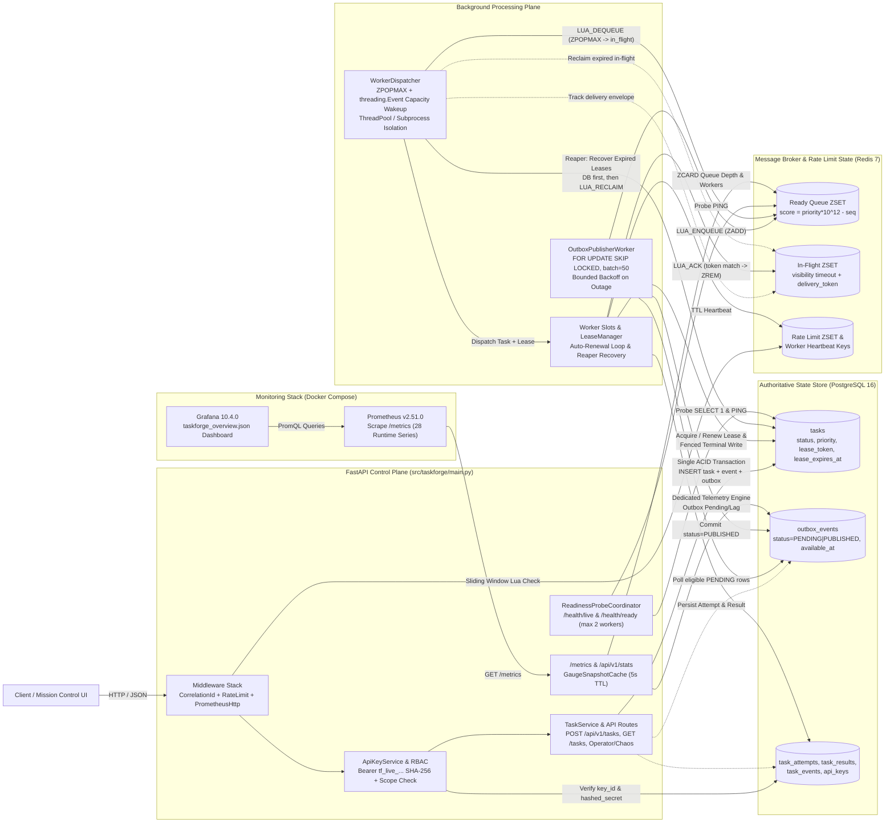
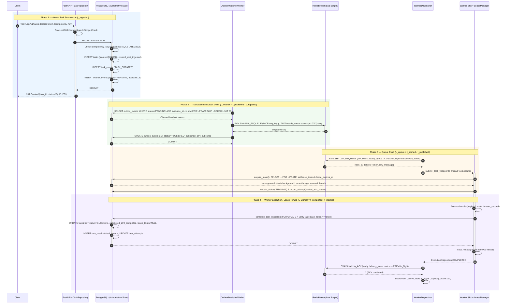
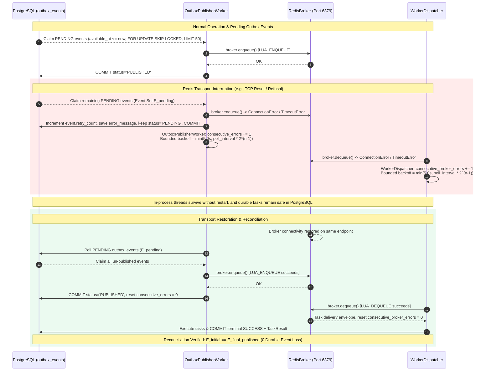
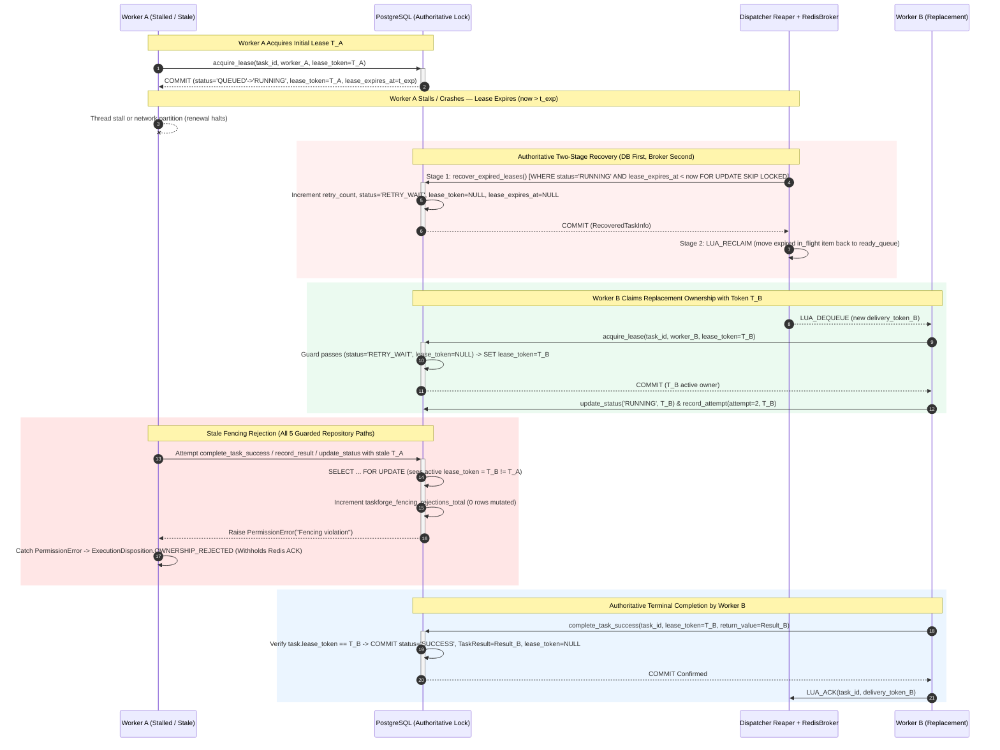

# TaskForge Architecture Whitepaper

**A Reliable, Observable, and Empirically Verified Asynchronous Task Processing Platform**

**Document Status:** Canonical Public Architecture Specification (Gate G9.5 Stage 3)  
**Production Code Baseline:** `a89858b73f8488e05cbcc2393a61f3080ffc7a38` (Frozen Phase 9 Production Code)  
**Frozen Phase 8 Baseline Tag:** `v0.8.0-phase8-freeze` (`da27047f56fe2eec75acdb8502f505542cf61202`)  
**Benchmark Harness Commit:** `1d4a76cd047a61548e92e57cfb1f032ba7914068` (`git_dirty = false`, Run `fc557f14`)  
**Benchmark Evidence Commit:** `2a14600`  
**Target Environment:** Python 3.12 · FastAPI · PostgreSQL 16 · Redis 7 · Prometheus · Grafana  

---

## Table of Contents

1. [Executive Summary](#1-executive-summary)
2. [System Requirements](#2-system-requirements)
3. [Architecture Overview](#3-architecture-overview)
4. [Task Lifecycle & State Machine](#4-task-lifecycle--state-machine)
5. [Data Architecture](#5-data-architecture)
6. [Queue Architecture](#6-queue-architecture)
7. [Reliability & Fault Recovery](#7-reliability--fault-recovery)
8. [Concurrency Control & Lease Fencing](#8-concurrency-control--lease-fencing)
9. [Observability & Health Probes](#9-observability--health-probes)
10. [Security & Access Controls](#10-security--access-controls)
11. [Performance Evaluation](#11-performance-evaluation)
12. [Trade-offs, Delivery Semantics & Limitations](#12-trade-offs-delivery-semantics--limitations)
13. [Deployment & Operations Runbook](#13-deployment--operations-runbook)

---

## 1. Executive Summary

Distributed background job systems frequently lose work or corrupt state across two brittle fault lines: the **dual-write boundary** (writing task metadata to a relational database while publishing a queue message to an external broker) and the **split-brain worker boundary** (a stalled worker waking up after its lease expired and overwriting the result committed by a replacement worker).

**TaskForge** is a locally deployable asynchronous task processing platform engineered to solve both failure modes through database-backed state authority, atomic Lua broker primitives, bounded telemetry, and reproducible empirical verification.

### Core Architectural Delivery Guarantee

> **TaskForge provides durable task submission through PostgreSQL transactions and a transactional outbox. Queue delivery is at-least-once. Worker ownership is protected by leases and fencing tokens. Task completion is persisted transactionally, and duplicate delivery is handled through idempotent execution and authoritative task state.**

### Design Goals & Verified Capabilities
1. **Zero Dual-Write Loss:** Task creation, audit events, and outbox publication records commit atomically inside a single PostgreSQL ACID transaction (`tasks`, `task_events`, `outbox_events`).
2. **Authoritative State & Strict Fencing:** PostgreSQL is the sole system of record. Conditional row-locked writes validate worker `lease_token` ownership across all state-mutating operations, rejecting stale workers with zero accepted mutations.
3. **Deterministic Priority Queueing:** Redis Sorted Sets (`ZSET`) driven by atomic Lua scripts enforce strict priority tiering (`CRITICAL > HIGH > MEDIUM > LOW`) paired with intra-tier FIFO ordering (`ZPOPMAX`).
4. **Bounded Operational Overhead:** An `Option A` Prometheus cardinality ceiling (`25` net-new Phase 9 runtime series; `28` combined runtime exposition series), isolated `GaugeSnapshotCache`, and fail-closed Redis sliding-window rate limiting protect storage engines from cascading failure.
5. **Reproducible Verification:** Every core behavioral and performance claim in this paper is backed by automated integration tests, OS-level transport failure drills, and a deterministic, schema-validated public benchmark suite (`benchmarks/public/run_public_benchmarks.py`).

---

## 2. System Requirements

### 2.1 Functional Requirements

| Requirement ID | Capability | Implemented Specification |
| :--- | :--- | :--- |
| **FR-1** | **Task Submission & Idempotency** | Synchronous HTTP ingestion (`POST /api/v1/tasks`) returning `201 Created` (new) or `200 OK` (idempotent hit) enforced via PostgreSQL `idempotency_key` unique constraint (`SQLSTATE 23505`). |
| **FR-2** | **Priority & Delayed Scheduling** | Four strict priority tiers (`1=LOW`, `2=MEDIUM`, `3=HIGH`, `4=CRITICAL`) and deferred execution via `scheduled_at` / `outbox_events.available_at`. |
| **FR-3** | **Controlled Retries & DLQ** | Automatic exponential backoff retries up to `max_retries`; tasks exhausting retry budgets transition through `FAILED` to terminal `DEAD_LETTER` with attempt audit trails. |
| **FR-4** | **Execution Timeouts & Cancellation** | Per-task `timeout_seconds` enforcement (thread future or OS subprocess `kill()`) and operator/client task cancellation (`POST /api/v1/tasks/{task_id}/cancel`) for non-terminal states. |
| **FR-5** | **Multi-Tenant Access & Operator Controls** | Tenant-scoped task queries, scoped API keys (`tasks:read`, `tasks:write`, `admin:operator`), and operator recovery endpoints (`/recover`, `/outbox-sweep`, `/purge-queue`). |

### 2.2 Non-Functional Requirements

| Requirement ID | Dimension | Implemented Specification |
| :--- | :--- | :--- |
| **NFR-1** | **Submission Durability** | Submitted tasks survive broker unavailability without loss; `outbox_events` retains `PENDING` records until Redis `enqueue()` succeeds. |
| **NFR-2** | **Fencing Correctness** | Stale or crashed workers holding expired `lease_token` values must have 100% of state updates rejected (`PermissionError` / `0` rows mutated). |
| **NFR-3** | **Bounded Telemetry Cardinality** | Finite label whitelists across all Prometheus metrics (`normalize_priority`, `normalize_task_type`, `normalize_route`, etc.); zero unbounded task IDs or tenant IDs in labels. |
| **NFR-4** | **Readiness Isolation & Deadlines** | `/health/ready` executes under a dedicated `ReadinessProbeCoordinator` (`max_workers=2`), strict driver timeouts (`1s` PG connect, `500ms` statement, `500ms` Redis), and `1.0s` total async deadline. |
| **NFR-5** | **Ingress Protection** | Redis Lua sliding-window rate limiter (`300 req/min` default) failing closed (`503 Service Unavailable`) when Redis is unreachable in production to prevent unbounded database saturation. |

---

## 3. Architecture Overview

TaskForge operates as a **modular monolith control and execution platform** (`src/taskforge/`) backed by PostgreSQL 16 and Redis 7, with optional dedicated Celery worker processes and Prometheus/Grafana observability containers.

### 3.1 System Architecture Diagram (D1)

Source: [`docs/whitepaper/diagrams/d1_system_architecture.mmd`](diagrams/d1_system_architecture.mmd)



### 3.2 Component Responsibilities

| Component | Source Module | Primary Responsibility |
| :--- | :--- | :--- |
| **FastAPI Control Plane** | `src/taskforge/main.py` | HTTP ingress, middleware orchestration (`CorrelationIdMiddleware`, `RateLimitMiddleware`, `PrometheusHttpMiddleware`), lifecycle management (`lifespan`), liveness/readiness probes, and static Mission Control UI serving (`/`, `/ui`). |
| **API Auth & Dependencies** | `src/taskforge/core/auth.py`, `src/taskforge/api/dependencies.py` | Bearer token extraction (`tf_live_<key_id>_<secret>`), constant-time SHA-256 verification, and scope-based authorization (`require_scope`). |
| **Task Repository & Service** | `src/taskforge/tasks/service.py`, `src/taskforge/database/repositories/task_repository.py` | Transactional task creation, idempotency collision resolution, lease acquisition/renewal/release, fencing validation, state machine enforcement, and expired lease recovery. |
| **Outbox Publisher** | `src/taskforge/queue/outbox.py` | Background daemon (`OutboxPublisherWorker`) claiming batches of up to 50 eligible `PENDING` events using `FOR UPDATE SKIP LOCKED`, enqueuing to Redis, and backing off up to `5.0s` during broker outages. |
| **Redis Broker** | `src/taskforge/queue/broker.py` | Atomic priority queueing via `ZSET` and Lua scripts (`LUA_ENQUEUE`, `LUA_DEQUEUE`, `LUA_ACK`, `LUA_RECLAIM`) with visibility timeouts and per-delivery fencing tokens. |
| **Worker Dispatcher** | `src/taskforge/workers/dispatcher.py` | Pulls work from Redis via `ZPOPMAX`, manages concurrent execution slots (`ThreadPoolExecutor` or `process_runner` subprocesses), wakes immediately on capacity release (`threading.Event`), and runs the background lease reaper (`Reaper`). |
| **Execution Engine & Lease Manager** | `src/taskforge/workers/execution_engine.py`, `src/taskforge/workers/lease_manager.py` | Acquires PostgreSQL lease (`lease_duration=30s`), runs periodic auto-renewal (`interval = max(1.0, duration / 2)`), runs registered handlers (`TaskRegistry`) under strict timeout, and maps outcomes to explicit `ExecutionDisposition` values governing Redis `ACK`. |
| **Monitoring & Telemetry** | `src/taskforge/monitoring/metrics.py`, `collector.py`, `health.py` | Bounded Prometheus instrumentation, 5.0-second single-flight `GaugeSnapshotCache` backed by an isolated telemetry engine (`pool_size=2, max_overflow=1`), and bounded readiness probing. |

---

## 4. Task Lifecycle & State Machine

### 4.1 Deterministic State Machine

TaskForge enforces all task state mutations through `src/taskforge/core/state_machine.py`. Illegal transitions raise `InvalidStateTransitionError` (mapped to HTTP `409 Conflict` on API cancellation).

| State (`TaskStatus`) | Terminal? | Cancellable? | Legal Outgoing Transitions (`ALLOWED_TRANSITIONS`) |
| :--- | :---: | :---: | :--- |
| **`PENDING`** | No | Yes | `QUEUED`, `CANCELLED` |
| **`QUEUED`** | No | Yes | `RUNNING`, `CANCELLED` |
| **`RUNNING`** | No | Yes | `SUCCESS`, `RETRY_WAIT`, `FAILED`, `CANCELLED` |
| **`RETRY_WAIT`** | No | Yes | `QUEUED`, `RUNNING`, `CANCELLED` |
| **`FAILED`** | No* | No | `DEAD_LETTER` |
| **`SUCCESS`** | **Yes** | No | *(none — terminal)* |
| **`DEAD_LETTER`** | **Yes** | No | *(none — terminal)* |
| **`CANCELLED`** | **Yes** | No | *(none — terminal)* |

*\*Note: When retries are exhausted during execution failure, `complete_task_failure()` transitions atomically through `RUNNING -> FAILED -> DEAD_LETTER` in a single database transaction, recording both `TaskEvent` audit transitions.*

### 4.2 Task Submission & Execution Sequence (D2)

Source: [`docs/whitepaper/diagrams/d2_task_submission_execution.mmd`](diagrams/d2_task_submission_execution.mmd)



### 4.3 Execution Disposition & Broker ACK Contract

To guarantee that messages are never acknowledged in Redis before authoritative durable persistence completes in PostgreSQL, `execute_task()` returns an `ExecutionDisposition` enum (`src/taskforge/workers/execution_engine.py`):

| `ExecutionDisposition` | Meaning | Broker `LUA_ACK` Executed? | Reason |
| :--- | :--- | :---: | :--- |
| `COMPLETED` | Task executed and `TaskResult` + `SUCCESS` committed. | **Yes** | Work durably finished. |
| `TERMINAL_DUPLICATE` | Task already in `SUCCESS`, `DEAD_LETTER`, or `CANCELLED` in PG. | **Yes** | Safe suppression of duplicate queue message. |
| `TERMINAL_FAILURE_RECORDED` | Retries exhausted; task committed as `DEAD_LETTER`. | **Yes** | Terminal failure durably persisted. |
| `RETRY_DURABLY_SCHEDULED` | Attempt failed; `RETRY_WAIT` and `TASK_RETRY` outbox row committed. | **Yes** | Future delivery durably owned by transactional outbox. |
| `RETRY_PENDING_PUBLICATION` | Retried without outbox persistence (`use_outbox=False`). | **No** | Preserves broker delivery for reclaim. |
| `OWNERSHIP_REJECTED` | Lease acquisition failed or stale write fenced (`PermissionError`). | **No** | Prevents stale worker from acknowledging active worker's delivery. |
| `UNEXPECTED_FAILURE` | Unhandled DB/infrastructure failure prior to state commit. | **No** | Allows Redis visibility timeout to expire and redeliver. |

---

## 5. Data Architecture

PostgreSQL serves as the **sole authoritative source of truth** (`src/taskforge/database/models.py`). Redis serves exclusively as an ephemeral priority signaling and rate-limiting cache; all tasks, retries, attempts, results, and audit records can be reconstructed from PostgreSQL even after total Redis memory loss.

### 5.1 Relational Schema Summary

| Table | Primary Key & Constraints | Critical Indexes | Authoritative Role |
| :--- | :--- | :--- | :--- |
| **`tasks`** | `id` (`UUID`), `idempotency_key` (`UNIQUE`) | `ix_tasks_status_priority`, `ix_tasks_lease_recovery (status, lease_expires_at)`, `ix_tasks_tenant_status`, `ix_tasks_tenant_created` | Stores core task definition, priority (`1–4`), active `status`, `retry_count`/`max_retries`, `tenant_id`, and active lease ownership (`lease_token`, `lease_expires_at`). |
| **`outbox_events`** | `id` (`UUID`) | `ix_outbox_status_available (status, available_at)`, `ix_outbox_status_created` | Transactional staging table (`status IN {'PENDING', 'PUBLISHED', 'FAILED'}`). `available_at` supports delayed/retry scheduling without scanning future events. |
| **`task_attempts`** | `id` (`SERIAL`), `UNIQUE (task_id, attempt_number)` | `ix_task_attempts_task_attempt` | Monotonic execution attempt log (`attempt_number`, `worker_id`, `started_at`, `completed_at`, `duration_ms`, error traceback). |
| **`task_results`** | `id` (`SERIAL`), `task_id` (`FK UNIQUE`) | `ix_task_results_task_id` | One-to-one durable result store (`return_value` JSON, `execution_metadata` JSON) persisted atomically with terminal `SUCCESS`. |
| **`task_events`** | `id` (`SERIAL`) | `ix_task_events_tenant_created`, `task_id` | Append-only audit log recording state transitions (`TASK_CREATED`, `STATUS_CHANGED`, `LEASE_EXPIRED_RECOVERED`, `OPERATOR_QUEUE_PURGED`) and `actor_id`. |
| **`api_keys`** | `id` (`UUID`), `key_id` (`UNIQUE`) | `tenant_id` | Stores tenant-scoped RBAC keys (`hashed_secret` SHA-256, `scopes` JSON, `is_active`, `expires_at`, `last_used_at`). |

### 5.2 Connection Pooling & Failure Isolation

Application sessions are managed via `InstrumentedQueuePool` (`src/taskforge/database/session.py`), subclassing SQLAlchemy's `QueuePool`:
- **Default Production Pool Sizing:** `db_pool_size=10`, `db_max_overflow=20` (`30` max connections), `db_pool_timeout=30s`, `pool_pre_ping=True`, and PostgreSQL `connect_timeout=1s`.
- **Isolated Telemetry Pool:** `GaugeSnapshotCache` uses a separate dedicated engine (`pool_size=2, max_overflow=1, pool_timeout=1.0s`, PostgreSQL `statement_timeout=500ms`), ensuring `/metrics` scrapes never contend with task processing transactions on the primary pool.

---

## 6. Queue Architecture

`RedisBroker` (`src/taskforge/queue/broker.py`) replaces standard FIFO list queues with two Redis Sorted Sets (`ready_queue` and `in_flight`) governed entirely by server-side **Lua scripts** executed via `EVALSHA`.

### 6.1 Disjoint Priority Score Band & FIFO Ordering

Task priorities occupy integer tiers $p \in \{1, 2, 3, 4\}$ (`LOW=1`, `MEDIUM=2`, `HIGH=3`, `CRITICAL=4`). Each tier maintains an independent monotonic counter key (`seq_key:<priority>`). On enqueue (`LUA_ENQUEUE`), a task receives score:

$$\text{score}(p, \text{seq}) = (p \times 10^{12}) - \text{seq}, \qquad 1 \le \text{seq} \le 999{,}999{,}999{,}999$$

| Priority Tier | Integer $p$ | Maximum Score ($\text{seq}=1$) | Minimum Score ($\text{seq}=10^{12}-1$) |
| :--- | :---: | :---: | :---: |
| **`CRITICAL`** | $4$ | $3{,}999{,}999{,}999{,}999$ | $3{,}000{,}000{,}000{,}001$ |
| **`HIGH`** | $3$ | $2{,}999{,}999{,}999{,}999$ | $2{,}000{,}000{,}000{,}001$ |
| **`MEDIUM`** | $2$ | $1{,}999{,}999{,}999{,}999$ | $1{,}000{,}000{,}000{,}001$ |
| **`LOW`** | $1$ | $999{,}999{,}999{,}999$ | $1$ |

Because adjacent bands are separated by a safety gap of $2$ and the highest possible score ($4 \times 10^{12}$) is over $2{,}250\times$ smaller than IEEE-754 double-precision exact integer ceiling ($2^{53} - 1 \approx 9.007 \times 10^{15}$), scores suffer zero floating-point precision loss.

- **Cross-Tier Priority:** Any task of tier $p$ always has a strictly higher score than any task of tier $p - 1$.
- **Intra-Tier FIFO:** Within tier $p$, earlier tasks receive smaller `seq` values and therefore strictly **higher** scores ($\text{seq}_1 < \text{seq}_2 \implies \text{score}_1 > \text{score}_2$).
- **Dequeue Operation (`LUA_DEQUEUE`):** `redis.call('ZPOPMAX', queue, 1)` atomically pops the highest-scoring element, ensuring strict priority preemption followed by exact FIFO ordering within each tier.

### 6.2 In-Flight Visibility & Delivery Fencing

`LUA_DEQUEUE` never simply drops a popped message; in one atomic Redis script it:
1. Pops the highest-score message via `ZPOPMAX`.
2. Wraps the payload inside a delivery envelope stamped with a per-delivery UUID (`delivery_token`).
3. Inserts the envelope into `in_flight` scored at `now + visibility_timeout`.

`LUA_ACK` removes an item from `in_flight` **only if both `task_id` and `delivery_token` match**, preventing an expired delivery worker from acknowledging and removing a replacement worker's active delivery envelope. Empty tokens fail closed (`return 0`).

`LUA_RECLAIM` scans expired `in_flight` scores (`0 .. now`), verifies remaining sequence capacity before mutating state (`cur_seq < MAX_SEQ`), and re-inserts expired items into `ready_queue` with a newly allocated sequence number inside their original priority tier.

### 6.3 Dispatcher Concurrency & Rejection of Batch Dequeue

During Gate G9.3 (Stage 2 Phase 2A–2C), lifecycle profiling discovered that `74.5%–89.9%` of worker completions previously occurred while `WorkerDispatcher` was blocked inside fixed polling sleeps. Adopting a lost-wakeup-proof `threading.Event` capacity wake-up signal reduced slot replenishment latency by `74.5%–89.4%`.

At production concurrency (`c=4`), Redis server-side `LUA_DEQUEUE` execution averages `49.7–61.9 us` and dispatcher active duty cycle is only `7.5%`, keeping workers `91.3%` saturated. **Batch dequeue (`ZPOPMAX > 1`) was explicitly evaluated and rejected** for the standard operating envelope (`c <= 10`) because holding pre-fetched tasks in worker process RAM increases blast-radius latency on worker crashes without improving throughput.

---

## 7. Reliability & Fault Recovery

### 7.1 Transactional Outbox & Starvation-Free Polling

`OutboxPublisherWorker` executes `publish_pending_outbox_events()` in batches of `50`:
- **Non-blocking Contention Control:** Uses `SELECT ... WHERE status = 'PENDING' AND available_at <= now ORDER BY available_at ASC, created_at ASC LIMIT 50 FOR UPDATE SKIP LOCKED`.
- **Starvation Prevention:** Future-scheduled and backoff-delayed retry events (`available_at > now`) are excluded at the SQL predicate level so they never occupy the 50-row claim window.
- **Retry Transitions:** Publishing a `TASK_RETRY` event atomically transitions the task in PostgreSQL from `RETRY_WAIT` to `QUEUED` within the same outbox publication commit.

### 7.2 Retries, Backoff, and Dead-Letter Queue

When a task handler fails or exceeds `timeout_seconds`:
1. `TaskRepository.complete_task_failure()` locks the `Task` row (`FOR UPDATE`) and checks `task.retry_count < task.max_retries`.
2. **If retryable:** `retry_count` increments, `status` transitions to `RETRY_WAIT`, `scheduled_at` is scheduled with bounded exponential backoff (`min(1.0 * 2^(retry_count - 1), 60.0)` in repository path; `calculate_backoff()` helper also adds `0.05–0.5s` full jitter), and a `TASK_RETRY` row is inserted into `outbox_events` with `available_at = retry_scheduled_at`.
3. **If exhausted:** `status` transitions through `RUNNING -> FAILED -> DEAD_LETTER`, stamps `completed_at`, releases the lease, increments `taskforge_dead_letter_total`, and preserves full stack traces in `task_attempts`.

### 7.3 Outbox & Broker Outage Recovery (D4)

Source: [`docs/whitepaper/diagrams/d4_outbox_broker_recovery.mmd`](diagrams/d4_outbox_broker_recovery.mmd)



### 7.4 Empirical Outage Drill Evidence (Gate G9.4.4)

Verified via an un-mocked OS-level TCP byte-stream proxy (`RealSocketTCPProxy`) disconnecting Redis for `5.71s` (`WinError 10054` / `10061` transport failures):
- **Initial Outbox Events (`50`):** `50/50` remained safely `PENDING` in PostgreSQL during outage.
- **Recovery:** Both `OutboxPublisherWorker` and `WorkerDispatcher` survived in-process without thread crash or restart using bounded backoff (`<= 5.0s`).
- **Final Reconciliation:** `50/50` events published and `50/50` tasks executed to `SUCCESS` with exact set equality ($E_{\text{initial}} = E_{\text{final\_published}}$, $T_{\text{initial}} = T_{\text{final\_success}}$) and `0` durable event loss.

---

## 8. Concurrency Control & Lease Fencing

### 8.1 Distributed Leases & Background Auto-Renewal

Every task execution slot is protected by a PostgreSQL-backed lease managed by `LeaseManager` (`src/taskforge/workers/lease_manager.py`):
- **Lease Acquisition (`acquire_lease`):** Acquires a `SELECT ... FOR UPDATE` row lock on `tasks`, validates the task is in a claimable state (`PENDING`, `QUEUED`, `RETRY_WAIT`, or cleanly vacated `RUNNING` with both `lease_token IS NULL AND lease_expires_at IS NULL`) and past `scheduled_at`, and atomically writes `lease_token = "lease-<uuid>"` and `lease_expires_at = now + 30s`.
- **Heartbeat Auto-Renewal:** A dedicated daemon thread (`LeaseRenew-<id>`) renews `lease_expires_at` every `max(1.0, lease_duration / 2.0)` seconds (`15s` default) using `WHERE id = :id AND lease_token = :token`.
- **Stale Renewal Rejection vs. Fencing Rejection:** If `renew_lease()` returns `False`, the worker sets `_ownership_lost = True`, halts renewal, and increments `taskforge_lease_renewals_total{status="failed"}` (distinguished from `taskforge_fencing_rejections_total`, which fires when a stale worker attempts an actual state mutation).

### 8.2 Two-Stage Reaper Recovery

The dispatcher's background reaper (`_stale_lease_recovery_loop`, `5.0s` cadence) enforces strict ordering in `run_recovery_cycle()`:
1. **Stage 1 (PostgreSQL First):** `recover_expired_leases()` locks `RUNNING` tasks with `lease_expires_at < now` (`FOR UPDATE SKIP LOCKED`), increments `retry_count`, clears `lease_token` and `lease_expires_at`, transitions to `RETRY_WAIT` (or `DEAD_LETTER` if exhausted), commits, and emits `LEASE_EXPIRED_RECOVERED`.
2. **Stage 2 (Redis Second):** Only after PostgreSQL commits does `broker.reclaim_expired()` move expired `in_flight` envelopes back to `ready_queue`. This guarantees a replacement worker dequeuing the task always observes a consistent, claimable database row.

### 8.3 Guarded Write Paths & Fencing Sequence (D3)

All five task state-mutating repository methods enforce `SELECT ... FOR UPDATE` and validate `task.lease_token == lease_token`:
1. `complete_task_success()`
2. `complete_task_failure()`
3. `record_result()`
4. `record_attempt()` (also enforces unexpired `lease_expires_at > now` and strictly monotonic `attempt_number`)
5. `update_status()`

Source: [`docs/whitepaper/diagrams/d3_lease_fencing_sequence.mmd`](diagrams/d3_lease_fencing_sequence.mmd)



In Gate G9.4.3 verification across all 5 guarded repository operations (`5` stale write injections against reassigned tasks), **5/5 stale mutations were rejected**, **`0` stale writes accepted**, and `taskforge_fencing_rejections_total` incremented by `5`.

---

## 9. Observability & Health Probes

### 9.1 Bounded Prometheus Cardinality Contract (Option A)

TaskForge enforces strict bounded label dimensionality in `src/taskforge/monitoring/metrics.py`. Unbounded identifiers (`task_id`, `tenant_id`, `worker_id`) are **strictly prohibited** in Prometheus labels. All incoming label dimensions pass through finite whitelist normalizers (`TASK_TYPE_WHITELIST` 5 approved + `other`, `PRIORITY_WHITELIST` 4 tiers, `ROUTE_WHITELIST` 4 routes + `other`).

Under the Phase 9 **Option A Telemetry Contract**, Phase 9 runtime series budgets are formally bounded and verified:

| Segment | Metrics Included | Runtime Series Count |
| :--- | :--- | :---: |
| **G9.2 Pre-Existing Baseline Pool Gauge** | `taskforge_db_pool_connections{pool_state="checked_out\|idle\|overflow"}` | `3` |
| **G9.4.2 DB Pool Additions** | `taskforge_db_pool_checkout_duration_seconds` (`13`), `checkout_timeouts_total` (`2`), `active_connections` (`2`), `overflow_connections` (`2`) | `19` |
| **G9.4.3 Lease & Fencing Additions** | `taskforge_lease_renewals_total{status="success\|failed"}` (`4`), `taskforge_fencing_rejections_total` (`2`) | `6` |
| **Total G9.4 Runtime Allocation** | **Combined Option A Exposition (`25` Net-New + `3` Pre-Existing)** | **`28` (`<= 28`)** |

*Core lifecycle metrics exported alongside the G9.4 resilience set include `taskforge_tasks_submitted_total`, `taskforge_task_queue_wait_seconds`, `taskforge_task_execution_duration_seconds`, `taskforge_tasks_completed_total`, `taskforge_retries_total`, `taskforge_dead_letter_total`, `taskforge_queue_depth`, `taskforge_outbox_pending_events`, `taskforge_outbox_lag_seconds`, `taskforge_lease_recoveries_total`, `taskforge_api_request_duration_seconds`, `taskforge_api_requests_total`, `taskforge_rate_limit_exceeded_total`, `taskforge_active_workers`, and `taskforge_telemetry_scrape_errors_total`.*

### 9.2 Scrape Isolation (`GaugeSnapshotCache`)

`GET /metrics` never runs ad-hoc queries synchronously per scrape against the primary application pool:
- `GaugeSnapshotCache` (`src/taskforge/monitoring/collector.py`) caches backend infrastructure gauges (`outbox_pending_events`, `outbox_lag_seconds`, `queue_depth`, `active_workers`) with a `5.0s` TTL protected by a single-flight refresh lock.
- Pool gauges (`checked_out`, `idle`, `overflow`) are read purely in memory via SQLAlchemy pool inspection without checking out connections, and clamped non-negatively (`max(0, raw_overflow)`).
- PostgreSQL outbox queries execute over an isolated telemetry engine (`pool_size=2, max_overflow=1`, `statement_timeout=500ms`), and failed refreshes preserve the previous valid snapshot while incrementing `taskforge_telemetry_scrape_errors_total`.

### 9.3 Bounded Health & Readiness Probes

- **Liveness (`/health/live`, `/healthz/live`):** Immediate static check returning `200 OK` without touching PostgreSQL or Redis.
- **Readiness (`/health/ready`, `/healthz/ready`):** Submits downstream checks to `ReadinessProbeCoordinator` (`max_workers=2` bounded thread pool) with `1.0s` async timeout. Probes use dedicated contracted timeouts (`PG connect_timeout=1s, statement_timeout=500ms`; `Redis socket_connect_timeout=0.5s, socket_timeout=0.5s`). During shutdown or probe pool saturation, new readiness requests fail fast with `503 Service Unavailable`.

---

## 10. Security & Access Controls

Implemented primarily under Gate G9.1 (`src/taskforge/core/auth.py`, `rate_limiter.py`, `sanitizer.py`, `api/dependencies.py`):

1. **API Key Entropy & Verification:** Keys use the prefix format `tf_live_<24-hex-key_id>_<32-url-safe-secret>` (`96-bit` key identifier, `192-bit` secret). Only the `SHA-256(f"{key_id}:{secret}")` digest is persisted in `api_keys.hashed_secret`. Verification checks `is_active`, `expires_at`, and compares hashes using constant-time `hmac.compare_digest()`.
2. **RBAC Scopes & Multi-Tenancy:** Endpoints enforce `require_scope()`: `tasks:read`, `tasks:write`, and `admin:operator` (admin superset). Every `TaskRepository` query filters rows by `principal.tenant_id`, isolating tenant data even when sharing keys or queues. *(Note: During tests with `TASKFORGE_TESTING=1` and `TASKFORGE_STRICT_AUTH!=1`, unauthenticated legacy test runners receive a synthetic default test principal; in all runtime deployments, missing or invalid tokens return `401 Unauthorized`.)*
3. **Sliding-Window Log Rate Limiter:** `RateLimitMiddleware` applies `LUA_RATE_LIMIT` in Redis against `taskforge:ratelimit:{client_key}` using authoritative Redis `TIME` and unique request members to eliminate clock skew and sub-millisecond member collisions (`300 req / 60s` default). Emits `X-RateLimit-Limit`, `X-RateLimit-Remaining`, and `Retry-After` on `429`. **Fail-Closed Policy:** When Redis is unreachable (`RedisError`), the limiter rejects ingress (`503`) with a `5s` retry window to shield PostgreSQL from unbounded traffic spikes. Health checks, `/metrics`, and UI static assets are exempt.
4. **Secret Sanitization:** `mask_secret_string()` scrubs PostgreSQL/Redis connection credentials, masks `tf_live_...` secrets, and hashes lease tokens into 12-char fingerprints (`lease-fp-<sha256[:12]>`) prior to log or error emission.

---

## 11. Performance Evaluation

### 11.1 Provenance & Measurement Boundaries

The canonical public benchmark numbers reported below are reproducible measurements captured in **Run `fc557f14`** using [`benchmarks/public/run_public_benchmarks.py`](../../benchmarks/public/run_public_benchmarks.py):
- **Harness Commit:** `1d4a76cd047a61548e92e57cfb1f032ba7914068` (`git_dirty = false`)
- **Harness Script SHA-256:** `6576de5ba663a77a07256b20ae0700adababb1d7b906343a66dce68ef853efc0`
- **Documentation & Artifact Commit:** `2a14600` (committed the generated JSON artifact and Stage 2 reconciliation addendum after clean execution)
- **Measured Environment:** Windows 11 (`AMD64`), Intel64 Family 6 Model 186 Stepping 2 (`12` logical cores), `15.65 GB` RAM, Python `3.12.10`, PostgreSQL `16.15`, Redis `7.4.12`, `concurrency=4`, outbox poll interval `0.05s`.

> **Environment Qualification:** All public benchmark measurements reflect this single-host Windows 11 / local PostgreSQL 16 / Redis 7 topology. Throughput figures should not be generalized to multi-node production clusters, Linux hosts, or alternative network topologies without dedicated benchmarking on those targets.

### 11.2 Canonical Timestamp & Stage Latency Definitions

Each measured task records four causal database timestamps enforcing an exact additive decomposition:

- **Outbox Dwell ($L_{\text{outbox}}$):** $t_{\text{published}} - t_{\text{ingested}}$ (Task/outbox DB commit to publisher Redis enqueue + DB publication commit).
- **Queue Dwell ($L_{\text{queue}}$):** $t_{\text{started}} - t_{\text{published}}$ (Outbox publication commit to worker lease claim & attempt start).
- **Worker Execution / Lease Tenure ($L_{\text{worker}}$):** $t_{\text{completed}} - t_{\text{started}}$ (Worker execution start through handler execution **plus** PostgreSQL lease ownership and durable terminal persistence `complete_task_success()` — *not* isolated callable time).
- **End-to-End ($L_{\text{e2e}}$):** $t_{\text{completed}} - t_{\text{ingested}}$ (Task ingestion through durable terminal completion).

Steady-state throughput excludes the first `10%` warmup tasks and divides measured completions by their execution window:

$$\text{Throughput} = \frac{N_{\text{measured}}}{T_{\text{end}} - T_{\text{start}}}$$

### 11.3 Canonical Public Benchmark Results (`Run fc557f14`)

| Workload ID | Task Type & Payload | Seeded / Warmup / Measured | Run Outcomes (Success / Fail / Retry) | Window ($\Delta t$) | Steady-State Throughput | Outbox Dwell ($p50$ / Mean) | Queue Dwell ($p50$ / Mean) | Worker Execution / Lease Tenure ($p50$ / Mean) | End-to-End Latency ($p50$ / $p95$ / $p99$ / Mean) |
| :--- | :--- | :---: | :---: | :---: | :---: | :---: | :---: | :---: | :---: |
| **`W-01`** | `noop` (framework overhead) | 300 / 30 / 270 | 300 / 0 / 0 *(270/0 meas.)* | `6.0294s` | **`44.78 tasks/s`** | `1,011.8` / `955.318 ms` | `2,997.5` / `3,084.507 ms` | `51.87` / `52.310 ms` | `4,063.9` / `6,756.8` / `7,003.2` / `4,092.136 ms` |
| **`W-02`** | `cpu_bound` (prime sieve $n=500$) | 200 / 20 / 180 | 200 / 0 / 0 *(180/0 meas.)* | `4.0370s` | **`44.59 tasks/s`** | `672.3` / `599.911 ms` | `2,128.7` / `2,173.850 ms` | `52.90` / `53.526 ms` | `2,842.9` / `4,607.8` / `4,743.1` / `2,827.287 ms` |
| **`W-03`** | `io_bound` ($50\,\text{ms}$ blocking sleep) | 100 / 10 / 90 | 100 / 0 / 0 *(90/0 meas.)* | `3.1228s` | **`28.82 tasks/s`** | `430.8` / `316.172 ms` | `1,900.9` / `1,876.566 ms` | `98.77` / `103.291 ms` | `2,309.3` / `3,555.8` / `3,675.5` / `2,296.029 ms` |

#### Latency Arithmetic Reconciliation Verification
Every individual observation across all `540` measured tasks reconciles with `max_per_task_discrepancy_ms = 0.000000 ms`:
- **`W-01`:** $955.318 + 3084.507 + 52.310 = 4092.135\,\text{ms}$ vs. reported E2E mean $4092.136\,\text{ms}$ (`0.001 ms` due to independent 3-decimal float rounding).
- **`W-02`:** $599.911 + 2173.850 + 53.526 = 2827.287\,\text{ms}$ vs. $2827.287\,\text{ms}$ (`0.000 ms` discrepancy).
- **`W-03`:** $316.172 + 1876.566 + 103.291 = 2296.029\,\text{ms}$ vs. $2296.029\,\text{ms}$ (`0.000 ms` discrepancy).

### 11.4 Supporting Phase 9 Empirical Benchmarks (G9.3 & G9.4)
- **Outbox Drain Capacity (Gate G9.4.1):** Across 3 independent trials of `1,000` pre-seeded outbox events (`100ms` poll interval, `batch=50`), `OutboxPublisherWorker` drained at a mean rate of **`276.10 tasks/s`** (`3.622s` mean duration; `42.25%` active SQL/Redis work, `57.75%` configured poll sleep).
- **Dispatcher Wake-up Impact (Gate G9.3 Stage 2B):** Enabling event-driven capacity signaling reduced slot replenishment latency by **`74.5%–89.4%`** (`29–34 ms -> 3.1–8.6 ms`) and collapsed worker starvation from `25%–31%` down to `1.7%–4.0%`.
- **Database Transaction Pacing:** `W-01` (`52.310 ms` worker lease tenure) and `W-02` (`53.526 ms`) demonstrate that PostgreSQL lease acquisition + terminal persistence (`~52 ms` combined across sessions) governs burst throughput, while `W-03` (`103.291 ms`) reflects that same ~53 ms persistence cost plus the `50 ms` simulated I/O work.

---

## 12. Trade-offs, Delivery Semantics & Limitations

### 12.1 Canonical Delivery Guarantee & Non-Claims

> **TaskForge provides durable task submission through PostgreSQL transactions and a transactional outbox. Queue delivery is at-least-once. Worker ownership is protected by leases and fencing tokens. Task completion is persisted transactionally, and duplicate delivery is handled through idempotent execution and authoritative task state.**

Within this explicit guarantee boundary, TaskForge **explicitly does NOT claim**:
- **Universal exactly-once execution.**
- **Exactly-once external side effects.**
- **Zero duplicate handler execution.**
- **Unlimited horizontal scalability.**
- **Fault tolerance beyond the failure scenarios empirically tested in Phase 8 and Phase 9.**

### 12.2 Duplicate Message Suppression vs. External Side-Effect Idempotency

Engineers reviewing TaskForge must distinguish between **state/delivery suppression** and **side-effect idempotency**:

1. **Ingress Deduplication (`idempotency_key`):** Duplicate `POST /api/v1/tasks` calls bearing the same `idempotency_key` resolve via PostgreSQL unique constraint (`SQLSTATE 23505`) to the original `Task` row (`200 OK`), preventing duplicate task creation.
2. **Duplicate Message Suppression (`TERMINAL_DUPLICATE`):** If Redis or the outbox redelivers a message for a task that has **already reached a terminal state** (`SUCCESS`, `DEAD_LETTER`, `CANCELLED`) in PostgreSQL, `execute_task()` detects `is_terminal_state(task.status)`, skips handler invocation entirely, logs `duplicate_delivery_ignored_terminal_state`, and acknowledges the queue message (`TERMINAL_DUPLICATE`).
3. **In-Flight Crash Redelivery & External Side Effects:** Under **at-least-once delivery**, if a worker executes an external HTTP webhook or payment API call and crashes *before* committing `complete_task_success()` to PostgreSQL, its lease will expire (`lease_expires_at < now`), the reaper will transition the task to `RETRY_WAIT`, and a replacement worker **will re-execute the handler**. Because TaskForge cannot control external non-transactional systems, handlers triggering external side effects **must pass downstream idempotency tokens** (e.g., `f"{task_id}:{attempt_num}"` or stable `task_id`) to guarantee end-to-end external idempotency.

### 12.3 Operational Trade-offs & Measured Scaling Limits

| Dimension | Architectural Choice | Trade-off / Measured Limitation |
| :--- | :--- | :--- |
| **PostgreSQL Single Authority** | All task writes, lease ownership, and audit records route through one relational database. | Simplifies transactional fencing and eliminates distributed consensus split-brain, but caps maximum ingestion/completion throughput to primary PostgreSQL commit IOPS (`~52ms` per task across lease/attempt/result cycles on Windows localhost). |
| **Single-Threaded Dispatcher Loop** | `WorkerDispatcher` runs one polling/dequeue thread feeding a `ThreadPoolExecutor`. | Zero inter-thread lock contention on broker dequeues and rejection of batch dequeue for `c <= 10`, but Gate G9.3 measured dispatcher serialization saturation at `c=20` (`74.0%` dispatcher duty cycle, worker saturation dropping to `24.8%`; exact onset threshold between `c=10` and `c=20` unmeasured). Horizontal scaling beyond ~10 workers requires multiple worker processes rather than raising single-process `concurrency`. |
| **Polling Transactional Outbox** | `OutboxPublisherWorker` polls PostgreSQL on a configurable interval (`0.5s` config default, `0.2s` FastAPI lifespan, `0.05s` benchmark). | Resilient to broker restarts with zero DB triggers or WAL CDC dependencies, at the cost of a polling dwell floor (`~72–145 ms` at `100ms` interval; higher under saturated bursts). |
| **Lua `ZRANGE` ACK Scan** | `LUA_ACK` scans `in_flight` (`ZRANGE 0 -1`) to match `(task_id, delivery_token)`. | Exact fencing validation against malformed/stale tokens, assuming active `in_flight` cardinality stays bounded by cluster worker concurrency (`O(N_in_flight)` scan). |
| **Tested Failure Envelope** | Drills tested `RealSocketTCPProxy` Redis resets (`5.71s`), 2x DB pool saturation (`30/15`), and stale worker fencing (`5/5`). | Real multi-host network partitions, PostgreSQL failover/replication lag, and sustained disk exhaustion remain outside the empirically tested failure matrix. |

---

## 13. Deployment & Operations Runbook

### 13.1 Deployment Topologies

#### Local Python Development (Zero-Container Quickstart or Local PG/Redis)
```powershell
# 1. Activate environment
.\.venv\Scripts\activate

# 2. Apply database schema migrations
alembic upgrade head

# 3. Start FastAPI Control Plane + Embedded Outbox Publisher & Worker Dispatcher
python -m uvicorn taskforge.main:app --host 127.0.0.1 --port 8000
```
*Note: `src/taskforge/core/config.py` includes `allow_sqlite_fallback` (prohibited when `app_env` is `prod`/`production`) and embedded background workers controlled by `start_embedded_workers=True`.*

#### Full Containerized Stack (`docker-compose.yml`)
```bash
docker compose up -d
```
Launches six coordinated containers:
- **`postgres`** (`postgres:16-alpine`, port `5432`) with `pg_isready` health check.
- **`redis`** (`redis:7-alpine`, port `6379`, `--appendonly yes`) with `redis-cli ping` health check.
- **`api`** (`8000`) FastAPI control plane & `/metrics`.
- **`worker`** (`celery -A taskforge.workers.celery_app worker --loglevel=info -c 4`).
- **`prometheus`** (`prom/prometheus:v2.51.0`, port `9090`) configured via `infrastructure/prometheus/prometheus.yml` and `alerting_rules.yml`.
- **`grafana`** (`grafana/grafana:10.4.0`, port `3000`) provisioned with `infrastructure/grafana/dashboards/taskforge_overview.json`.

### 13.2 Reproducible Verification & Benchmark Commands

| Verification Purpose | Command | Expected Result |
| :--- | :--- | :--- |
| **Pre-flight Dependency Check** | `.venv\Scripts\python.exe scripts/demo.py --check` | Validates Python 3.12, PostgreSQL 16, Redis 7 reachability without creating state. |
| **End-to-End Local Demo (D1–D12)** | `.venv\Scripts\python.exe scripts/demo.py` | Provisions isolated DB/Redis, verifies `ZPOPMAX` priority, runs `3.0s` Redis outage drill, proves stale lease rejection vs. `TERMINAL_DUPLICATE`, and cleans up. |
| **Canonical Public Benchmarks** | `.venv\Scripts\python.exe benchmarks/public/run_public_benchmarks.py` | Runs `W-01`, `W-02`, `W-03`, enforces additive latency reconciliation, validates `schema/v1.json`, emits `benchmark_results.json`. |
| **Fast Quick Benchmark / Single Tier** | `.venv\Scripts\python.exe benchmarks/public/run_public_benchmarks.py --quick --workload W-01` | Sub-minute smoke execution validating schema & arithmetic invariants. |
| **G9.5 Integration Test Suite** | `.venv\Scripts\pytest -v tests/integration/test_g95_demo_reproducibility.py tests/integration/test_g95_public_benchmarks.py` | Executes all `7` reproducible verification & invariant tests. |

### 13.3 Operational Runbook & Troubleshooting

#### Health & Telemetry Checks
- **Readiness Degraded (`503` on `/health/ready`):** Inspect JSON `checks` payload (`database` vs. `redis`). Confirm PostgreSQL pool connectivity (`connect_timeout=1s`) and Redis responsiveness (`500ms` socket timeout). If `RateLimitMiddleware` fails closed with `503`, restore Redis availability first.
- **Inspect Live Snapshot:** Query `GET /api/v1/stats` for real-time task state distribution, average duration, Redis queue depth, and active worker heartbeats (`GET /api/v1/workers`).

#### Incident Remediation Endpoints (Requires `admin:operator` Scope)
1. **Stuck `PENDING` Outbox Backlog (`taskforge_outbox_pending_events` rising / `outbox_lag_seconds` high):**
   - Verify `OutboxPublisherWorker` logs for `outbox_publisher_cycle_failed` or Redis connection resets.
   - Trigger an immediate sweep of up to 100 eligible events: `POST /api/v1/operator/outbox-sweep`.
2. **Orphaned `RUNNING` Tasks After Unclean Worker Termination:**
   - Monitor `taskforge_lease_recoveries_total` and `taskforge_fencing_rejections_total`.
   - Wait for the `5.0s` reaper loop after `30s` lease TTL, or trigger immediate recovery: `POST /api/v1/operator/recover` (recovers expired DB leases first, then reclaims Redis `in_flight`).
3. **Database Connection Pool Exhaustion (`taskforge_db_pool_checkout_timeouts_total > 0`):**
   - Check `taskforge_db_pool_active_connections` and `overflow_connections`. Reduce worker concurrency per API/worker instance or increase `db_pool_size` / `db_max_overflow` within PostgreSQL `max_connections` limits.
4. **Emergency Queue Drain:**
   - `POST /api/v1/operator/purge-queue` with `{"queue_name": "...", "confirm_purge": true}` purges both ready and `in_flight` Redis ZSETs and records an `OPERATOR_QUEUE_PURGED` audit entry in `task_events`. *(Use only during emergencies: tasks remain safely stored in PostgreSQL.)*
